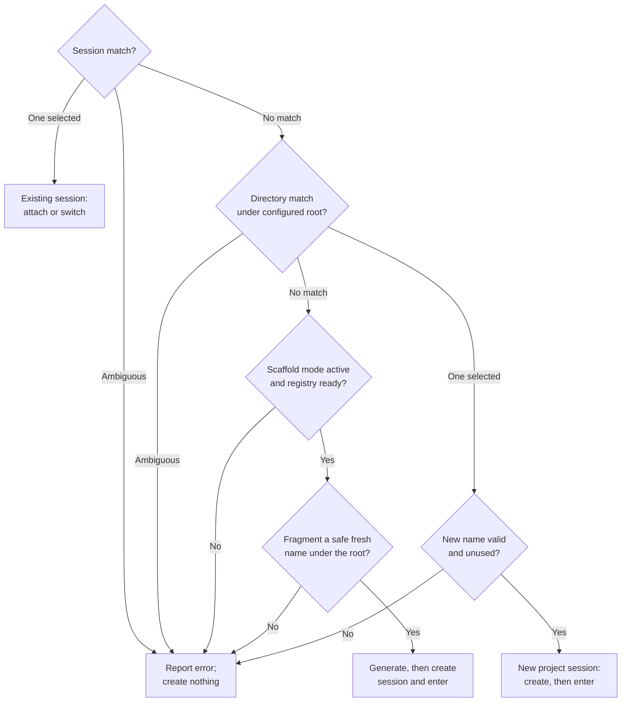

# tta

Attach to a matching tmux session. If none matches, find a matching directory
under the configured project root (default `~/src`), create a session named after
that directory, and enter it. With [scaffold mode](#scaffolding-missing-projects)
configured, a project that does not exist yet can be generated first.
The workflow builds on [dtachment's `dta` precedent](#precedent-dtachment).

## Action matrix

**Existing sessions win. Exact names win over partial matches. Ambiguity stops.**

| Match selected | Outside tmux | Inside the same tmux server |
| --- | --- | --- |
| **Existing session** | Attach to it by session ID | Switch the current client to it |
| **Project directory**, with no matching session | Create a session in that directory and attach | Create a detached session in that directory, then switch on success |
| **No match anywhere**, scaffold mode active | Run the generator, then create a session in the new directory and attach | Generate, create detached in the new directory, then switch on success |
| **Ambiguous or missing match**, otherwise | Report the problem; create nothing | Report the problem; create nothing |

New sessions use the directory basename unless `--session-name` overrides it.
Outside tmux, direct execution replaces `tta` with the real tmux client; inside,
it switches the existing client rather than nesting an attachment. Selecting a
different server from inside tmux is an error.

With **`--print-shell`**, these actions are only printed, ready to evaluate; no
session is created or entered. See [shell output modes](#shell-output).

```sh
tta project
tta --root ~/work project
tta --socket-name work project
tta --session-name project-name project.name
tta fresh-project          # with scaffold mode on, generates fresh-project first
```

## Grouped satellites, startup argv and initial directory

These options are explicit; omitting them preserves ordinary attach/switch and
tmux's default startup command or shell.

```sh
tta --group project
tta --dir "$PWD" project -- nvim 'file with spaces'
tta --group --dir "$PWD" -- -project nvim 'file with spaces'
```

- **`--group`**: when an existing session matches, create a satellite sharing its
  windows but with its own current-window selection. Outside tmux the command is
  `new-session -t SESSION_ID ; set-option destroy-unattached keep-last`. Inside
  tmux, create a named detached satellite, switch the current client to that exact
  name, then set its `destroy-unattached` option. This requires **tmux 3.4+**.
  An unattached satellite is removed while another group member remains; the
  last session is retained. Existing windows and their processes are shared.
  Grouping does not alter project matching or create an extra satellite when a
  new project session is needed.
- **`--dir PATH`**: use this initial directory for new project sessions or grouped
  satellites. Relative paths belong to the invocation cwd and are made absolute
  before the launch plan changes directory. New-project shell output also changes
  to this directory. A satellite's directory is its session starting directory;
  existing shared panes retain their cwd. Ordinary attachment ignores this option.
  Directory paths must be UTF-8; library callers must provide an absolute path.
- **Trailing `ARGV`**: the executable and arguments run only when creating a new
  project session. Existing selections, including grouped satellites, ignore them.
  Both `FRAGMENT -- ARGV...` and `-- FRAGMENT ARGV...` work; the latter also supports
  leading-`-` fragments. No shell splitting or interpolation is applied. A lone
  executable is protected from tmux's single-operand shell interpretation with
  `/bin/sh -c 'exec "$0"' EXECUTABLE`. Multiple operands go directly to tmux as argv.
  Non-UTF-8 argument bytes work in direct execution; `--print-shell` rejects them.

The library exposes the same opt-in behavior through
[`tta_launcher::launch`](session/launcher/src/plan.rs):

```rust,ignore
let expression = tta_launcher::launch()
    .selection(&selection)
    .socket(&socket)
    .client_mode(mode)
    .program(tmux_program)
    .grouped(grouped)                    // default false
    .startup(&startup_argv)               // &[OsString], default empty
    .maybe_directory(initial_directory)  // Option<&Path>, default None
    .call()?;
```

Inside satellites use process/counter-qualified names; a name collision fails
visibly rather than attaching to an unrelated session. As with other creation
plans, a failure after creation may leave the newly created session behind.
The [satellite runtime tests](session/launcher/tests/satellites.rs) use real control
clients on preflight-verified absolute sockets under `/tmp/opencode`, checking
independent current windows, same-client switching, detach/keep-last behavior,
literal argv and cwd. Cleanup targets individual owned sessions.

## How a fragment becomes an action

**Exact name first; otherwise a unique literal substring.** For a nonempty
fragment and a valid endpoint/client context:



An absent server counts as an empty session inventory. An ambiguous session
match never falls through to directories. Lookup and filesystem errors also stop
before launch. `--print-shell` emits the selected action rather than executing it.
The [matching tables](#matching-and-failure-behavior) cover inputs and errors;
[execution failures](#creation-and-execution-failures) explain what can remain
after a command starts.

## Precedent: dtachment

[`dtachment`](https://github.com/jauntywunderkind/dtachment), checked out at
`~/src/dtachment`, is the original project-entry workflow. Its
[`dta` shell function](file:///home/rektide/src/dtachment/dta) selects a directory
under `~/${PROJECTS_DIR:-src}`, tries the supplied name before appending a `*`
glob, and attaches through that directory's `.dtach.sock`. When creating a new
instance, it starts `${EDITOR:-vim}` in the project, optionally supplies files
discovered by `fd` and a Neovim listen socket, restores the caller's directory,
then attaches.

`tta` carries forward **find a project, resume its workspace, or create one and
enter it**. Its tmux adaptation searches existing session names first, uses
explicit exact/unique-substring matching, and uses tmux's configured startup
command or shell unless explicit startup argv is supplied. The predecessor's editor startup and per-directory
sockets explain the lineage; [the action matrix](#action-matrix) describes the
current tmux behavior.

The [environment configuration](#environment-configuration) adopts `PROJECTS_DIR`
compatibility without adopting `${EDITOR:-vim}` or `DTACHMENT_NVIM_LISTEN`:
tta lets tmux choose the new session's startup command or shell when no explicit
startup argv is supplied.

## Build and install

Requires Rust, tmux 3.2 or newer, and a Unix terminal. The default native lookup
requires **little-endian Linux** and a tmux protocol supported by the sibling
[tmax checkout](file:///home/rektide/src/tmux-interface-control/README.md).
Live tests here use tmux **3.7c**; they do not establish every version's behavior.

This development workspace depends on `../tmux-interface-control`, package
`tmax` 0.4.0, with only its `client` feature. Keep that sibling checkout available;
this is not a claim that its current API is published on crates.io.

The workspace root is a virtual manifest, so `cargo install --path .` does not
work here. The `cargo install-tta` alias (see `.cargo/config.toml`) runs the
default install above; extra arguments pass through, e.g.
`cargo install-tta --features cli`.

```sh
cargo install --path app/cli --locked
# Include the optional scripted lookup backend:
cargo install --path app/cli --locked --features cli
# CLI-only runtime lookup, e.g. for other Unix platforms:
cargo install --path app/cli --locked --no-default-features --features cli
```

`native` is the default feature/backend. With both compiled, select
`--backend native` or `--backend cli`. There is no hidden fallback after a native
error. CLI-only execution still uses tmax's shared typed schema/decoder, whose
current `client` compilation feature also includes native plumbing.

Default features also include `scaffold-rekon` (the script-wrapping rekon
generator), `scaffold-rekon-native` (tta's own parameterized reimplementation),
and `scaffold-by-default` (scaffold on a clean miss; drop the feature to make
scaffolding opt-in per invocation). Adapters are separate crates under
`scaffold/`; `--no-default-features` builds omit them and any configuration
naming them fails with the compiled-adapter list.

## Zim / Zsh completion

The [Zsh module](shell/zsh/functions/_tta) completes **live tmux session names and
immediate project directory basenames**, plus CLI options and their values.
Type a prefix, substring, or wildcard pattern, then press **Tab**:

```text
tta pipe<Tab>          → tta pipewire-native
tta wire<Tab>          → tta pipewire-native
tta *wire*nat*<Tab>    → tta pipewire-native
```

Multiple matches remain available for selection through Zsh's completion UI.
Inserted names are shell-escaped, including spaces and literal metacharacters.
**Press Tab before Enter:** wildcard matching belongs to completion; the launcher
still uses [literal exact/unique-substring matching](#matching-and-failure-behavior).
Completion does not bypass tmux's new-session name restrictions; use
`--session-name` when a project basename needs a different session name.

First install the updated binary with `cargo install --path app/cli --locked`.
In your Zim configuration (`~/.zimrc`, or `$ZIM_CONFIG_FILE`), add the local module
**before** the existing `zmodule completion` line:

```zsh
zmodule ~/src/tta --root shell/zsh
# ...other completion providers...
zmodule completion
```

Run `zimfw install`, then start a new shell. Alternatively, after this code is
available upstream, use `zmodule rektide/tta --root shell/zsh` for a Zim-managed
checkout. The module supplies completion definitions, not the Rust executable.

For plain Zsh, before your existing `compinit` call:

```zsh
fpath=( ~/src/tta/shell/zsh/functions $fpath )
autoload -Uz compinit
compinit
```

If Tab is bound to `expand-or-complete`, Zsh may expand a wildcard against the
**current directory** before asking tta for candidates. For predictable wildcard
project completion, put `bindkey '^I' complete-word` in `.zshrc` after your keymap
setup. This changes Tab to completion-only for all commands; the module itself
does not change your bindings or global completion styles.

Candidates use the same [root and endpoint configuration](#environment-configuration)
as launch, including `--root=PATH`, `--socket-path PATH`, and environment fallbacks.
Session and project inventories are queried independently: an unavailable project
root does not hide sessions, and a failed session query does not hide projects.
`--scaffold=` completes configured generator names from the registry. Tab
suppresses inventory diagnostics; run tta normally to see configuration or
lookup errors. Completion only observes state: it never creates, attaches, or
switches a session, and does not require a server for project candidates.
Control-character names are omitted from the line-oriented candidate protocol.

The [completion integration tests](app/cli/tests/completion.rs) exercise real Zsh
widgets in a private PTY, configuration precedence, symlinks, quoted names, and
live and absent private tmux servers. Zsh and tmux are required for those tests.
Work anchor: `tta-zsh-completion` on the project's Beads board.

## Environment configuration

**Explicit CLI options win over environment values, then built-in defaults.**
Unset and empty environment values both mean “not configured.” CLI values retain
their ordinary meaning; paths and program values are literal, not shell source,
and do not expand `~`, `$variables`, or embedded arguments.

| Variable | CLI override | Meaning / default |
| --- | --- | --- |
| `TTA_ROOT` | `--root` | Project root; relative paths use the invocation cwd |
| `PROJECTS_DIR` | `--root` or `TTA_ROOT` | Compatibility with dtachment: relative paths use `$HOME`; absolute paths are honored; default `src` under `$HOME` |
| `TTA_BACKEND` | `--backend` | `native` or `cli`, only if compiled; default native when compiled, otherwise cli; no automatic fallback |
| `TTA_SOCKET_NAME` | Either socket option | tmux `-L` label; otherwise normal tmux endpoint selection |
| `TTA_SOCKET_PATH` | Either socket option | tmux `-S` path; relative paths use the invocation cwd |
| `TTA_TMUX` | `--tmux` | Client executable (not a command string); default `tmux` on PATH |
| `TTA_TMUX_CONFIG` | `--tmux-config` | Startup config passed with `-f`; relative paths use the invocation cwd; otherwise tmux defaults |
| `TTA_TRACE` | `--trace` / `--trace=false` | JSON diagnostics on stderr; exactly `true`/`1` or `false`/`0`; default off |
| `TTA_SCAFFOLD` | `--scaffold=NAME` / `--scaffold=false` | Scaffold posture: a configured generator name, `default`/`true`/`1` for the configured default, or `false`/`0`/`off`/`none` to disable; compiled default is on |
| `TTA_CONFIG` | — | Scaffold registry TOML path; relative paths use the invocation cwd; default `$XDG_CONFIG_HOME/tta/config.toml`, or `$HOME/.config/tta/config.toml` |

Root precedence is **`--root` > `TTA_ROOT` > `PROJECTS_DIR` > `$HOME/src`**.
HOME is needed only for a relative `PROJECTS_DIR` or the default root. Missing
HOME or an unreadable root does not block an existing-session match: directory
search still happens last.

The two socket selectors are one family: an explicit `--socket-name` or
`--socket-path` suppresses **both** environment selectors. Without either CLI
selector, setting both nonempty environment selectors is an error. Explicitly
passing both CLI selectors remains a usage error. Invalid active backend or trace
values fail before lookup; an explicit CLI override ignores the replaced value.

```sh
export PROJECTS_DIR=work          # searches $HOME/work, like dtachment
tta project
TTA_ROOT=./checkout tta project   # invocation-cwd-relative, not home-relative
TTA_SOCKET_NAME=work tta project
TTA_TRACE=1 tta --trace=false project
TTA_SCAFFOLD=rekon tta fresh      # scaffold misses with the rekon generator
tta --scaffold=false fresh        # never scaffold this invocation
```

`--session-name`, `--group`, `--dir`, startup argv, `--print-shell`, and `--exec-shell` stay explicit, not ambient
environment preferences. Scaffold posture joins the ordinary CLI > environment >
default layering because an empty registry keeps misses inert. See
[scaffolding](#scaffolding-missing-projects) for the registry and posture,
[endpoint/client options](#endpoint-and-client-options)
for path freezing and [shell output](#shell-output) for safe evaluation.
The [environment layer](app/cli/src/environment.rs) implements this small surface;
[CLI integration tests](app/cli/tests/cli.rs) exercise precedence, empty/invalid
values, literal paths, session-first behavior and observation-only plans.

## Matching and failure behavior

Matching is **case-sensitive and literal**. Each search prefers an exact name;
only when there is no exact name must the substring match be unique.

### Session search comes first

| Fragment / session lookup result | Outcome |
| --- | --- |
| Fragment omitted | CLI usage error |
| Empty fragment (`""`) | Error: provide a nonempty fragment |
| Exact session name exists | Select it, even if other names contain the fragment |
| No exact name; one session contains the fragment | Select that session |
| No exact name; multiple sessions contain the fragment | Error with sorted candidates; do not search directories |
| No session contains the fragment | Search project directories |
| Server absent or has no sessions | Search project directories |
| Permission, protocol, decoding, or other lookup failure | Error; do not search directories |

For example, `tta foo` selects session `foo` ahead of `foobar`. Without `foo`,
it selects `foobar` if that is the only match; with both `foobar` and `myfoo`,
it reports ambiguity. A directory named `foo` does not override either result.

### Directory search is the fallback

This search runs **only when no session matches**, under the
[configured root](#environment-configuration), defaulting to `$HOME/src`.

| Directory search result | Outcome |
| --- | --- |
| Exact directory basename exists | Select it, even if other basenames contain the fragment |
| No exact basename; one directory contains the fragment | Select that directory |
| No exact basename; multiple directories contain the fragment | Error with sorted candidates |
| No directory contains the fragment | [Scaffold](#scaffolding-missing-projects) if active and ready; otherwise error: no matching session or project directory |
| No root can be determined from CLI/environment | Error: cannot determine project root |
| Root or a relevant entry cannot be inspected | Report the filesystem error |

Only immediate directories qualify. Directory symlinks count, retaining their
entry basename; dangling symlinks, regular files, and deeper descendants do not.

Arguments are not globs or regular expressions. Quote shell metacharacters; use
`--` before a fragment beginning with `-`. Project matching requires UTF-8 names;
non-UTF-8 directory entries are skipped. New tmux start-directory paths must also
be UTF-8. No project root or HOME is needed when an existing session matches.

### Creation and execution failures

| Condition | Outcome |
| --- | --- |
| Project selected, no `--session-name` | Use the directory basename as the new session name |
| Project selected with `--session-name NAME` | Use `NAME`; fragment matching is unchanged |
| Existing session selected with `--session-name` | Override has no effect |
| New name empty or contains `.`, `:`, or control characters | Error; choose a distinct safe name with `--session-name` |
| Override already belongs to another session | Error; choose another name |
| Selected project's start-directory path is not UTF-8 | Error before launch |
| Another process creates the same session name after lookup | Creation fails visibly; rerun to resolve again |
| Scaffold fragment contains `/`, or is `.` or `..` | Error: a new project name must be a single path component |
| Scaffold target exists under the root (file or dangling symlink) | Error: refuse to scaffold over something existing |
| Session-name validation or collision fails in scaffold mode | Error before the generator runs; nothing is generated |
| Generator exits nonzero, or the expected directory never appears | Stop at the generator or the following `cd`; no session is created |
| Project cd or creation fails | Stop; subsequent commands do not run |
| Detached creation succeeds, then switching fails | Report failure; the new detached session remains |
| Client executable cannot start, or attach/switch fails | Report failure; do not choose another match automatically |

Names are rejected rather than silently normalized into potentially colliding
names. Existing sessions are targeted by canonical server-local IDs, not tmux's
fuzzy name lookup. There is no `new-session -A` fallback that might change an
existing session's cwd. Server restarts, rename/replacement between create and
switch, and changes after shell emission remain races, not hidden reconciliation
duties.

### Lookup backend details

Native discovery does not spawn a process or implicitly start a server. Missing
or refused server sockets and a server with no sessions are empty inventories;
permission, protocol, decode, and other errors are failures. CLI lookup uses the
same strict typed decoder, `-u` for UTF-8 framing, and narrowly matched C-locale
absence diagnostics. Native discovery inherits tmax's bounded connection/output
policy; the optional CLI lookup currently has no equivalent timeout/output cap.

The [matcher](session/launcher/src/matching.rs),
[resolver](session/launcher/src/resolve.rs), and
[launch planner](session/launcher/src/plan.rs) implement these rules.
[CLI checks](app/cli/tests/cli.rs) cover input and emission behavior;
[runtime acceptance](#runtime-verification) exercises actual attach, create,
switch, and detach behavior.

## Scaffolding missing projects

When nothing matches at all — no session, no immediate directory, and no
candidates to make ambiguous — scaffold mode runs a **generator** to materialize
`<root>/<fragment>`, then continues into the ordinary new-project flow. Existing
sessions and directories always win first: a valid scaffold choice never runs a
generator for an existing match. Registry and choice validation still happen
before matching, so invalid configuration or an unknown generator remains an error.

Generators are **named registry entries** in a TOML file, each pointing at a
compiled-in adapter crate:

```toml
# $XDG_CONFIG_HOME/tta/config.toml (TTA_CONFIG overrides)
[scaffold]
default = "rekon"

[scaffold.generators.rekon]
adapter = "rekon"
```

- **Registry**: entry names are your choice; `adapter` must name an adapter this
  build includes (`rekon` or `rekon-native` in default installs). Unknown
  adapters, defaults, and keys fail at startup, before any lookup. Entries may
  carry an `options` table the adapter validates when the generator runs. An
  absent file is an empty registry: misses keep the classic error.
- **Default choice**: a bare miss (or bare `--scaffold`) uses `[scaffold] default`,
  else the sole entry. Multiple entries without a default never guess; pass
  `--scaffold=NAME`.
- **Posture**: default installs scaffold on miss. Build without the
  `scaffold-by-default` feature to flip the default to opt-in; `--scaffold=NAME`
  always enables, `--scaffold=false` (or `TTA_SCAFFOLD=off`) always disables.
  Precedence is CLI > environment > compiled default.
- **The plan**: `generator && cd -P <root>/<fragment> && tmux new-session …`
  The fragment becomes the directory and session name exactly as typed (no
  normalization); `--session-name` overrides the session name only. Name
  validation and collision checks run **before** the generator, so a collision
  never generates anything. Direct mode runs the generator in the foreground —
  interactive scaffolds work — and stops at the `cd` if the expected directory
  never appeared. `--print-shell` emits the whole expression, so the evaluated
  plan performs the generation; the snapshot semantics are unchanged.

The `rekon` adapter wraps the user's
[`rekon` script](file:///home/rektide/.local/bin/rekon) as `rekon <name>` — a
bare PATH name resolved when the plan runs, from the invocation cwd. The script
owns where the project lands (it hardcodes `~/src`) and everything afterwards:
git/jj init, remotes, `npm init`, `pnpm i`, and an initial commit. A non-default
`--root` therefore diverges; the adapter checks nothing, the following `cd`
does.

The `rekon-native` adapter is tta's own reimplementation of that workflow —
parameterized and improved rather than reproduced. It honors the configured
root, creates the initial branch with `git init -b`, templates remotes and
starter files, authors `package.json` directly (no `npm init`/`jq`/`unexpand`),
and installs with `pnpm install --silent` — the script's `pnpm i -q` is rejected
by current pnpm and was silently failing anyway. Every knob is a per-entry
option:

```toml
[scaffold.generators.mine]
adapter = "rekon-native"

[scaffold.generators.mine.options]
branch = "main"                                  # git init -b; default main
origin-remote = "git@github.com:rektide/{name}"  # {name} templates; "" disables
voodoo-remote = "https://archive.voodoowarez.com/{name}"  # "" disables
starter-files = ["README.md", "{name}.ts"]       # {name} templates
author = "rektide"      # > AUTHOR env > git config user.name > omitted
license = "MIT"         # > LICENSE env > MIT
package-json = true     # module {name}.js, type module
install = true          # pnpm install --silent after authoring
```

Option mistakes surface when the generator runs (adapters validate at
expression-build time), not at config load. More adapters grow from the
board — each its own crate behind a feature; `start-it-up` is recorded there
as interesting prior art, not the path. Work anchor: `tta-scaffold` on the
project's Beads board; design decisions in
[the scaffold proposal](design/scaffold/proposal0.glm53max.md).

### Shared scaffold API

[`tta_launcher::scaffold`](session/launcher/src/scaffold.rs) owns the registry,
choice policy, and create-prefix preparation used by the CLI and embedded
consumers. Enable the launcher's **`scaffold-rekon`** feature to include that
adapter; the CLI feature of the same name forwards to it. The library's default
features do not enable an adapter or choose a scaffold posture for its caller.

```rust,ignore
let resolved = tta_launcher::scaffold::resolve()
    .lookup(lookup)
    .argument(fragment)
    .maybe_root(root)                  // Option<&Path>
    .maybe_session_name(session_name)  // Option<&str>
    .choice(choice)                    // "false", "default", or registry name
    .call()?;

let plan = tta_launcher::launch()
    .selection(&resolved.selection)
    .socket(&socket)
    .client_mode(mode)
    .program(tmux_program)
    .maybe_prefix(resolved.prefix.as_ref())
    .startup(&startup_argv)
    .maybe_directory(initial_directory)
    .call()?;
```

The caller layers its explicit option and `TTA_SCAFFOLD` before supplying
`choice`. The CLI retains its `scaffold-by-default` feature: it supplies `default`
when enabled and `false` otherwise. The shared resolver loads the same
`TTA_CONFIG`/XDG/HOME registry unless passed `.config(&config)` with an already
loaded `scaffold::Config`. `Config::names()` also supplies scaffold completion.

`Resolved` exposes `selection`, `prefix: Option<tta_command::Expression>`, and
`generator: Option<scaffold::Entry>` for tracing. Only `Selection::Create` has a
prefix and generator; resolution itself executes neither. Passing the prefix to
`launch` places it before the directory change and tmux creation, with failures
short-circuiting the remainder. `scaffold::Error` implements
`std::error::Error + Send + Sync`, preserving underlying causes for `?` into
callers such as eyre.

[Shared policy tests](session/launcher/tests/scaffold.rs) exercise existing
matches, clean and ambiguous misses, choice errors, retained causes, and prefix
ordering/failure in direct and shell execution using private `rekon` and tmux
shims. [CLI scaffold tests](app/cli/tests/scaffold.rs) check configuration
precedence, completion, and feature-controlled defaults.

## Shell output

| Invocation mode | What `tta` does now | Effect on the calling shell |
| --- | --- | --- |
| `tta FRAGMENT` | Resolve and execute; replace `tta` with the final tmux client | Its cwd is unchanged |
| `tta --print-shell FRAGMENT` | Resolve and print an expression only | When evaluated, a new-project plan changes its cwd; the shell survives the tmux command |
| `tta --print-shell --exec-shell FRAGMENT` | Resolve and print an expression ending in `exec` | When evaluated, explicitly replace the shell with the final tmux client |

No shell is needed for normal execution. To change the calling shell's directory
as well when entering a new project, evaluate the emitted POSIX shell expression:

```sh
tta_plan=$(tta --print-shell project) && eval "$tta_plan"
```

The guard matters: `eval "$(tta ...)"` alone can conceal a failed lookup.
Printing only observes state and emits a plan; it does not create or attach.
Stdout contains only the complete command expression. Errors and optional tracing
use stderr. Ordinary output never replaces the evaluating shell; explicitly add
`--exec-shell` if replacement is wanted.

New-project output models `cd -P ... && tmux ...`; direct execution supplies the
same physical cwd to child processes without changing the parent shell's cwd.
Shell output is a snapshot, not a fresh lookup at evaluation time. Evaluate it in
the same terminal/context rather than saving it as a durable session identity.

## Endpoint and client options

- `--socket-name LABEL` selects tmux's `-L` label; tmux still creates/checks its
  private socket directory on cold startup. Relative `TMUX_TMPDIR` is frozen
  against the invocation cwd.
- `--socket-path PATH` selects `-S`; relative paths are frozen before project cd.
  As with tmux itself, an explicit socket path needs an existing parent directory.
- Inside tmux, selecting another server fails explicitly: clients cannot switch
  between servers. Run outside tmux, or deliberately unset `TMUX` and `TMUX_PANE`
  before creating a separate client.
- `--tmux PROGRAM` chooses the client executable (also used by CLI lookup).
  Explicit relative paths such as `./bin/tmux` are frozen before cd. Bare names
  retain normal PATH lookup: relative PATH entries can resolve differently after
  entering a project; use an absolute executable path when that matters.
- `--tmux-config PATH` passes `-f` to the final client; relative configuration
  paths also belong to the invocation cwd. `/dev/null` is useful for isolation.
- `--trace` (or `TTA_TRACE=1`) emits structured JSON events on stderr: lookup,
  match decision, operations, emission, handoff attempt, and failure. A handoff event means an
  **attempt**, not proof that tmux attached after replacing the Rust process.

## Reusable pieces

| Home | Responsibility |
| --- | --- |
| [shell/command](shell/command/src/lib.rs) | Bon-built argv commands, validated environment assignments, physical cd, short-circuit conjunction; direct run/Unix exec or POSIX shell rendering |
| [shell/zsh](shell/zsh/functions/_tta) | Zim-compatible option, live session, project and wildcard Tab completion |
| [scaffold/rekon](scaffold/rekon/src/lib.rs) | rekon-script scaffold adapter: one argv expression, `rekon <name>` |
| [scaffold/rekon-native](scaffold/rekon-native/src/lib.rs) | Parameterized native rekon reimplementation: templated remotes/branch/starter files, authored package.json, validated options |
| [session/launcher](session/launcher/src/lib.rs) | `SessionLookup`, native/CLI acquisition, deterministic resolution, endpoint policy and launch planning |
| [session/launcher scaffold API](session/launcher/src/scaffold.rs) | Shared scaffold registry, generator choice, session-first resolution and creation prefix |
| [app/cli](app/cli/src/main.rs) | Arguments, environment/feature posture, structured diagnostics and interactive handoff |
| [verification/driver](verification/driver/src/lib.rs) | Shared Rust runtime exercise/observation library plus `tta-verify` command |

The generic command model knows no tmux syntax. The launcher separately handles
tmux's argv trailing-semicolon rule, exact targets, and format operands (`-s` and
`-c`). Shell quoting alone does not make tmux formats literal.

[Launcher research: language boundaries, native/CLI lookup and runtime acceptance](design/launcher/research0.gpt6a.md)
provides the independent rationale, residual races, and focused review findings;
it is design evidence, not a replacement owner for this guide.

## Runtime verification

`cargo verify` runs the Rust **runtime driver**, not a formatter/test orchestrator.
It exercises the actual built `tta` executable with a PTY on exclusively owned
private tmux sockets:

```sh
cargo build -p tta --all-features
cargo verify --backend native
cargo verify --backend cli --inside --report report.json
# Narrow a reproduction:
cargo verify --tta target/debug/tta --backend native --mode shell --scenario new
```

By default it covers direct and evaluated-shell execution for both cold creation
and an existing session. `--inside` instead starts a real attached origin pane,
invokes tta there, and verifies switching the **same client**, preserving the
original pane/shell. The [integration tests](app/cli/tests/acceptance.rs) call that
same library for both contexts and both compiled backends.

The JSON report contains process lifecycle events, captured output/PTY transcript,
actual session/client/pane IDs and cwd before/after detach, parsed child tracing,
and cleanup results. Outside direct mode verifies exec preserves the client PID;
shell mode verifies the evaluator survives. Detach must preserve the same session
and pane. Traces are compared against those independent tmux observations rather
than treated as completion evidence themselves.

Queries/lifecycle phases have bounded timeouts (`--timeout`, default 10 seconds);
retained process/PTY output is bounded to 256 KiB per stream. Fixtures use
`/dev/null` tmux config and isolated homes. CLI tests and runtime fixtures remove
inherited `TTA_*` and `PROJECTS_DIR` settings, so local preferences do not steer
acceptance. Only owned endpoints are cleaned up.
Reports retain diagnostics after fixture removal. Missing tmux, unsupported
backends, failed assertions and failed cleanup return nonzero, not skipped
acceptance reported as success.

## Development checks

Tests and recorders are Rust/Cargo artifacts; no Python harness is required.
Live tests need tmux on PATH. Native tests require its supported Linux platform.
Scoped `tracing-mock` expectations and the complementary `tracing-test` diagnostic
test live in separate test binaries; child JSON is captured by the runtime driver.

```sh
# Name owned packages: --all can traverse the sibling tmax dependency.
cargo fmt -p tta-command -p tta-launcher -p tta-scaffold-rekon -p tta-scaffold-rekon-native -p tta -p tta-verify --check
cargo clippy --workspace --all-targets --all-features --no-deps -- -D warnings
cargo nextest run --workspace --all-features
cargo nextest run --workspace --no-default-features --features cli
cargo test --workspace --all-features --doc
```

The development tmax dependency currently emits its own compiler warnings;
`--no-deps` keeps clippy's deny-warnings policy scoped to this workspace.
