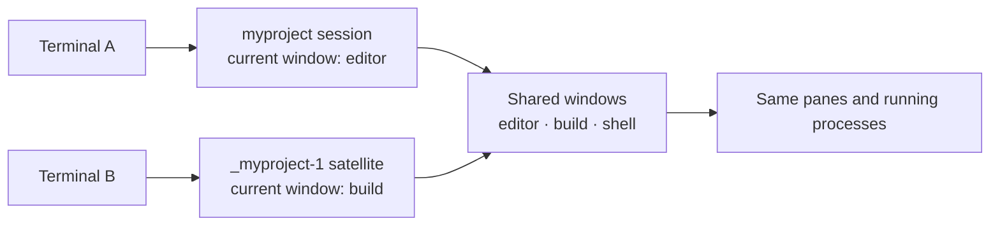
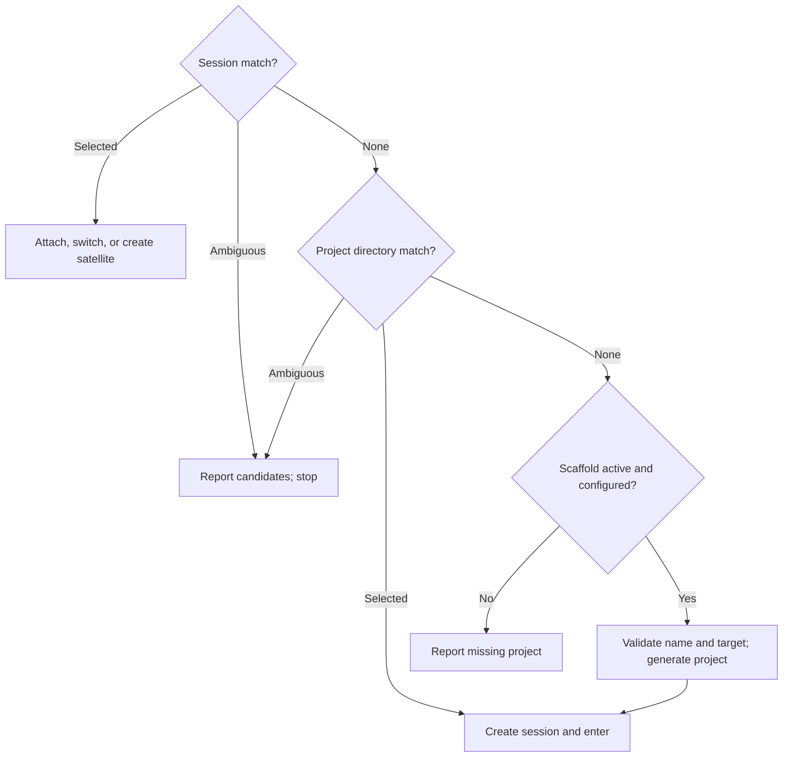

# tta

**Enter a project. Resume its work. Open another view without starting over.**

tta brings project discovery, persistent tmux workspaces, and project creation
into one command. Give it a name or a fragment: it finds a running session,
opens a project directory in a new session, or scaffolds a fresh project with
your configured generator.

Its tmux trick is **shared work with independent window selection**. Open a
grouped satellite from another terminal and navigate the same running windows
without moving the first terminal to a different window. Detach when you're
done; tmux keeps the work alive.

```sh
tta myproject                            # resume it, or start it from ~/src
tta --group myproject                    # another view of its running windows
tta --ssh work myproject                 # target needs tmux, not installed tta
tta myproject -- nvim 'file with spaces'  # start nvim only if creating a session
tta --scaffold=mine new-project           # generate a project, then enter it
tta --print-shell myproject               # inspect the launch plan
```

The CLI is one entry point. Rust callers can reuse the same discovery,
resolution, scaffolding, and launch planner; command expressions can run
directly or render as POSIX shell.

**Start here:** [Install](#build-and-install) · [How tmux works](#how-we-use-tmux) ·
[Scaffolding](#scaffolding-missing-projects) · [Zsh completion](#zim--zsh-completion)

**Go deeper:** [Configuration](#environment-configuration) · [SSH](#ssh-targets) ·
[Matching](#matching-and-failure-behavior) · [Shell plans](#shell-output) ·
[Rust pieces](#reusable-pieces) · [Verification](#runtime-verification)

## How we use tmux

A terminal is a **client**. A tmux **session** holds a collection of windows and
a current-window selection. Each **window** contains panes and their running
processes. A **session group** lets several sessions share the same windows
while retaining their own current-window selection.

That distinction makes two useful ways to enter a workspace:

- **`tta myproject`** joins the matching session. Clients attached to that same
  session follow its current-window selection together.
- **`tta --group myproject`** creates a satellite session in the same group.
  Each session can select a different window, with the same underlying work
  available in both.



For example, keep an editor visible in one terminal and select a build window
in another. Creating or closing a window changes the shared collection. If
both views select the same window, they see the same panes; input goes to the
same processes. Independence is at **session/window selection**, not a copy
of the terminal state.

### Grouped satellites, startup argv and initial directory

On an existing match, `--group` chooses the smallest unused satellite suffix:
`_myproject-1`, `_myproject-2`, and so on. It creates that satellite detached,
attaches or switches to its exact name, then sets its session option
`destroy-unattached` to `keep-last`.

**The view is disposable; the shared work persists.** An unattached satellite
is removed while another session in the group remains. If it is the last
session in the group, it is retained. This uses **tmux 3.4+**. When the project
needs its first session, `--group` creates that ordinary session directly.

| Entry option | New project session | Existing session | Grouped satellite |
| --- | --- | --- | --- |
| `--dir PATH` | Initial pane directory, overriding the project directory | No effect | Session starting directory; existing shared panes keep their cwd |
| `-- ARGV...` | Startup executable and literal arguments | No effect | No effect; existing processes are shared |
| `--session-name NAME` | Override the new session's name | No effect | Satellite name is derived from the matched session |
| `--window-name NAME` | Name the initial window (default: the session name) | No effect | No effect; tmux rejects `-n` with `-t`, and satellites share the group's windows |

```sh
tta --dir "$PWD" myproject -- nvim 'file with spaces'
tta --group --dir "$PWD" myproject
tta -- --leading-dash-project nvim README.md
```

Relative `--dir` paths resolve from the invocation directory. Without startup
argv, tmux uses its configured startup command or shell. Arguments are passed
literally: tta does no shell splitting or interpolation. A lone executable is
wrapped with `/bin/sh -c 'exec "$0"' EXECUTABLE` to avoid tmux interpreting a
single operand as shell source. Direct execution accepts non-UTF-8 argument
bytes; shell rendering requires UTF-8. Initial-directory paths require UTF-8.

A created session names its initial window after itself, so the status line
leads with the project you entered. Naming a window makes tmux disable
`automatic-rename` for it: the name sticks instead of following the running
command. `--window-name=NAME` renames the initial window (spaces, `.`, `:`,
and `#` allowed), and `--window-name=false` skips naming entirely to keep
tmux's automatic renaming. The window name is a tmux format-escaped literal
like the session name.

### Action matrix

tta works both outside and inside tmux. Inside, it switches an existing client
within the same server rather than nesting a client. Automatic client inference
is currently heuristic, not a reliable input-origin identity.

| Selected work | Outside tmux | Inside the same server |
| --- | --- | --- |
| Existing session | Attach by session ID | Switch a client by session ID |
| Existing session with `--group` | Create a satellite, then attach | Create a satellite, then switch a client |
| Project directory | Create and attach | Create detached, then switch on success |
| Missing project, configured scaffold active | Generate, then create and attach | Generate, create detached, then switch |

The real tmux client owns the terminal: direct execution replaces tta with it.
Switching to a different server from inside tmux is an error.

**Independent views today:** use `tta --group PROJECT` from each outside terminal.
Plain `tta PROJECT` still shares one session's current-window selection. The
[independent-view follow-up](design/launcher/launch-backends1.gpt61sol.md) proposes
making independent views the default, but that default is not yet changed.

**Known inside-switch limitation:** when two clients show the same shared pane,
they use the same shell/environment/tty. Recent activity can make tmux choose
the other terminal for a switch. This is reproduced with two real terminals on
both backends; using CLI switching does not solve the identity ambiguity. The
[recorded trial](verification/trials/independent-views/README.md) and follow-up
hold the explicit-client targeting decision rather than pretending a native
client-name query would prove which terminal invoked tta.

## Build and install

Requires Rust, a Unix terminal, and **tmux 3.2+** (**3.4+** for satellites).
The default native backend requires **little-endian Linux** and a
tmux protocol supported by the [tmax checkout](file:///home/rektide/src/tmux-interface-control/README.md).
This launch-backend slice was verified with a pinned tmux **3.7c** fixture and
also exercised against the current system tmux **3.8**.

This development workspace has a path dependency on `../tmux-interface-control`
(package `tmax` 0.6.0). The pure launcher uses `operations`; only the optional
runner's `native` feature enables `client`. Keep that sibling checkout available.

```sh
cargo install --path app/cli --locked
# Or the local alias (also forces replacement of an installed binary):
cargo install-tta

# Add the optional CLI backend:
cargo install --path app/cli --locked --features cli
# CLI-only runtime execution, e.g. for other Unix platforms:
cargo install --path app/cli --locked --no-default-features --features cli
```

The root is a virtual Cargo workspace; install from `app/cli`, not `.`.
Default features are `native`, `scaffold-rekon`, `scaffold-rekon-native`, and
`scaffold-by-default`. A CLI-only build above omits the scaffold adapters;
add their features explicitly if wanted. With both backends built, choose
`--backend native` or `--backend cli` (also `TTA_BACKEND`). Native is the default
when compiled; the selection covers discovery and eligible direct launch work.

### Which operations use tmax?

| Operation | Native selection (default) | CLI selection |
| --- | --- | --- |
| Session discovery | Native tmax query | tmux subprocess with the same typed query |
| Ordinary project/scaffold creation inside a live server, UTF-8 startup argv | Native tmax detached creation, then CLI switch | CLI detached creation, then CLI switch |
| Outside creation and attachment | One real tmux client, including cold server startup | Same |
| Existing-session attach or invoking-client switch | Real tmux client | Same |
| Grouped satellite creation, client move and `keep-last` | One CLI command queue, preserving lifecycle ordering | Same |
| Non-UTF-8 startup argv | CLI, preserving raw Unix argument bytes | Same |
| `--print-shell` / `--exec-shell` | Complete CLI expression; no mutation while printing | Same |

Native inside creation first reads the inventory again. An absent or sessionless
server takes the CLI creation path **before** generation or mutation, preserving
server startup, `-f` configuration and label-directory setup. Other read errors
stop. Once a native mutation is attempted, there is **no CLI retry or rollback**.
The generator still runs first, directory validation precedes creation, and a
failed creation prevents switching. A failed handoff can leave the new session.

Grouping stays together because splitting detached creation from attachment can
let inherited `destroy-unattached` settings remove the satellite between commands.
Switching stays CLI because tmax's descriptor-free client is not the invoking
terminal client. Native does not mean a new interactive terminal implementation.
See the [execution decision](design/launcher/launch-backends0.gpt61sol.md) and the
library-side [tta consumer account](file:///home/rektide/src/tmux-interface-control/doc/consumer/tta.md).

## Scaffolding missing projects

A new project can begin with the same command used to return to it later.
On a clean miss, a configured generator creates `<root>/<name>`, then tta
opens its tmux session. Existing sessions and directories take precedence.

Configure a named generator in `$XDG_CONFIG_HOME/tta/config.toml`, or
`~/.config/tta/config.toml` when XDG is unset. `TTA_CONFIG` overrides the path.
For example, this `rekon-native` entry sets up Git/jj, starter files, and a
JavaScript package, with a customized remote:

```toml
[scaffold]
default = "mine"

[scaffold.generators.mine]
adapter = "rekon-native"

[scaffold.generators.mine.options]
branch = "main"
starter-files = ["README.md", "{name}.ts"]
license = "MIT"
package-json = true
install = true

[scaffold.generators.mine.options.remotes]
origin = "git@github.com:YOUR-ACCOUNT/{name}"
tngl = ""
voodoo = ""
```

```sh
tta new-project                   # use the configured default on a clean miss
tta --scaffold=mine new-project    # choose a generator explicitly
tta --scaffold=false new-project   # require an existing session or directory
```

The default build enables scaffolding on miss, but **an empty or absent registry
creates nothing**. Bare `--scaffold` uses the configured default, or the sole
entry. Multiple entries without a default require an explicit choice. Drop the
`scaffold-by-default` build feature to make generation opt-in.

### Generator adapters

| Adapter | What it does |
| --- | --- |
| [`rekon-native`](scaffold/rekon-native/src/lib.rs) | Honors the project root; initializes Git and colocated jj, creates starter files and an initial commit, configures remotes and bookmark tracking, optionally authors `package.json` and runs `pnpm install --silent` |
| [`rekon`](scaffold/rekon/src/lib.rs) | Runs the external `rekon NAME` script from PATH; the script owns setup and hardcodes `~/src`, so another tta root may disagree with its output |

`rekon-native` needs Git, jj, and pnpm when package installation is enabled.
Its options above show the branch, starter-file, license, package and install
defaults. `author` can be set explicitly; otherwise it uses `AUTHOR`, then
`git config user.name`, then omits the field. License falls back to `LICENSE`
and then `MIT` when no explicit value is supplied.

Generator planning itself is pure. The optional runner observes those defaults
only when a clean creation actually needs them, then supplies ordinary values to
the adapter. Supplied-facts callers pass their own target defaults explicitly.

Remote entries **merge over** the adapter's personal-workflow defaults:
`origin = "git@github.com:rektide/{name}"`,
`tngl = "tngl:jauntywunderkind.bsky.social/{name}"`, and
`voodoo = "https://archive.voodoowarez.com/{name}"`. An empty string disables
one; extra keys add remotes. `{name}` is the supported template placeholder.
Every configured remote gets local jj bookmark tracking; this neither creates
remote repositories nor pushes. `origin` also receives Git tracking configuration.

Registry names are yours; adapters must be compiled into the binary. Unknown
adapters, registry keys, defaults, or selected generators fail before matching.
Adapter options are validated when a new-project expression is built, including
for `--print-shell`. The script-wrapping `rekon` adapter accepts no options.

Generation is a short-circuiting plan: **generate → enter directory → create
session → enter workspace**. Name/collision checks precede generation. A
failure stops later steps, but does not roll back files or sessions already
created. Interactive generators run in the foreground.

The [scaffold design record](design/scaffold/proposal0.glm53max.md) explains the
registry and adapter decisions; work anchor: `tta-scaffold`.

## Zim / Zsh completion

Complete **live session names and project directory names**, using prefixes,
substrings, or wildcard patterns:

```text
tta pipe<Tab>          → tta pipewire-native
tta wire<Tab>          → tta pipewire-native
tta *wire*nat*<Tab>    → tta pipewire-native
```

**Press Tab before Enter.** Wildcards belong to completion; the launcher matches
literal names. Multiple candidates remain available in Zsh's completion UI,
and inserted names are shell-escaped. Options and `--scaffold=` names complete too.

After installing the binary, put the local module in `.zimrc` before completion:

```zsh
zmodule ~/src/tta --root shell/zsh
# ...other completion providers...
zmodule completion
```

Run `zimfw install` and start a fresh shell. The module supplies completion, not
the executable. For plain Zsh, add its functions directory before `compinit`:

```zsh
fpath=( ~/src/tta/shell/zsh/functions $fpath )
autoload -Uz compinit
compinit
```

If Tab's `expand-or-complete` expands wildcards against your current directory
first, `bindkey '^I' complete-word` after keymap setup makes Tab completion-only
for all commands. The module does not change global bindings or styles.

Completion uses launch's root/endpoint settings, queries sessions and projects
independently, and never creates or enters a session. Inventory errors are
suppressed for Tab; run tta normally to diagnose them. Control-character names
are omitted from its line-oriented protocol. See the
[module](shell/zsh/functions/_tta) and [PTY integration tests](app/cli/tests/completion.rs).
Work anchor: `tta-zsh-completion`.

## How a fragment becomes an action

**Sessions first. Exact names first. Otherwise, a unique literal substring.**



For example, `tta foo` selects session `foo` ahead of `foobar`. With no exact
match, `foobar` alone works; `foobar` and `myfoo` are ambiguous. A directory
named `foo` does not override either session result.

### Matching and failure behavior

#### Session search comes first

Matching is case-sensitive. An absent server or one with no sessions is an empty
inventory. Permission, protocol, decoding, and other lookup errors stop the
operation; they do not become permission to create a workspace. Session
ambiguity stops before directory search. An existing-session match needs no
project root or HOME, though registry/choice validation still happens first.

#### Directory search is the fallback

Only immediate directories under the configured root qualify. Directory
symlinks count under their entry basename; files, dangling symlinks, deeper
descendants, and non-UTF-8 names do not. Filesystem inspection errors stop the
search. Missing or empty fragments are errors. Quote shell metacharacters and
use `--` before a leading-`-` fragment: names are neither globs nor regexes.

#### Creation and execution failures

New sessions use the project basename unless `--session-name` overrides it.
Empty names and names containing `.`, `:`, or control characters are rejected,
as are collisions with existing sessions. Names are never silently normalized.
Window names are freer (`.` and `:` allowed) but must be nonempty and
printable; empty or control-character values are rejected, not silently
coerced to the session name.
A scaffold name must additionally be one path component, not `.` or `..`, and
its target must not already exist, including as a file or dangling symlink.

Existing sessions are targeted by canonical server-local IDs; satellites are
entered by exact chosen names. A concurrent creation can still collide and
fail. Failed creation prevents switching; failed switching or option-setting
after creation can leave the new session behind. There is no automatic retry
against another match or `new-session -A` fallback.

#### Backend details

Native discovery uses tmax to query the server directly, without spawning a
process or starting a server. Optional CLI discovery runs tmux with the same
typed query/decoder. Backends are explicit; native errors do not trigger a
hidden CLI fallback. Native discovery inherits tmax's bounded connection/output
policy; CLI discovery uses complete-EOF bounded capture (10 seconds and 256 KiB
retained per stream by default). Child exit with pipe-holding descendants is
incomplete at the deadline, not a successful empty inventory. CLI-only
runtime execution no longer compiles tmax's `client` feature or native plumbing.
Native detached creation uses the same endpoint policy and a client-directory
override, without changing the Rust process's cwd. The
[operation matrix](#which-operations-use-tmax) states the deliberate CLI boundaries.

Implementation: [matcher](session/launcher/src/matching.rs),
[resolver](session/launcher/src/resolve.rs), [backends](session/runner/src/backend.rs),
and [launch planner](session/launcher/src/plan.rs) /
[execution policy](session/runner/src/execution.rs).

## Environment configuration

**Explicit CLI options > environment > built-in defaults.** Empty environment
values mean unset. Paths and executable values are literal, not shell source;
tta does not expand embedded `~`, variables, or argument strings.

| Variable | CLI override | Meaning / default |
| --- | --- | --- |
| `TTA_ROOT` | `--root` | Project root; relative to invocation cwd |
| `PROJECTS_DIR` | `--root` or `TTA_ROOT` | dtachment compatibility: relative to HOME; absolute paths honored; default `$HOME/src` |
| `TTA_BACKEND` | `--backend` | Compiled backend; native when available, otherwise cli |
| `TTA_SOCKET_NAME` | Either socket option | tmux `-L` label |
| `TTA_SOCKET_PATH` | Either socket option | tmux `-S` path; relative to invocation cwd |
| `TTA_TMUX` | `--tmux` | Client executable, default `tmux` on PATH |
| `TTA_TMUX_CONFIG` | `--tmux-config` | Startup configuration passed with `-f` |
| `TTA_TRACE` | `--trace` / `--trace=false` | JSON stderr diagnostics; `true`/`1` or `false`/`0`; default off |
| `TTA_SCAFFOLD` | `--scaffold[=NAME]` / `--scaffold=false` | Generator name; `default`/`true`/`1` for default; `false`/`0`/`off`/`none` to disable |
| `TTA_CONFIG` | — | Scaffold registry path; default XDG/HOME location |

Root precedence is `--root` > `TTA_ROOT` > `PROJECTS_DIR` > `$HOME/src`.
For example, `PROJECTS_DIR=work` searches `$HOME/work`, whereas `TTA_ROOT=./work`
searches relative to the invocation cwd.

Either explicit socket selector suppresses both environment socket selectors.
Setting both selectors at the same active layer is an error. Invalid active
backend/trace values fail before lookup; explicit overrides ignore replaced
environment values. Grouping, initial directory, startup argv, session naming,
and shell-output modes remain explicit per invocation.

### Endpoint and client options

- `--socket-name LABEL` follows tmux's `-L` socket-directory rules;
  `--socket-path PATH` follows `-S` and needs an existing parent directory.
- Relative socket paths, `TMUX_TMPDIR`, `--dir`, `--tmux-config`, and explicit
  executable paths such as `--tmux ./bin/tmux` are frozen against invocation cwd
  before a plan changes directory. Bare executables retain PATH lookup.
- Inside tmux, a client can switch only within its current server. To deliberately
  create a separate client, run outside tmux or unset both `TMUX` and `TMUX_PANE`.
- `--trace` records lookup, resolution, planning, emission, handoff attempts and
  failures on stderr. A handoff event records an attempt; it cannot prove what
  happened after the Rust process was replaced.

## SSH targets

**Observe remotely, decide locally, then hand the terminal to one target action.**
The target needs tmux and the selected generator's tools, **not an installed tta**:

```sh
tta --ssh work myproject
tta --ssh work --group myproject
tta --ssh work --target-shell /bin/zsh --target-interactive myproject
tta --ssh work --target-cwd /srv/work --dir ./editor myproject -- nvim 'literal file'
tta --ssh work --ssh-option=-F --ssh-option=/path/to/private-ssh-config myproject
tta --ssh work --target-env PATH=/usr/bin:/bin --scaffold=false myproject
```

The default shell is the **target's** `$SHELL`, then `/bin/sh`; login startup is
enabled (`--target-login=false` disables it), interactive startup is opt-in.
`--target-env NAME=VALUE` and `--target-unset NAME` apply after startup. The same
setup runs for every non-PTY probe and the final PTY action. The first observed
physical cwd is frozen for subsequent operations. `--target-cwd` selects invocation
cwd; `--dir` only selects a created pane's initial cwd. Relative target paths are
never canonicalized locally, and embedded `~` is not expanded.

Target HOME, UID, root, socket policy, config/registry, author/license and Git
identity supply defaults; explicit caller options override them. Local `TTA_*`,
HOME, PATH and TMUX do not supply remote launch defaults (local `TTA_TRACE` still
controls diagnostics). A fresh SSH terminal **attaches**, never switches a local
tmux client; TMUX and TMUX_PANE are cleared after setup. `--backend native` is not
an SSH backend. Connection options, including the caller's SSH config and
ControlMaster settings, are shared by observation and handoff.
Probe acquisition has closed stdin and its own process group. Authentication must
be available through keys/agent or an already authenticated ControlMaster; a
separate interactive password/passphrase bootstrap is not implemented or tested.

The declared worker-free probe profile is POSIX `/bin/sh`, `pwd`, `id`, `cat`,
`od`, `head`, **GNU find**, and **GNU stat** for symlink referents, plus tmux and
Git when needed. No Python, Perl or target worker is installed or assumed. Successful
NUL-delimited directory enumeration proves an absent entry; dangling symlinks
remain present, and inaccessible/non-directory/looping paths fail closed. Remote
shell output and context/configuration values require UTF-8; binary framing
preserves supported newlines, quotes, tabs and literal content. The SSH command
shell must accept POSIX quoting; selected-shell startup supports POSIX, Fish and Nu.

GNU find's `%Y=N` alone is not used as proof of a missing referent: it also covers
non-directory ancestors. A separately framed, single-operand GNU stat call uses
real status/mode and its C-locale errno diagnostic. Only classified `ENOENT` may
be skipped; unknown diagnostics, `ENOTDIR`, permission errors and loops stop the
relevant observation. Exact destination presence still uses lstat semantics.

Versioned, nonce-bound frames separate startup chatter, command stdout/stderr and
command status. Complete EOF, carrier failure, malformed/truncated frames, failed
commands and exact endpoint absence are distinct. Diagnostics go to stderr, not
shell-output stdout. The runner retains every captured observation on failure.
Each probe uses bounded capture; no observation failure authorizes mutation.

`--ssh --print-shell` performs read-only observations and prints a **resolved local
SSH invocation**, including its target setup/action block. `--exec-shell` replaces
the evaluating local shell with SSH. It is a snapshot, **not** a deferred workflow
that will repeat discovery later:

```sh
plan=$(tta --ssh work --print-shell myproject) && eval "$plan"
```

Generation and creation short-circuit before handoff. Grouped create → attach →
`keep-last` remains one tmux queue. Transport loss after action start can leave
target mutation uncertain; the runner never replays the block, falls back to a
second backend, rolls back or prunes. SSH process-group cleanup concerns only
locally owned acquisition processes, not a remote server or arbitrary escaped
descendants. Actual SSH evidence and rerun recipes:
[SSH verification toolkit](verification/ssh/README.md).

## Shell output

Every launch retains a reusable CLI expression: argv commands, environment
assignments, physical directory changes, file writes, and short-circuit sequences.
Normal execution chooses the selected backend's eligible operations;
`--print-shell` renders the complete expression without generating files,
creating sessions, or attaching.

```sh
tta --print-shell --group myproject
# To evaluate a plan, preserving failure from lookup:
tta_plan=$(tta --print-shell myproject) && eval "$tta_plan"
```

| Mode | Calling shell's cwd | Terminal handoff |
| --- | --- | --- |
| Direct `tta` | Unchanged | tta is replaced by the final tmux client |
| Evaluate `--print-shell` | New-project plans change it | Evaluating shell survives |
| Evaluate `--print-shell --exec-shell` | New-project plans change it | Evaluating shell is replaced by the final tmux client |

Stdout contains only the complete expression; diagnostics use stderr. The
guarded assignment matters: `eval "$(tta ...)"` alone can hide lookup failure.
An emitted plan is a snapshot of the selected session and endpoint, not a fresh
lookup when evaluated. Evaluate it in the same terminal/context.

## Reusable pieces

The CLI and library share the workflow. Discovery supplies facts, resolution
chooses work, adapters prepare new projects, and the planner turns that choice
into executable operations.

| Crate / home | Responsibility |
| --- | --- |
| [`tta-launcher`](session/launcher/src/lib.rs) | Pure observation requests/replies, progression, matching, endpoint/client policy and semantic plans; no runner dependency |
| [`tta-launcher::scaffold`](session/launcher/src/scaffold.rs) | Supplied registry text parsing, generator choice and explicit-default creation prefixes |
| [`tta-command`](shell/command/src/lib.rs) | Pure literal argv/environment/cwd/file-write/sequence expressions and POSIX rendering |
| [`tta-runner`](session/runner/src/lib.rs) | Local acquisition/driver, bounded process capture, native execution and SSH probe/prepared-terminal adapters |
| [`tta-scaffold-rekon`](scaffold/rekon/src/lib.rs) / [`tta-scaffold-rekon-native`](scaffold/rekon-native/src/lib.rs) | Feature-gated adapters returning command expressions |
| [`tta`](app/cli/src/main.rs) | CLI/environment policy, tracing and terminal handoff |
| [`shell/zsh`](shell/zsh/functions/_tta) | Live completion through read-only inventories |
| [`tta-verify`](verification/driver/src/lib.rs) | Reusable runtime exercise/observation library and verification command |
| [`tta-core-witness`](verification/core/README.md) | No-runner transcript replay and semantic checks, with a package-only dependency witness |

The generic expression model knows no tmux syntax. The launcher handles tmux
targets, format operands and trailing-semicolon parsing separately: shell
quoting alone does not make a tmux format literal.

### Shared local runner API

Embedded callers can use the same registry and selection policy, then supply
their own client mode and launch options. In this outline, `lookup`, `socket`,
and the other inputs are supplied by the caller:

```rust,ignore
let prepared = tta_runner::prepare()
    .lookup(lookup)
    .argument(fragment)
    .socket(&socket)
    .client_mode(mode)
    .program(tmux_program)
    .maybe_root(root)                  // Option<&Path>
    .choice("default")                // or "false" or a registry name
    .grouped(grouped)
    .startup(&startup_argv)
    .maybe_directory(initial_directory) // absolute Option<&Path>
    .call()?;

let shell = prepared.plan.expression().shell(tta_command::Handoff::Run)?;
// Execution is explicitly supplied by the optional runner:
use tta_runner::execution::ExecuteLaunch;
prepared.plan.execute(tta_runner::execution::LaunchBackend::default(),
                      tta_command::Handoff::Exec)?;
```

`tta_launcher::launch()` and `prepare_launch()` remain pure lowering APIs for an
already selected workspace. `workflow::Input` and `Workflow` add pure progression:
the caller supplies target context and a parsed registry, then answers session,
project, destination and generator-default observations until a plan is ready.
See the [runner-free toolkit](verification/core/README.md) for runnable examples.
The [local runner checkpoint](design/launcher/runner-core1.gpt61sol.md) records the
first milestone; the [SSH checkpoint](design/launcher/runner-core2.gpt61sol.md)
records the implemented transport boundary and remaining decisions.
Neither core crate contains filesystem/environment acquisition or process/native
execution. `tta_runner::command::{execute, process}` interprets generic commands;
its `Execute` and `ProcessCommand` traits are optional conveniences.

Library defaults enable neither scaffold adapters nor scaffold posture. Enable
`scaffold-rekon` or `scaffold-rekon-native` as needed and layer caller preferences
before passing `choice`. Runner registry loading honors `TTA_CONFIG`/XDG/HOME, or accepts
`.config(&config)` with an already loaded `scaffold::Config`.

Resolution executes no generator. `scaffold::Resolved` contains the selection, optional
generator expression prefix, and generator metadata. Pass the prefix into
`launch`; creation without it fails. Low-level grouped plans require an explicitly
chosen satellite name; the workflow requests a fresh inventory and supplies it.
Errors retain underlying causes
through `std::error::Error + Send + Sync` at the scaffold boundary.

### Runner-free target setup and shared SSH preparation

`target::Bootstrap` yields context/registry `Request`s or a complete workflow
`Input`. Feed explicit `Reply`s through `supply()`; `Facts::input()` also lowers
already supplied target facts directly. `probe::Probe::new(request, token)` emits
the versioned script or setup-wrapped shell command; `decode()` takes captured
bytes, actual carrier status and explicit EOF completeness. None of these core
APIs performs I/O or needs `tta-runner`.

The optional runner composes that prelude and the ordinary workflow:

```rust,ignore
let ssh = tta_runner::ssh::Ssh::builder()
    .destination("work".into()).options(ssh_options).build();
let setup = tta_launcher::target::TargetSetup::builder()
    .shell("/bin/zsh".into()).login(true).interactive(true).build();
let options = tta_launcher::target::Options::builder()
    .argument("myproject".into()).default_scaffold("default".into()).build();
let prepared = tta_runner::ssh::prepare(ssh, setup, options, Default::default())?;
// No mutation yet. Retains launch.plan, semantic creation data, target facts,
// setup and captured/decoded observations. The consumer owns execution/PTY:
let terminal_command = prepared.command()?;
let local_shell = prepared.shell(tta_command::Handoff::Run)?;
```

`ssh::Error::observations` retains the failed acquisition and prior evidence.
`PreparedRemote::command()` is the mutation/terminal boundary; after it starts,
the caller owns uncertainty and must not blindly replay it. Version 0.4.0 marks
these public interfaces; coordinated workspace dependencies are exact-pinned.
The [term-preserver consumer account](doc/consumer/term-preserver.md) ⇄ its
[launch guide](file:///home/rektide/src/term-preserver/doc/launch/README.md) records
implemented adoption and the separate mosh observation-channel choice.

## Runtime verification

Terminal behavior is exercised against **real tmux on private sockets**.
`cargo verify` runs the Rust PTY driver against the built tta executable:

```sh
cargo build -p tta --all-features
cargo verify --backend native
cargo verify --backend cli --inside --report report.json
cargo verify --tta target/debug/tta --backend native --mode shell --scenario new
```

The default exercises cold creation and existing-session entry, both directly
and through evaluated shell plans. `--inside` starts a real attached origin pane
and checks that tta switches the **same client**, preserving its original shell.
The [acceptance tests](app/cli/tests/acceptance.rs) use the same driver.

Reports retain PTY/process output, actual session/client/pane IDs, cwd, tracing,
and cleanup results. Direct mode checks exec/PID continuity; shell mode checks
the evaluator survives; detach checks the session and pane persist. Independent
tmux observations establish outcomes rather than treating trace messages as proof.

Additional suites cover [satellite lifecycle and literal startup argv](session/runner/tests/satellites.rs),
[native/CLI launch execution and failure ordering](app/cli/tests/launch.rs),
[shared scaffold policy](session/runner/tests/scaffold.rs),
[CLI scaffold behavior](app/cli/tests/scaffold.rs),
[real Git/jj generator setup](session/runner/tests/generator_live.rs), and
[Zsh completion in a PTY](app/cli/tests/completion.rs).

Runtime fixtures isolate homes/configuration and own their sockets. The driver
bounds lifecycle phases (`--timeout`, default 10 seconds) and retained output
(256 KiB per stream). Missing tools, failed assertions, and failed cleanup return
nonzero. Only owned endpoints are cleaned up.

### Development checks

Live checks need tmux; completion tests also need Zsh. Native tests require the
supported Linux platform. Generator live tests use Git and jj.

```sh
# Name owned packages: --all can traverse the sibling tmax dependency.
cargo fmt -p tta-command -p tta-launcher -p tta-runner -p tta-scaffold-rekon -p tta-scaffold-rekon-native -p tta -p tta-verify -p tta-core-witness --check
cargo clippy --workspace --all-targets --all-features --no-deps -- -D warnings
cargo nextest run --workspace --all-features
cargo nextest run --workspace --no-default-features --features cli
cargo test --workspace --all-features --doc
./verification/core/check.sh --report /tmp/opencode/tta-core-report.json
```

`--no-deps` scopes clippy's deny-warnings policy to this workspace; the development
tmax dependency currently emits its own compiler warnings.

## Precedent: dtachment

[dtachment](https://github.com/jauntywunderkind/dtachment) established the
project-entry habit: find a project, resume its workspace, or create one and
enter it. Its `dta` function finds directories under `~/${PROJECTS_DIR:-src}`,
starts an editor, and attaches through a per-directory `.dtach.sock`.

tta carries that habit into tmux: session-first discovery, shared-window groups,
same-client switching, configurable project generation, and reusable launch
plans. It retains `PROJECTS_DIR` compatibility; tmux's defaults or explicit
startup argv choose the program to run.

The [launcher research](design/launcher/research0.gpt6a.md) records the language
boundaries, native/CLI discovery tradeoffs, and runtime-acceptance rationale.
It and the [scaffold proposal](design/scaffold/proposal0.glm53max.md) are design
evidence; this guide describes the current implementation.
