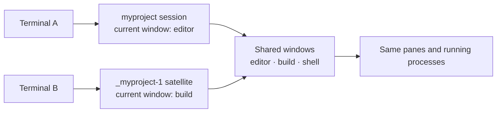
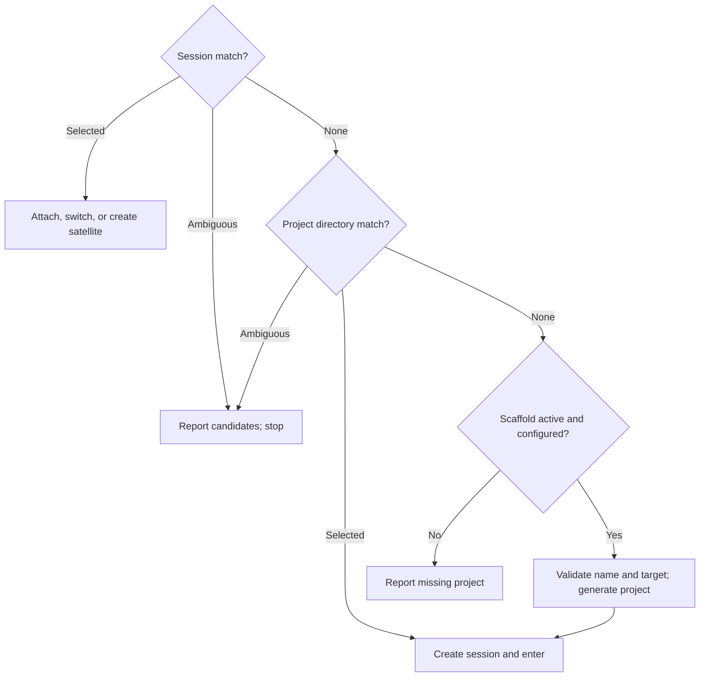

# tta

**Enter a project. Resume its work. Open another view without starting over.**

tta brings project discovery, persistent tmux workspaces, and project creation
into one command. Give it a name or a fragment: it finds a running session,
opens a project directory in a new session, or scaffolds a fresh project with
your configured generator.

Its tmux trick is **shared work with independent window selection**. Open a
grouped satellite from another terminal and navigate the same running windows
without moving the first terminal to a different window. Detach when you're
done; tmux keeps the work alive.

```sh
tta myproject                            # resume it, or start it from ~/src
tta --group myproject                    # another view of its running windows
tta myproject -- nvim 'file with spaces'  # start nvim only if creating a session
tta --scaffold=mine new-project           # generate a project, then enter it
tta --print-shell myproject               # inspect the launch plan
```

The CLI is one entry point. Rust callers can reuse the same discovery,
resolution, scaffolding, and launch planner; command expressions can run
directly or render as POSIX shell.

**Start here:** [Install](#build-and-install) · [How tmux works](#how-we-use-tmux) ·
[Scaffolding](#scaffolding-missing-projects) · [Zsh completion](#zim--zsh-completion)

**Go deeper:** [Configuration](#environment-configuration) ·
[Matching](#matching-and-failure-behavior) · [Shell plans](#shell-output) ·
[Rust pieces](#reusable-pieces) · [Verification](#runtime-verification)

## How we use tmux

A terminal is a **client**. A tmux **session** holds a collection of windows and
a current-window selection. Each **window** contains panes and their running
processes. A **session group** lets several sessions share the same windows
while retaining their own current-window selection.

That distinction makes two useful ways to enter a workspace:

- **`tta myproject`** joins the matching session. Clients attached to that same
  session follow its current-window selection together.
- **`tta --group myproject`** creates a satellite session in the same group.
  Each session can select a different window, with the same underlying work
  available in both.



For example, keep an editor visible in one terminal and select a build window
in another. Creating or closing a window changes the shared collection. If
both views select the same window, they see the same panes; input goes to the
same processes. Independence is at **session/window selection**, not a copy
of the terminal state.

### Grouped satellites, startup argv and initial directory

On an existing match, `--group` chooses the smallest unused satellite suffix:
`_myproject-1`, `_myproject-2`, and so on. It creates that satellite detached,
attaches or switches to its exact name, then sets its session option
`destroy-unattached` to `keep-last`.

**The view is disposable; the shared work persists.** An unattached satellite
is removed while another session in the group remains. If it is the last
session in the group, it is retained. This uses **tmux 3.4+**. When the project
needs its first session, `--group` creates that ordinary session directly.

| Entry option | New project session | Existing session | Grouped satellite |
| --- | --- | --- | --- |
| `--dir PATH` | Initial pane directory, overriding the project directory | No effect | Session starting directory; existing shared panes keep their cwd |
| `-- ARGV...` | Startup executable and literal arguments | No effect | No effect; existing processes are shared |
| `--session-name NAME` | Override the new session's name | No effect | Satellite name is derived from the matched session |

```sh
tta --dir "$PWD" myproject -- nvim 'file with spaces'
tta --group --dir "$PWD" myproject
tta -- --leading-dash-project nvim README.md
```

Relative `--dir` paths resolve from the invocation directory. Without startup
argv, tmux uses its configured startup command or shell. Arguments are passed
literally: tta does no shell splitting or interpolation. A lone executable is
wrapped with `/bin/sh -c 'exec "$0"' EXECUTABLE` to avoid tmux interpreting a
single operand as shell source. Direct execution accepts non-UTF-8 argument
bytes; shell rendering requires UTF-8. Initial-directory paths require UTF-8.

### Action matrix

tta works both outside and inside tmux. Inside, it moves the **current client**
within the same server, so entering another workspace does not nest a client.

| Selected work | Outside tmux | Inside the same server |
| --- | --- | --- |
| Existing session | Attach by session ID | Switch the current client by session ID |
| Existing session with `--group` | Create a satellite, then attach | Create a satellite, then switch the current client |
| Project directory | Create and attach | Create detached, then switch on success |
| Missing project, configured scaffold active | Generate, then create and attach | Generate, create detached, then switch |

The real tmux client owns the terminal: direct execution replaces tta with it.
Switching to a different server from inside tmux is an error.

## Build and install

Requires Rust, a Unix terminal, and **tmux 3.2+** (**3.4+** for satellites).
The default native discovery backend requires **little-endian Linux** and a
tmux protocol supported by the [tmax checkout](file:///home/rektide/src/tmux-interface-control/README.md).
Runtime verification here uses tmux **3.7c**.

This development workspace has a path dependency on `../tmux-interface-control`
(package `tmax` 0.4.0, `client` feature). Keep that sibling checkout available;
the dependency uses its development API.

```sh
cargo install --path app/cli --locked
# Or the local alias (also forces replacement of an installed binary):
cargo install-tta

# Add the optional CLI discovery backend:
cargo install --path app/cli --locked --features cli
# CLI-only runtime discovery, e.g. for other Unix platforms:
cargo install --path app/cli --locked --no-default-features --features cli
```

The root is a virtual Cargo workspace; install from `app/cli`, not `.`.
Default features are `native`, `scaffold-rekon`, `scaffold-rekon-native`, and
`scaffold-by-default`. A CLI-only build above omits the scaffold adapters;
add their features explicitly if wanted. With both discovery backends built,
choose `--backend native` or `--backend cli`.

## Scaffolding missing projects

A new project can begin with the same command used to return to it later.
On a clean miss, a configured generator creates `<root>/<name>`, then tta
opens its tmux session. Existing sessions and directories take precedence.

Configure a named generator in `$XDG_CONFIG_HOME/tta/config.toml`, or
`~/.config/tta/config.toml` when XDG is unset. `TTA_CONFIG` overrides the path.
For example, this `rekon-native` entry sets up Git/jj, starter files, and a
JavaScript package, with a customized remote:

```toml
[scaffold]
default = "mine"

[scaffold.generators.mine]
adapter = "rekon-native"

[scaffold.generators.mine.options]
branch = "main"
starter-files = ["README.md", "{name}.ts"]
license = "MIT"
package-json = true
install = true

[scaffold.generators.mine.options.remotes]
origin = "git@github.com:YOUR-ACCOUNT/{name}"
tngl = ""
voodoo = ""
```

```sh
tta new-project                   # use the configured default on a clean miss
tta --scaffold=mine new-project    # choose a generator explicitly
tta --scaffold=false new-project   # require an existing session or directory
```

The default build enables scaffolding on miss, but **an empty or absent registry
creates nothing**. Bare `--scaffold` uses the configured default, or the sole
entry. Multiple entries without a default require an explicit choice. Drop the
`scaffold-by-default` build feature to make generation opt-in.

### Generator adapters

| Adapter | What it does |
| --- | --- |
| [`rekon-native`](scaffold/rekon-native/src/lib.rs) | Honors the project root; initializes Git and colocated jj, creates starter files and an initial commit, configures remotes and bookmark tracking, optionally authors `package.json` and runs `pnpm install --silent` |
| [`rekon`](scaffold/rekon/src/lib.rs) | Runs the external `rekon NAME` script from PATH; the script owns setup and hardcodes `~/src`, so another tta root may disagree with its output |

`rekon-native` needs Git, jj, and pnpm when package installation is enabled.
Its options above show the branch, starter-file, license, package and install
defaults. `author` can be set explicitly; otherwise it uses `AUTHOR`, then
`git config user.name`, then omits the field. License falls back to `LICENSE`
and then `MIT` when no explicit value is supplied.

Remote entries **merge over** the adapter's personal-workflow defaults:
`origin = "git@github.com:rektide/{name}"`,
`tngl = "tngl:jauntywunderkind.bsky.social/{name}"`, and
`voodoo = "https://archive.voodoowarez.com/{name}"`. An empty string disables
one; extra keys add remotes. `{name}` is the supported template placeholder.
Every configured remote gets local jj bookmark tracking; this neither creates
remote repositories nor pushes. `origin` also receives Git tracking configuration.

Registry names are yours; adapters must be compiled into the binary. Unknown
adapters, registry keys, defaults, or selected generators fail before matching.
Adapter options are validated when a new-project expression is built, including
for `--print-shell`. The script-wrapping `rekon` adapter accepts no options.

Generation is a short-circuiting plan: **generate → enter directory → create
session → enter workspace**. Name/collision checks precede generation. A
failure stops later steps, but does not roll back files or sessions already
created. Interactive generators run in the foreground.

The [scaffold design record](design/scaffold/proposal0.glm53max.md) explains the
registry and adapter decisions; work anchor: `tta-scaffold`.

## Zim / Zsh completion

Complete **live session names and project directory names**, using prefixes,
substrings, or wildcard patterns:

```text
tta pipe<Tab>          → tta pipewire-native
tta wire<Tab>          → tta pipewire-native
tta *wire*nat*<Tab>    → tta pipewire-native
```

**Press Tab before Enter.** Wildcards belong to completion; the launcher matches
literal names. Multiple candidates remain available in Zsh's completion UI,
and inserted names are shell-escaped. Options and `--scaffold=` names complete too.

After installing the binary, put the local module in `.zimrc` before completion:

```zsh
zmodule ~/src/tta --root shell/zsh
# ...other completion providers...
zmodule completion
```

Run `zimfw install` and start a fresh shell. The module supplies completion, not
the executable. For plain Zsh, add its functions directory before `compinit`:

```zsh
fpath=( ~/src/tta/shell/zsh/functions $fpath )
autoload -Uz compinit
compinit
```

If Tab's `expand-or-complete` expands wildcards against your current directory
first, `bindkey '^I' complete-word` after keymap setup makes Tab completion-only
for all commands. The module does not change global bindings or styles.

Completion uses launch's root/endpoint settings, queries sessions and projects
independently, and never creates or enters a session. Inventory errors are
suppressed for Tab; run tta normally to diagnose them. Control-character names
are omitted from its line-oriented protocol. See the
[module](shell/zsh/functions/_tta) and [PTY integration tests](app/cli/tests/completion.rs).
Work anchor: `tta-zsh-completion`.

## How a fragment becomes an action

**Sessions first. Exact names first. Otherwise, a unique literal substring.**



For example, `tta foo` selects session `foo` ahead of `foobar`. With no exact
match, `foobar` alone works; `foobar` and `myfoo` are ambiguous. A directory
named `foo` does not override either session result.

### Matching and failure behavior

#### Session search comes first

Matching is case-sensitive. An absent server or one with no sessions is an empty
inventory. Permission, protocol, decoding, and other lookup errors stop the
operation; they do not become permission to create a workspace. Session
ambiguity stops before directory search. An existing-session match needs no
project root or HOME, though registry/choice validation still happens first.

#### Directory search is the fallback

Only immediate directories under the configured root qualify. Directory
symlinks count under their entry basename; files, dangling symlinks, deeper
descendants, and non-UTF-8 names do not. Filesystem inspection errors stop the
search. Missing or empty fragments are errors. Quote shell metacharacters and
use `--` before a leading-`-` fragment: names are neither globs nor regexes.

#### Creation and execution failures

New sessions use the project basename unless `--session-name` overrides it.
Empty names and names containing `.`, `:`, or control characters are rejected,
as are collisions with existing sessions. Names are never silently normalized.
A scaffold name must additionally be one path component, not `.` or `..`, and
its target must not already exist, including as a file or dangling symlink.

Existing sessions are targeted by canonical server-local IDs; satellites are
entered by exact chosen names. A concurrent creation can still collide and
fail. Failed creation prevents switching; failed switching or option-setting
after creation can leave the new session behind. There is no automatic retry
against another match or `new-session -A` fallback.

#### Lookup backend details

Native discovery uses tmax to query the server directly, without spawning a
process or starting a server. Optional CLI discovery runs tmux with the same
typed query/decoder. Backends are explicit; native errors do not trigger a
hidden CLI fallback. Native discovery inherits tmax's bounded connection/output
policy; CLI discovery currently has no equivalent timeout/output cap. CLI-only
runtime lookup still compiles tmax's `client` feature, including native plumbing.

Implementation: [matcher](session/launcher/src/matching.rs),
[resolver](session/launcher/src/resolve.rs), [backends](session/launcher/src/backend.rs),
and [launch planner](session/launcher/src/plan.rs).

## Environment configuration

**Explicit CLI options > environment > built-in defaults.** Empty environment
values mean unset. Paths and executable values are literal, not shell source;
tta does not expand embedded `~`, variables, or argument strings.

| Variable | CLI override | Meaning / default |
| --- | --- | --- |
| `TTA_ROOT` | `--root` | Project root; relative to invocation cwd |
| `PROJECTS_DIR` | `--root` or `TTA_ROOT` | dtachment compatibility: relative to HOME; absolute paths honored; default `$HOME/src` |
| `TTA_BACKEND` | `--backend` | Compiled backend; native when available, otherwise cli |
| `TTA_SOCKET_NAME` | Either socket option | tmux `-L` label |
| `TTA_SOCKET_PATH` | Either socket option | tmux `-S` path; relative to invocation cwd |
| `TTA_TMUX` | `--tmux` | Client executable, default `tmux` on PATH |
| `TTA_TMUX_CONFIG` | `--tmux-config` | Startup configuration passed with `-f` |
| `TTA_TRACE` | `--trace` / `--trace=false` | JSON stderr diagnostics; `true`/`1` or `false`/`0`; default off |
| `TTA_SCAFFOLD` | `--scaffold[=NAME]` / `--scaffold=false` | Generator name; `default`/`true`/`1` for default; `false`/`0`/`off`/`none` to disable |
| `TTA_CONFIG` | — | Scaffold registry path; default XDG/HOME location |

Root precedence is `--root` > `TTA_ROOT` > `PROJECTS_DIR` > `$HOME/src`.
For example, `PROJECTS_DIR=work` searches `$HOME/work`, whereas `TTA_ROOT=./work`
searches relative to the invocation cwd.

Either explicit socket selector suppresses both environment socket selectors.
Setting both selectors at the same active layer is an error. Invalid active
backend/trace values fail before lookup; explicit overrides ignore replaced
environment values. Grouping, initial directory, startup argv, session naming,
and shell-output modes remain explicit per invocation.

### Endpoint and client options

- `--socket-name LABEL` follows tmux's `-L` socket-directory rules;
  `--socket-path PATH` follows `-S` and needs an existing parent directory.
- Relative socket paths, `TMUX_TMPDIR`, `--dir`, `--tmux-config`, and explicit
  executable paths such as `--tmux ./bin/tmux` are frozen against invocation cwd
  before a plan changes directory. Bare executables retain PATH lookup.
- Inside tmux, a client can switch only within its current server. To deliberately
  create a separate client, run outside tmux or unset both `TMUX` and `TMUX_PANE`.
- `--trace` records lookup, resolution, planning, emission, handoff attempts and
  failures on stderr. A handoff event records an attempt; it cannot prove what
  happened after the Rust process was replaced.

## Shell output

The launch plan is a reusable expression: argv commands, environment assignments,
physical directory changes, file writes, and short-circuit sequences. Normal
execution runs it directly; `--print-shell` renders it without generating files,
creating sessions, or attaching.

```sh
tta --print-shell --group myproject
# To evaluate a plan, preserving failure from lookup:
tta_plan=$(tta --print-shell myproject) && eval "$tta_plan"
```

| Mode | Calling shell's cwd | Terminal handoff |
| --- | --- | --- |
| Direct `tta` | Unchanged | tta is replaced by the final tmux client |
| Evaluate `--print-shell` | New-project plans change it | Evaluating shell survives |
| Evaluate `--print-shell --exec-shell` | New-project plans change it | Evaluating shell is replaced by the final tmux client |

Stdout contains only the complete expression; diagnostics use stderr. The
guarded assignment matters: `eval "$(tta ...)"` alone can hide lookup failure.
An emitted plan is a snapshot of the selected session and endpoint, not a fresh
lookup when evaluated. Evaluate it in the same terminal/context.

## Reusable pieces

The CLI and library share the workflow. Discovery supplies facts, resolution
chooses work, adapters prepare new projects, and the planner turns that choice
into executable operations.

| Crate / home | Responsibility |
| --- | --- |
| [`tta-launcher`](session/launcher/src/lib.rs) | Replaceable `SessionLookup`, matching, resolution, endpoint/client policy, satellite naming and launch plans |
| [`tta-launcher::scaffold`](session/launcher/src/scaffold.rs) | Shared registry, generator choice, session-first resolution and creation prefix |
| [`tta-command`](shell/command/src/lib.rs) | Bon-built command expressions, literal file writes, cwd and environment; direct run/Unix exec or POSIX rendering |
| [`tta-scaffold-rekon`](scaffold/rekon/src/lib.rs) / [`tta-scaffold-rekon-native`](scaffold/rekon-native/src/lib.rs) | Feature-gated adapters returning command expressions |
| [`tta`](app/cli/src/main.rs) | CLI/environment policy, tracing and terminal handoff |
| [`shell/zsh`](shell/zsh/functions/_tta) | Live completion through read-only inventories |
| [`tta-verify`](verification/driver/src/lib.rs) | Reusable runtime exercise/observation library and verification command |

The generic expression model knows no tmux syntax. The launcher handles tmux
targets, format operands and trailing-semicolon parsing separately: shell
quoting alone does not make a tmux format literal.

### Shared scaffold API

Embedded callers can use the same registry and selection policy, then supply
their own client mode and launch options. In this outline, `lookup`, `socket`,
and the other inputs are supplied by the caller:

```rust,ignore
let resolved = tta_launcher::scaffold::resolve()
    .lookup(lookup)
    .argument(fragment)
    .maybe_root(root)                  // Option<&Path>
    .choice("default")                // or "false" or a registry name
    .call()?;

let satellite = match (&resolved.selection, grouped) {
    (tta_launcher::Selection::Existing(session), true) =>
        Some(tta_launcher::satellite_name(&session.name, &lookup.sessions()?)),
    _ => None,
};
let plan = tta_launcher::launch()
    .selection(&resolved.selection)
    .socket(&socket)
    .client_mode(mode)
    .program(tmux_program)
    .maybe_prefix(resolved.prefix.as_ref())
    .grouped(grouped)
    .maybe_satellite_name(satellite.as_deref())
    .startup(&startup_argv)
    .maybe_directory(initial_directory) // absolute Option<&Path>
    .call()?;

let shell = plan.shell(tta_command::Handoff::Run)?;
// Or run with plan.execute(...), choosing Run or Exec for the caller's lifecycle.
```

Library defaults enable neither scaffold adapters nor scaffold posture. Enable
`scaffold-rekon` or `scaffold-rekon-native` as needed and layer caller preferences
before passing `choice`. Registry loading honors `TTA_CONFIG`/XDG/HOME, or accepts
`.config(&config)` with an already loaded `scaffold::Config`.

Resolution executes no generator. `Resolved` contains the selection, optional
generator expression prefix, and generator metadata. Pass the prefix into
`launch`; creation without it fails. Grouped existing-session plans likewise
require an explicitly chosen satellite name. Errors retain underlying causes
through `std::error::Error + Send + Sync` at the scaffold boundary.

## Runtime verification

Terminal behavior is exercised against **real tmux on private sockets**.
`cargo verify` runs the Rust PTY driver against the built tta executable:

```sh
cargo build -p tta --all-features
cargo verify --backend native
cargo verify --backend cli --inside --report report.json
cargo verify --tta target/debug/tta --backend native --mode shell --scenario new
```

The default exercises cold creation and existing-session entry, both directly
and through evaluated shell plans. `--inside` starts a real attached origin pane
and checks that tta switches the **same client**, preserving its original shell.
The [acceptance tests](app/cli/tests/acceptance.rs) use the same driver.

Reports retain PTY/process output, actual session/client/pane IDs, cwd, tracing,
and cleanup results. Direct mode checks exec/PID continuity; shell mode checks
the evaluator survives; detach checks the session and pane persist. Independent
tmux observations establish outcomes rather than treating trace messages as proof.

Additional suites cover [satellite lifecycle and literal startup argv](session/launcher/tests/satellites.rs),
[shared scaffold policy](session/launcher/tests/scaffold.rs),
[CLI scaffold behavior](app/cli/tests/scaffold.rs),
[real Git/jj generator setup](scaffold/rekon-native/tests/live.rs), and
[Zsh completion in a PTY](app/cli/tests/completion.rs).

Runtime fixtures isolate homes/configuration and own their sockets. The driver
bounds lifecycle phases (`--timeout`, default 10 seconds) and retained output
(256 KiB per stream). Missing tools, failed assertions, and failed cleanup return
nonzero. Only owned endpoints are cleaned up.

### Development checks

Live checks need tmux; completion tests also need Zsh. Native tests require the
supported Linux platform. Generator live tests use Git and jj.

```sh
# Name owned packages: --all can traverse the sibling tmax dependency.
cargo fmt -p tta-command -p tta-launcher -p tta-scaffold-rekon -p tta-scaffold-rekon-native -p tta -p tta-verify --check
cargo clippy --workspace --all-targets --all-features --no-deps -- -D warnings
cargo nextest run --workspace --all-features
cargo nextest run --workspace --no-default-features --features cli
cargo test --workspace --all-features --doc
```

`--no-deps` scopes clippy's deny-warnings policy to this workspace; the development
tmax dependency currently emits its own compiler warnings.

## Precedent: dtachment

[dtachment](https://github.com/jauntywunderkind/dtachment) established the
project-entry habit: find a project, resume its workspace, or create one and
enter it. Its `dta` function finds directories under `~/${PROJECTS_DIR:-src}`,
starts an editor, and attaches through a per-directory `.dtach.sock`.

tta carries that habit into tmux: session-first discovery, shared-window groups,
same-client switching, configurable project generation, and reusable launch
plans. It retains `PROJECTS_DIR` compatibility; tmux's defaults or explicit
startup argv choose the program to run.

The [launcher research](design/launcher/research0.gpt6a.md) records the language
boundaries, native/CLI discovery tradeoffs, and runtime-acceptance rationale.
It and the [scaffold proposal](design/scaffold/proposal0.glm53max.md) are design
evidence; this guide describes the current implementation.
