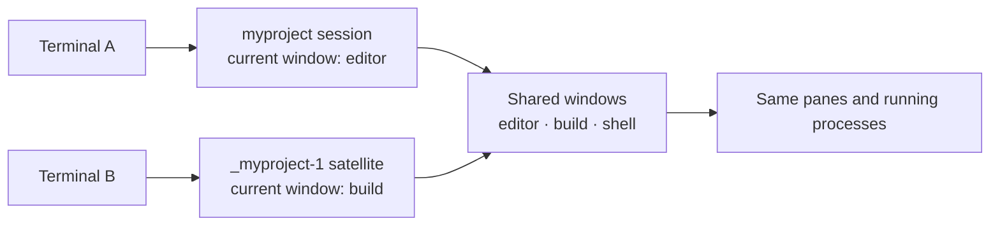
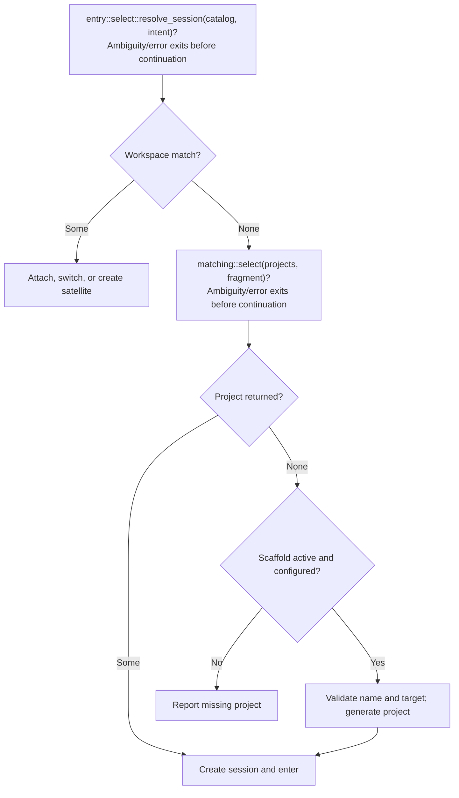

# tta

**Enter a project. Resume its work. Open another view without starting over.**

tta brings project discovery, persistent tmux workspaces, and project creation
into one command. Give it a name or a fragment: it finds a running session,
opens a project directory in a new session, or scaffolds a fresh project with
your configured generator.

Its tmux trick is **shared work with independent window selection**. Run plain
tta from another terminal and navigate the same running windows
without moving the first terminal to a different window. Detach when you're
done; tmux keeps the work alive.

```sh
tta myproject                            # resume it, or start it from ~/src
tta myproject                            # in another terminal: independent view, same work
tta --group=false myproject              # intentionally share window selection
tta --ssh work myproject                 # target needs tmux, not installed tta
tta myproject -- nvim 'file with spaces'  # start nvim only if creating a session
tta --scaffold=mine new-project           # generate a project, then enter it
tta --print-shell myproject               # inspect the launch plan
```

The CLI is one entry point. Rust callers can reuse the same discovery,
resolution, scaffolding, and launch planner; command expressions can run
directly or render as POSIX shell.

**Start here:** [Install](#build-and-install) · [How tmux works](#how-we-use-tmux) ·
[Scaffolding](#scaffolding-missing-projects) · [Zsh completion](#zim--zsh-completion)

**Go deeper:** [Configuration](#environment-configuration) · [SSH](#ssh-targets) ·
[Matching](#matching-and-failure-behavior) · [Shell plans](#shell-output) ·
[Rust pieces](#reusable-pieces) · [Verification](#runtime-verification)

## What tta can do

A compact map of the capability surfaces, what works today, and where each
edge is heading. These are navigation headings over the maintained contracts
below, not separate product promises. Open work lives on the project's Beads
board; closed tickets remain the delivery history behind each row.

| Surface | Available now | Edge |
| --- | --- | --- |
| **Find and return to work** | Session-first [matching](#matching-and-failure-behavior) — literal name, workspace alias, shortest substring; rootless session hits; [multiple ordered project roots](#environment-configuration) with `@N/name` selectors and identity-aware [Zsh completion](#zim--zsh-completion) | — |
| **Open another view; switch work** | Outside entry gives [independent window selection](#how-we-use-tmux) over shared processes; explicit shared selection; orphan aliases, custom prefix and last-view survival | Guarded inside switching (`tta-launch-backends-switching`) and input-origin research (`tta-launch-backends-input-origin`) are separate open work |
| **Create and start a project** | Configured [scaffold-on-miss](#scaffolding-missing-projects) with named adapters and native generator options; literal startup argv/cwd; [initial window naming](#grouped-satellites-startup-argv-and-initial-directory) | Delivered; a future generator need is a new bounded ticket |
| **Enter work on another host** | [SSH target-local observation](#ssh-targets) and real terminal handoff — the target needs tmux, not installed tta | Remote-carrier and socket-tunnel siblings are optional directions pending a consumer-grounded relevance decision, not requirements of shipped SSH |
| **Embed the same entry policy** | [Reusable Rust pieces](#reusable-pieces) — the owned entry attempt from context binding through effects, driven by the CLI, SSH and term-preserver's embedded call sites with explicit caller grouping | [0.8.0 cutover receipt](design/entry/cutover1.gpt61sol.md): superseded runtime removed; real local/SSH consumer retries verified; maintained architecture in [doc/entry](doc/entry/README.md) |
| **Inspect and execute a launch plan** | [POSIX shell snapshots](#shell-output); literal command expressions; native/CLI [execution boundaries](#which-operations-use-tmax); [tracing](#endpoint-and-client-options) | Deferred workflow compilation remains a possible later commission, not a promise of `--print-shell` |

Grouping, configuration, naming and matching are features within these
surfaces rather than separate epics; “native”, “SSH” and “Rust library”
name execution choices of one entry policy, not mutually exclusive buckets.
Historical delivery anchors — `tta-zsh-completion`,
`tta-launch-backends-independent-views`, `tta-scaffold`,
`tta-launch-backends-remote-target`, `tta-state-machine` and
`tta-window-name` — are closed on the board with their evidence.

Multi-root discovery is delivered: ordered roots carry through the CLI,
environment, pure core, local and SSH acquisition, completion and planning,
with physical-directory provenance and qualified selectors. The
[contract](doc/entry/project-roots.md), [establishing checkpoint](design/entry/project-roots0.gpt61sol.md)
and [integration checkpoint](design/entry/project-roots1.glm53max.md) record
the decisions and evidence.

## How we use tmux

A terminal is a **client**. A tmux **session** holds a collection of windows and
a current-window selection. Each **window** contains panes and their running
processes. A **session group** lets several sessions share the same windows
while retaining their own current-window selection.

That distinction gives two outside-entry modes:

- **`tta myproject`**, outside tmux, creates a satellite session in the same group.
  Each session can select a different window, with the same underlying work
  available in both.
- **`tta --group=false myproject`** joins the selected session directly. Clients
  attached to that same session follow its current-window selection together.
- Inside tmux, omitted grouping retains ordinary client switching. Explicit
  `--group` requests a satellite there too; it does not resolve client identity.



For example, keep an editor visible in one terminal and select a build window
in another. Creating or closing a window changes the shared collection. If
both views select the same window, they see the same panes; input goes to the
same processes. Independence is at **session/window selection**, not a copy
of the terminal state.

### Grouped satellites, startup argv and initial directory

On an existing outside match, tta chooses the smallest unused satellite suffix:
`_myproject-1`, `_myproject-2`, and so on. It creates that satellite detached,
attaches or switches to its exact name, then sets its session option
`destroy-unattached` to `keep-last`.

**The view is disposable; the shared work persists.** An unattached satellite
is removed while another session in the group remains. If it is the last
session in the group, it is retained. This uses **tmux 3.4+**. When the project
needs its first session, tta creates that ordinary session directly.

Set `--satellite-prefix view-` or `TTA_SATELLITE_PREFIX=view-` to use names such
as `view-myproject-1` instead. The default prefix is `_`. Explicit CLI wins over
environment. Prefixes must be nonempty, with no `.`, `:` or control characters;
an empty environment value is unset, but an explicit empty prefix is an error.

If only `_myproject-42` survives after the original session is gone, both
`tta myproject` and Tab's `myproject` alias return to its running work. A new view
is named `_myproject-1`, not `__myproject-42-1`. Alias recognition uses the active
prefix plus one final `-DIGITS`, not arbitrary trailing digits or recursive
stripping. Keep the same prefix configuration when returning to a workspace.

| Entry option | New project session | Existing session | Grouped satellite |
| --- | --- | --- | --- |
| `--dir PATH` | Initial pane directory, overriding the project directory | No effect | Session starting directory; existing shared panes keep their cwd |
| `-- ARGV...` | Startup executable and literal arguments | No effect | No effect; existing processes are shared |
| `--session-name NAME` | Override the new session's name | No effect | Actual group's logical base supplies the satellite name |
| `--window-name NAME` | Name the initial window (default: the session name) | No effect | No effect; tmux rejects `-n` with `-t`, and satellites share the group's windows |

```sh
tta --dir "$PWD" myproject -- nvim 'file with spaces'
tta --group --dir "$PWD" myproject
tta -- --leading-dash-project nvim README.md
```

Relative `--dir` paths resolve from the invocation directory. Without startup
argv, tmux uses its configured startup command or shell. Arguments are passed
literally: tta does no shell splitting or interpolation. A lone executable is
wrapped with `/bin/sh -c 'exec "$0"' EXECUTABLE` to avoid tmux interpreting a
single operand as shell source. Direct execution accepts non-UTF-8 argument
bytes; shell rendering requires UTF-8. Initial-directory paths require UTF-8.

A created session names its initial window after itself, so the status line
leads with the project you entered. Naming a window makes tmux disable
`automatic-rename` for it: the name sticks instead of following the running
command. `--window-name=NAME` renames the initial window (spaces, `.`, `:`,
and `#` allowed), and `--window-name=false` skips naming entirely to keep
tmux's automatic renaming. The window name is a tmux format-escaped literal
like the session name.

### Action matrix

tta works both outside and inside tmux. Inside, it switches an existing client
within the same server rather than nesting a client. Automatic client inference
is currently heuristic, not a reliable input-origin identity.

| Selected work | Outside tmux | Inside the same server |
| --- | --- | --- |
| Existing session, omitted grouping | Create a satellite, then attach | Switch a client by session ID |
| Existing session with `--group=false` | Attach by session ID | Switch a client by session ID |
| Existing session with `--group` | Create a satellite, then attach | Create a satellite, then switch a client |
| Project directory | Create and attach | Create detached, then switch on success |
| Missing project, configured scaffold active | Generate, then create and attach | Generate, create detached, then switch |

The real tmux client owns the terminal: direct execution replaces tta with it.
Switching to a different server from inside tmux is an error.

**Independent views are the outside default**, including SSH and reusable
workflow/runner APIs. Explicit caller grouping policy is preserved. The
[input-state contract](doc/entry/README.md) connects the Mermaid flow to the
actual core resolution, observation and planning stages.

**Known inside-switch limitation:** when two clients show the same shared pane,
they use the same shell/environment/tty. Recent activity can make tmux choose
the other terminal for a switch. This is reproduced with two real terminals on
both backends; using CLI switching does not solve the identity ambiguity. The
[historical trial](verification/trials/independent-views/README.md) preserves that
defect. Guarded inside switching is separately scoped; this outside-default change
does not claim to fix it or establish which terminal supplied shared-pane input.

## Build and install

Requires Rust **1.99+** (the pinned statechart runtime's minimum), a Unix terminal,
and **tmux 3.4+** for default independent views
(**3.2+** for explicit shared-only entry).
The default native backend requires **little-endian Linux** and a
tmux protocol supported by the [tmax checkout](file:///home/rektide/src/tmux-interface-control/README.md).
This launch-backend slice was verified with a pinned tmux **3.7c** fixture and
also exercised against the current system tmux **3.8**.

This development workspace has a path dependency on `../tmux-interface-control`
(package `tmax` 0.7.0). The pure launcher uses `operations`; only the optional
runner's `native` feature enables `client`. Keep that sibling checkout available.

```sh
cargo install --path app/cli --locked --root ~/.local --force
# Add the optional CLI backend:
cargo install --path app/cli --locked --root ~/.local --force --features cli
# CLI-only runtime execution, e.g. for other Unix platforms:
cargo install --path app/cli --locked --root ~/.local --force --no-default-features --features cli
```

The root is a virtual Cargo workspace; install from `app/cli`, not `.`. The
explicit root installs to `~/.local/bin`; ensure that directory precedes any
older system `tta` on your PATH, and run `rehash` in zsh if needed.
Default features are `native`, `scaffold-rekon`, `scaffold-rekon-native`, and
`scaffold-by-default`. A CLI-only build above omits the scaffold adapters;
add their features explicitly if wanted. With both backends built, choose
`--backend native` or `--backend cli` (also `TTA_BACKEND`). Native is the default
when compiled; the selection covers discovery and eligible direct launch work.

### Which operations use tmax?

| Operation | Native selection (default) | CLI selection |
| --- | --- | --- |
| Session discovery | Native tmax query | tmux subprocess with the same typed query |
| Ordinary project/scaffold creation inside a live server, UTF-8 startup argv | Native tmax detached creation, then CLI switch | CLI detached creation, then CLI switch |
| Outside creation and attachment | One real tmux client, including cold server startup | Same |
| Existing-session attach or invoking-client switch | Real tmux client | Same |
| Grouped satellite creation, client move and `keep-last` | One CLI command queue, preserving lifecycle ordering | Same |
| Non-UTF-8 startup argv | CLI, preserving raw Unix argument bytes | Same |
| `--print-shell` / `--exec-shell` | Complete CLI expression; no mutation while printing | Same |

Native inside creation first reads the inventory again. An absent or sessionless
server takes the CLI creation path **before** generation or mutation, preserving
server startup, `-f` configuration and label-directory setup. Other read errors
stop. Once a native mutation is attempted, there is **no CLI retry or rollback**.
The generator still runs first, directory validation precedes creation, and a
failed creation prevents switching. A failed handoff can leave the new session.

Grouping stays together because splitting detached creation from attachment can
let inherited `destroy-unattached` settings remove the satellite between commands.
Switching stays CLI because tmax's descriptor-free client is not the invoking
terminal client. Native does not mean a new interactive terminal implementation.
See the [execution decision](design/launcher/launch-backends0.gpt61sol.md) and the
library-side [tta consumer account](file:///home/rektide/src/tmux-interface-control/doc/consumer/tta.md).

## Scaffolding missing projects

A new project can begin with the same command used to return to it later.
On a clean miss, a configured generator creates `<root>/<name>`, then tta
opens its tmux session. Existing sessions and directories take precedence.

Configure a named generator in `$XDG_CONFIG_HOME/tta/config.toml`, or
`~/.config/tta/config.toml` when XDG is unset. `TTA_CONFIG` overrides the path.
For example, this `rekon-native` entry sets up Git/jj, starter files, and a
JavaScript package, with a customized remote:

```toml
[scaffold]
default = "mine"

[scaffold.generators.mine]
adapter = "rekon-native"

[scaffold.generators.mine.options]
branch = "main"
starter-files = ["README.md", "{name}.ts"]
license = "MIT"
package-json = true
install = true

[scaffold.generators.mine.options.remotes]
origin = "git@github.com:YOUR-ACCOUNT/{name}"
tngl = ""
voodoo = ""
```

```sh
tta new-project                   # use the configured default on a clean miss
tta --scaffold=mine new-project    # choose a generator explicitly
tta --scaffold=false new-project   # require an existing session or directory
```

The default build enables scaffolding on miss, but **an empty or absent registry
creates nothing**. Bare `--scaffold` uses the configured default, or the sole
entry. Multiple entries without a default require an explicit choice. Drop the
`scaffold-by-default` build feature to make generation opt-in.

### Generator adapters

| Adapter | What it does |
| --- | --- |
| [`rekon-native`](scaffold/rekon-native/src/lib.rs) | Honors the project root; initializes Git and colocated jj, creates starter files and an initial commit, configures remotes and bookmark tracking, optionally authors `package.json` and runs `pnpm install --silent` |
| [`rekon`](scaffold/rekon/src/lib.rs) | Runs the external `rekon NAME` script from PATH; the script owns setup and hardcodes `~/src`, so another tta root may disagree with its output — with **multiple configured roots, creation fails closed** with an actionable error instead of generating in the wrong location |

`rekon-native` needs Git, jj, and pnpm when package installation is enabled.
Its options above show the branch, starter-file, license, package and install
defaults. `author` can be set explicitly; otherwise it uses `AUTHOR`, then
`git config user.name`, then omits the field. License falls back to `LICENSE`
and then `MIT` when no explicit value is supplied.

Generator planning itself is pure. The optional runner observes those defaults
only when a clean creation actually needs them, then supplies ordinary values to
the adapter. Supplied-facts callers pass their own target defaults explicitly.

Remote entries **merge over** the adapter's personal-workflow defaults:
`origin = "git@github.com:rektide/{name}"`,
`tngl = "tngl:jauntywunderkind.bsky.social/{name}"`, and
`voodoo = "https://archive.voodoowarez.com/{name}"`. An empty string disables
one; extra keys add remotes. `{name}` is the supported template placeholder.
Every configured remote gets local jj bookmark tracking; this neither creates
remote repositories nor pushes. `origin` also receives Git tracking configuration.

Registry names are yours; adapters must be compiled into the binary. Unknown
adapters, registry keys, defaults, or selected generators fail before matching.
Adapter options are validated when a new-project expression is built, including
for `--print-shell`. The script-wrapping `rekon` adapter accepts no options.

Generation is a short-circuiting plan: **generate → enter directory → create
session → enter workspace**. Name/collision checks precede generation. A
failure stops later steps, but does not roll back files or sessions already
created. Interactive generators run in the foreground.

The [scaffold design record](design/scaffold/proposal0.glm53max.md) explains the
registry and adapter decisions; work anchor: `tta-scaffold`.

## Zim / Zsh completion

Complete **live workspace aliases and project directory names**, using prefixes,
substrings, or wildcard patterns:

```text
tta pipe<Tab>          → tta pipewire-native
tta wire<Tab>          → tta pipewire-native
tta *wire*nat*<Tab>    → tta pipewire-native
```

**Press Tab before Enter.** Wildcards belong to completion; the launcher matches
literal names. Multiple candidates remain available in Zsh's completion UI,
and inserted names are shell-escaped. Options and `--scaffold=` names complete too.
Generated satellites complete as their logical project name, including when the
original session is gone. Literal selectors remain reachable by typing their
decoration, for example `_myproj`; custom prefix configuration is forwarded to
the read-only inventory. Completion offers all aliases, not just the shortest
launch winner. Distinct workspaces with the same alias can still be ambiguous
on Enter; use the reported literal selector to disambiguate.

After installing the binary, put the local module in `.zimrc` before completion:

```zsh
zmodule ~/src/tta --root shell/zsh
# ...other completion providers...
zmodule completion
```

Run `zimfw install` and start a fresh shell. The module supplies completion, not
the executable. For plain Zsh, add its functions directory before `compinit`:

```zsh
fpath=( ~/src/tta/shell/zsh/functions $fpath )
autoload -Uz compinit
compinit
```

If Tab's `expand-or-complete` expands wildcards against your current directory
first, `bindkey '^I' complete-word` after keymap setup makes Tab completion-only
for all commands. The module does not change global bindings or styles.

Completion uses launch's root/endpoint settings — including every repeated
`--root` on the line, in order — queries sessions and projects independently,
and never creates or enters a session. A basename offered bare always selects
unambiguously on Enter; a name that exists in two distinct physical directories
completes only through its qualified `@N/name` selector (substring and wildcard
filtering match the basename inside the selector). Inventory errors are
suppressed for Tab; run tta normally to diagnose them. Control-character names
are omitted from its line-oriented protocol. See the
[module](shell/zsh/functions/_tta) and [PTY integration tests](app/cli/tests/completion.rs).
Work anchor: `tta-zsh-completion`.

## How a fragment becomes an action

**Sessions first. Exact raw name, then exact workspace alias, then shortest substring.**



For example, `tta foo` selects session `foo` ahead of `foobar`. With no exact
match, `myfoo` wins over `foobar` because its name is shorter. Length is measured
in Unicode characters; ties between shortest names (such as `afoo` and `zfoo`)
remain ambiguous and report only those tied candidates. A directory named `foo`
does not override either session result.

Satellite aliases participate at their logical name's length: `_foo-42` offers
`foo`. Equal winners in one **actual tmux group** are one workspace; equal winners
in unrelated groups (or separate ungrouped sessions) remain ambiguous, regardless
of similar names. An exact raw selector wins even over another group's identical
alias. The [entry chart](doc/entry/README.md#the-executable-chart) documents
guards, numeric stripping, deterministic group representatives and pure stages.

### Matching and failure behavior

#### Session search comes first

Matching is case-sensitive. An absent server or one with no sessions is an empty
inventory. Permission, protocol, decoding, and other lookup errors stop the
operation; they do not become permission to create a workspace. Session
ambiguity stops before directory search. An existing-session match needs no
project root or HOME, though registry/choice validation still happens first.

#### Directory search is the fallback

Only immediate directories under the configured roots qualify. Directory
symlinks count under their entry basename; files, dangling symlinks, deeper
descendants, and non-UTF-8 names do not. Filesystem inspection errors stop the
search. Missing or empty fragments are errors. Quote shell metacharacters and
use `--` before a leading-`-` fragment: names are neither globs nor regexes.
Across several roots the shortest matching basename wins globally; equal
winners collapse to one selection only when their canonical physical directory
is the same, otherwise tta reports the `@N/name` selectors that name each
configured root slot.

#### Creation and execution failures

New sessions use the project basename unless `--session-name` overrides it.
Empty names and names containing `.`, `:`, or control characters are rejected,
as are collisions with existing sessions. Names are never silently normalized.
Window names are freer (`.` and `:` allowed) but must be nonempty and
printable; empty or control-character values are rejected, not silently
coerced to the session name.
A scaffold name must additionally be one path component, not `.` or `..`, and
its target must not already exist, including as a file or dangling symlink.

Existing sessions are targeted by canonical server-local IDs; satellites are
entered by exact chosen names. A concurrent creation can still collide and
fail. Failed creation prevents switching; failed switching or option-setting
after creation can leave the new session behind. There is no automatic retry
against another match or `new-session -A` fallback.

#### Backend details

Native discovery uses tmax to query the server directly, without spawning a
process or starting a server. Optional CLI discovery runs tmux with the same
typed query/decoder. Backends are explicit; native errors do not trigger a
hidden CLI fallback. Native discovery inherits tmax's bounded connection/output
policy; CLI discovery uses complete-EOF bounded capture (10 seconds and 256 KiB
retained per stream by default). Child exit with pipe-holding descendants is
incomplete at the deadline, not a successful empty inventory. CLI-only
runtime execution no longer compiles tmax's `client` feature or native plumbing.
Native detached creation uses the same endpoint policy and a client-directory
override, without changing the Rust process's cwd. The
[operation matrix](#which-operations-use-tmax) states the deliberate CLI boundaries.

Implementation: [matcher](session/launcher/src/matching.rs),
[guarded workspace selection](session/launcher/src/entry/select.rs),
[observers](session/runner/src/observe/local.rs),
[semantic action lowering](session/launcher/src/entry/action.rs) and
[effect interpretation](session/runner/src/execute/local.rs).

## Environment configuration

**Explicit CLI options > environment > built-in defaults.** Empty environment
values mean unset. Paths and executable values are literal, not shell source;
tta does not expand embedded `~`, variables, or argument strings.

| Variable | CLI override | Meaning / default |
| --- | --- | --- |
| `TTA_ROOTS` | `--root` (repeatable) | JSON array of ordered nonempty paths, e.g. `'["/work/personal","/work/team"]'`; relative entries freeze against invocation cwd |
| `TTA_ROOT` | `--root` or `TTA_ROOTS` | Single project root; relative to invocation cwd |
| `PROJECTS_DIR` | any root layer above | dtachment compatibility: relative to HOME; absolute paths honored; default `$HOME/src` |
| `TTA_BACKEND` | `--backend` | Compiled backend; native when available, otherwise cli |
| `TTA_SOCKET_NAME` | Either socket option | tmux `-L` label |
| `TTA_SOCKET_PATH` | Either socket option | tmux `-S` path; relative to invocation cwd |
| `TTA_TMUX` | `--tmux` | Client executable, default `tmux` on PATH |
| `TTA_TMUX_CONFIG` | `--tmux-config` | Startup configuration passed with `-f` |
| `TTA_TRACE` | `--trace` / `--trace=false` | JSON stderr diagnostics; `true`/`1` or `false`/`0`; default off |
| `TTA_SCAFFOLD` | `--scaffold[=NAME]` / `--scaffold=false` | Generator name; `default`/`true`/`1` for default; `false`/`0`/`off`/`none` to disable |
| `TTA_CONFIG` | — | Scaffold registry path; default XDG/HOME location |
| `TTA_SATELLITE_PREFIX` | `--satellite-prefix` | Satellite decoration and alias recognition; default `_` |

Root precedence is repeated `--root` > `TTA_ROOTS` > `TTA_ROOT` >
`PROJECTS_DIR` > `$HOME/src`. **One active layer replaces the entire list**:
explicit roots ignore lower layers entirely (an invalid `TTA_ROOTS` is never
parsed), while an invalid *active* layer — an empty array, non-array, empty
element or malformed JSON — fails before lookup. Empty environment strings
mean unset. For example, `PROJECTS_DIR=work` searches `$HOME/work`, whereas
`TTA_ROOT=./work` searches relative to the invocation cwd.

With several roots, entry basenames rank by the existing literal shortest-name
rule **globally across all roots** (root order is presentation, not priority),
then tie-break by canonical physical directory. The same basename in two
distinct physical directories is ambiguous and reports one-based `@N/name`
selectors — `@N` names the configured root slot. A qualified selector observes
only its root; a clean miss scaffolds only with an explicit `@N/new-name` or a
single physical root. The external `rekon` script adapter refuses multi-root
creation outright (see the [adapter table](#generator-adapters)); `rekon-native`
honors the selected root. SSH layers roots from **target-local** facts;
explicit caller roots replace target defaults and resolve on the target.

Either explicit socket selector suppresses both environment socket selectors.
Setting both selectors at the same active layer is an error. Invalid active
backend/trace values fail before lookup; explicit overrides ignore replaced
environment values. Grouping (`--group[=true/false]`), initial directory, startup argv, session naming,
and shell-output modes remain explicit per invocation.

### Endpoint and client options

- `--socket-name LABEL` follows tmux's `-L` socket-directory rules;
  `--socket-path PATH` follows `-S` and needs an existing parent directory.
- Relative socket paths, `TMUX_TMPDIR`, `--dir`, `--tmux-config`, and explicit
  executable paths such as `--tmux ./bin/tmux` are frozen against invocation cwd
  before a plan changes directory. Bare executables retain PATH lookup.
- Inside tmux, a client can switch only within its current server. To deliberately
  create a separate client, run outside tmux or unset both `TMUX` and `TMUX_PANE`.
- `--trace` records lookup, resolution, planning, emission, handoff attempts and
  failures on stderr. A handoff event records an attempt; it cannot prove what
  happened after the Rust process was replaced.

## SSH targets

**Observe remotely, decide locally, then hand the terminal to one target action.**
The target needs tmux and the selected generator's tools, **not an installed tta**:

```sh
tta --ssh work myproject
tta --ssh work --group=false myproject   # intentional shared selection
tta --ssh work --satellite-prefix view- myproject
tta --ssh work --target-shell /bin/zsh --target-interactive myproject
tta --ssh work --target-cwd /srv/work --dir ./editor myproject -- nvim 'literal file'
tta --ssh work --ssh-option=-F --ssh-option=/path/to/private-ssh-config myproject
tta --ssh work --target-env PATH=/usr/bin:/bin --scaffold=false myproject
```

The default shell is the **target's** `$SHELL`, then `/bin/sh`; login startup is
enabled (`--target-login=false` disables it), interactive startup is opt-in.
`--target-env NAME=VALUE` and `--target-unset NAME` apply after startup. The same
setup runs for every non-PTY probe and the final PTY action. The first observed
physical cwd is frozen for subsequent operations. `--target-cwd` selects invocation
cwd; `--dir` only selects a created pane's initial cwd. Relative target paths are
never canonicalized locally, and embedded `~` is not expanded.

Target HOME, UID, root, socket policy, config/registry, author/license and Git
identity supply defaults; explicit caller options override them. Local `TTA_*`,
HOME, PATH and TMUX do not supply remote launch defaults (local `TTA_TRACE` and
`TTA_SSH_PROBE_*` still control diagnostics/acquisition). A fresh SSH terminal **attaches**, never switches a local
tmux client; TMUX and TMUX_PANE are cleared after setup. `--backend native` is not
an SSH backend. Connection options, including the caller's SSH config and
ControlMaster settings, are shared by observation and handoff.
Probe acquisition has closed stdin and its own process group. Authentication must
be available through keys/agent or an already authenticated ControlMaster; a
separate interactive password/passphrase bootstrap is not implemented or tested.

Local probe policy is configurable with `--ssh-probe-timeout MS` (positive integer
milliseconds, default **10000**) and `--ssh-probe-retention BYTES` (positive integer
bytes per channel stream, default **262144**). CLI values override the local
`TTA_SSH_PROBE_TIMEOUT` / `TTA_SSH_PROBE_RETENTION` environment, then defaults;
empty environment values are ignored. These settings bound **each** read-only
acquisition, including SSH connection and target startup, not the terminal action
or the whole launch. They are not target-side matching/default inputs.

Retention counts **encoded SSH channel bytes**, not decoded diagnostic bytes:
operation stderr is hex metadata in channel stdout at roughly **3×** expansion.
With the default 256 KiB cap, about **87 KiB** of operation stderr alone can
exhaust it; operation stdout, framing and startup/trailing chatter share that
same budget. The probe also has an independent 786432-character metadata ceiling;
raising local retention does not raise that protocol ceiling. Either truncation
fails closed, never authorizing mutation.

The declared worker-free probe profile is POSIX `/bin/sh`, `pwd`, `id`, `cat`,
`od`, `head`, **GNU find**, and **GNU stat** for symlink referents, plus tmux and
Git when needed. No Python, Perl or target worker is installed or assumed. Successful
NUL-delimited directory enumeration proves an absent entry; dangling symlinks
remain present, and inaccessible/non-directory/looping paths fail closed. Remote
shell output and context/configuration values require UTF-8; binary framing
preserves supported newlines, quotes, tabs and literal content. The SSH command
shell must accept POSIX quoting; selected-shell startup supports POSIX, Fish and Nu.
Fish/Nu carrier construction is implemented, but their execution is **not
certified** by the installed-shell fixtures (neither shell was installed).

GNU find's `%Y=N` alone is not used as proof of a missing referent: it also covers
non-directory ancestors. A separately framed, single-operand GNU stat call uses
real status/mode and its C-locale errno diagnostic. Only classified `ENOENT` may
be skipped; unknown diagnostics, `ENOTDIR`, permission errors and loops stop the
relevant observation. Exact destination presence still uses lstat semantics.

Versioned, nonce-bound frames separate startup chatter, command stdout/stderr and
command status. Complete EOF, carrier failure, malformed/truncated frames, failed
commands and exact endpoint absence are distinct. Diagnostics go to stderr, not
shell-output stdout. The runner retains every captured observation on failure;
both CLI and embedded consumer report earlier diagnostics and failed capture
status, completeness, omissions and cleanup evidence before propagating its cause.
Each probe uses bounded capture; no observation failure authorizes mutation.

`--ssh --print-shell` performs read-only observations and prints a **resolved local
SSH invocation**, including its target setup/action block. `--exec-shell` replaces
the evaluating local shell with SSH. It is a snapshot, **not** a deferred workflow
that will repeat discovery later:

```sh
plan=$(tta --ssh work --print-shell myproject) && eval "$plan"
```

Generation and creation short-circuit before handoff. Grouped create → attach →
`keep-last` remains one tmux queue. Transport loss after action start can leave
target mutation uncertain; the runner never replays the block, falls back to a
second backend, rolls back or prunes. SSH process-group cleanup concerns only
locally owned acquisition processes, not a remote server or arbitrary escaped
descendants. Actual SSH evidence and rerun recipes:
[SSH verification toolkit](verification/ssh/README.md).

## Shell output

Every launch retains a reusable CLI expression: argv commands, environment
assignments, physical directory changes, file writes, and short-circuit sequences.
Normal execution chooses the selected backend's eligible operations;
`--print-shell` renders the complete expression without generating files,
creating sessions, or attaching.

```sh
tta --print-shell --group myproject
# To evaluate a plan, preserving failure from lookup:
tta_plan=$(tta --print-shell myproject) && eval "$tta_plan"
```

| Mode | Calling shell's cwd | Terminal handoff |
| --- | --- | --- |
| Direct `tta` | Unchanged | tta is replaced by the final tmux client |
| Evaluate `--print-shell` | New-project plans change it | Evaluating shell survives |
| Evaluate `--print-shell --exec-shell` | New-project plans change it | Evaluating shell is replaced by the final tmux client |

Stdout contains only the complete expression; diagnostics use stderr. The
guarded assignment matters: `eval "$(tta ...)"` alone can hide lookup failure.
An emitted plan is a snapshot of the selected session and endpoint, not a fresh
lookup when evaluated. Evaluate it in the same terminal/context.

## Reusable pieces

The CLI and library share one owned entry attempt. The chart requests facts,
native functions decide, and replaceable interpreters observe and execute:
the same protocol drives local CLI runs, SSH targets and embedded consumers.

| Crate / home | Responsibility |
| --- | --- |
| [`tta-launcher`](session/launcher/src/lib.rs) | The owned [`EntryAttempt`](session/launcher/src/entry/mod.rs) and read-only [`CatalogQuery`](session/launcher/src/entry/catalog.rs) protocols, semantic decisions and bound actions, guarded matching, endpoint/client policy and whole-layer context policy; no runner dependency |
| [`tta-launcher::scaffold`](session/launcher/src/scaffold.rs) | Registry parsing, generator choice, and adapters split into validation → requirements → destination contract → materialization |
| [`tta-launcher::target`](session/launcher/src/target.rs) | Pure target shell-carrier construction (`TargetSetup`) and worker-free probe codecs |
| [`tta-command`](shell/command/src/lib.rs) | Pure literal argv/environment/cwd/file-write/sequence expressions and POSIX rendering |
| [`tta-runner`](session/runner/src/lib.rs) | Local/SSH read interpreters (`observe`), one thin shared read driver, bounded process capture, and effect executors (`execute`) that interpret exactly the dispatched effect |
| [`tta-scaffold-rekon`](scaffold/rekon/src/lib.rs) / [`tta-scaffold-rekon-native`](scaffold/rekon-native/src/lib.rs) | Feature-gated adapters returning command expressions |
| [`tta`](app/cli/src/main.rs) | CLI/environment policy, tracing and terminal handoff |
| [`shell/zsh`](shell/zsh/functions/_tta) | Live completion through read-only catalog queries |
| [`tta-verify`](verification/driver/src/lib.rs) | Reusable runtime exercise/observation library and verification command |
| [`tta-core-witness`](verification/core/README.md) | Runner-free supplied-facts attempt exercises and protocol rejection checks, with a package-only dependency witness |

The generic expression model knows no tmux syntax. The launcher handles tmux
targets, format operands and trailing-semicolon parsing separately: shell
quoting alone does not make a tmux format literal. The
[maintained entry contract](doc/entry/README.md) owns the full architecture;
the [0.8.0 cutover receipt](design/entry/cutover1.gpt61sol.md) records the
coordinated deletion of the retired 0.7 preparation/workflow/resolver surface.

### Owned entry attempts

An attempt is acquired (the chart will request raw target context) or started
from a supplied frozen context. It advances one correlated event at a time;
`waiting()` is inert:

```rust,ignore
use tta_launcher::entry::{EntryAttempt, context, protocol::*};

let mut attempt = EntryAttempt::acquire(context::Acquisition {
    scope: context::Scope {          // local or SSH origin with optional setup
        origin: context::Origin::Local { host: "local".into() },
        cwd: None,
    },
    overrides: context::Overrides {  // explicit values by presence, never
        roots: Some(vec!["/work/personal".into(), "/work/team".into()]),
        ..Default::default()         // prefilled CLI defaults
    },
    intent: EntryIntent {            // view policy, startup, prefix, roots…
        view: ViewPreference::Independent,
        ..EntryIntent::selector("myproject")
    },
    default_scaffold: "default".into(),
})?;
```

Reads are answered by an observer — native tmax queries, tmux CLI subprocesses,
SSH probes or supplied test facts — and driven by one shared loop:

```rust,ignore
// Local: the scope comes from the first pending read request.
let Waiting::Read(request) = attempt.waiting() else { unreachable!() };
let scope = (*request.scope).clone();
let mut backend = tta_runner::observe::local::SessionBackend::Native; // or Cli
let mut observer = tta_runner::observe::local::Local::acquire(scope, &mut backend)?;
let mut executor = tta_runner::execute::local::Local::default();

let snapshot = tta_runner::execute::drive(
    &mut attempt, &mut observer, &mut executor,
    Delivery::Execute { native: true },   // or Delivery::Export to freeze a snapshot
    tta_command::Handoff::Exec,           // the real client replaces this process
)?;
```

`execute::drive` interprets the dispatched effects in order, records
`EffectStarted` before each operation, and returns an `AttemptSnapshot` whose
outcome is honest: `Completed` with effect receipts, `Delegated` when an
embedder took over the terminal, `Stopped`/`Cancelled` with the boundary and
retained effect knowledge. Drivers never choose generators, view policy,
grouping, satellites or rerank a selection. Export finishes as
`AttemptOutcome::Exported(action)`; `action.expression()` is the complete CLI
snapshot and `action.shell()` its POSIX rendering.

SSH replaces the interpreters, not the policy: `tta_runner::ssh::Ssh` builds
literal transport argv, `observe::ssh::Ssh::acquire` freezes connection/setup
and answers the same requests with nonce-bound probes, and
`execute::ssh::drive` dispatches the bound action through one terminal
invocation sharing that frozen policy. `observe::ssh::write_diagnostics`
reports retained observations without I/O in the core. See the
[SSH section](#ssh-targets) for the target profile and capture budget.

Library defaults enable neither scaffold adapters nor scaffold posture. Enable
`scaffold-rekon`/`scaffold-rekon-native` as needed; adapters validate options,
declare their destination contract and default requirements, then materialize
once with observed target defaults. `EntryIntent` fields (not runner builders)
carry roots, grouping (`ViewPreference::Shared`/`Independent`/`Auto`),
satellite prefix, session name, startup argv and initial directories. Session
facts retain actual `Session::group`; callers must not invent group membership
from names. Errors retain native typed causes end to end.

### Read-only catalogs

Completion and inventory use the separate `CatalogQuery`, never an entry
attempt in disguise:

```rust,ignore
use tta_launcher::entry::catalog;

let mut query = catalog::CatalogQuery::acquire(catalog::Input { scope, overrides });
tta_runner::observe::drive_reads(&mut query, &mut observer)?;
let catalog::Waiting::Finished(catalog::Outcome::Report(report)) = query.waiting() else {
    unreachable!("catalog has only two finals");
};
let names = report.completion_names();   // aliases, views and @N/name selectors
```

A report retains workspace aliases, literal view selectors, project routes
with physical identity, generator names and per-source failures; only complete
root evidence certifies bare project names. The query cannot issue an effect.
The [catalog structural graph](doc/entry/catalog-graph.md) is generated from
its executable definition.

### Version history

The 0.7 surface — `Workflow` replay, `resolve_unique`, `prepare()`/
`ssh::prepare` and the parallel portable/native `LaunchPlan` — was removed in
the coordinated **0.8.0** cutover with no compatibility facade; its delivery
history (0.4 runner extraction, 0.5 diagnostics/probe policy, 0.6 independent
views, 0.7 ordered roots) remains recorded in the
[design reports](design/entry/README.md) and the
[cutover receipt](design/entry/cutover1.gpt61sol.md). Coordinated workspace
dependencies remain exact-pinned; `tmax` stays separately versioned.
The [term-preserver consumer account](doc/consumer/term-preserver.md) ⇄ its
[launch guide](file:///home/rektide/src/term-preserver/doc/launch/README.md) records
implemented adoption and the separate mosh observation-channel choice.

## Runtime verification

Terminal behavior is exercised against **real tmux on private sockets**.
`cargo verify` runs the Rust PTY driver against the built tta executable:

```sh
cargo build -p tta --all-features
cargo verify --backend native
cargo verify --backend cli --inside --report report.json
cargo verify --tta target/debug/tta --backend native --mode shell --scenario new
cargo verify --backend native --independent-views --report /tmp/opencode/tta-views.json
cargo verify --backend cli --independent-views --satellite-prefix view-
```

The default exercises cold creation and existing-session entry, both directly
and through evaluated shell plans. `--inside` starts a real attached origin pane
and checks that tta switches the **same client**, preserving its original shell.
The [acceptance tests](app/cli/tests/acceptance.rs) use the same driver.

Reports retain PTY/process output, actual session/client/pane IDs, cwd, tracing,
and cleanup results. Direct mode checks exec/PID continuity; shell mode checks
the evaluator survives; detach checks the session and pane persist. Independent
tmux observations establish outcomes rather than treating trace messages as proof.

Additional suites cover [satellite lifecycle and literal startup argv](session/runner/tests/satellites.rs),
[two-real-terminal default independence and orphan rendezvous](verification/views/README.md),
[native/CLI launch execution and failure ordering](app/cli/tests/launch.rs),
[shared scaffold policy](session/runner/tests/scaffold.rs),
[CLI scaffold behavior](app/cli/tests/scaffold.rs),
[real Git/jj generator setup](session/runner/tests/generator_live.rs), and
[Zsh completion in a PTY](app/cli/tests/completion.rs).

Runtime fixtures isolate homes/configuration and own their sockets. The driver
bounds lifecycle phases (`--timeout`, default 10 seconds) and retained output
(256 KiB per stream). Missing tools, failed assertions, and failed cleanup return
nonzero. Only owned endpoints are cleaned up.

### Development checks

Live checks need tmux; completion tests also need Zsh. Native tests require the
supported Linux platform. Generator live tests use Git and jj.

```sh
# Name owned packages: --all can traverse the sibling tmax dependency.
cargo fmt -p tta-command -p tta-launcher -p tta-runner -p tta-scaffold-rekon -p tta-scaffold-rekon-native -p tta -p tta-verify -p tta-core-witness -p tta-probe-witness --check
cargo clippy --workspace --all-targets --all-features --no-deps -- -D warnings
cargo nextest run --workspace --all-features
cargo nextest run --workspace --no-default-features --features cli
cargo test --workspace --all-features --doc
./verification/core/check.sh --report /tmp/opencode/tta-core-report.json
./verification/probes/check.sh --report /tmp/opencode/tta-probe-report.json
```

`--no-deps` scopes clippy's deny-warnings policy to this workspace; the development
tmax dependency currently emits its own compiler warnings.

## Precedent: dtachment

[dtachment](https://github.com/jauntywunderkind/dtachment) established the
project-entry habit: find a project, resume its workspace, or create one and
enter it. Its `dta` function finds directories under `~/${PROJECTS_DIR:-src}`,
starts an editor, and attaches through a per-directory `.dtach.sock`.

tta carries that habit into tmux: session-first discovery, shared-window groups,
same-client switching, configurable project generation, and reusable launch
plans. It retains `PROJECTS_DIR` compatibility; tmux's defaults or explicit
startup argv choose the program to run.

The [launcher research](design/launcher/research0.gpt6a.md) records the language
boundaries, native/CLI discovery tradeoffs, and runtime-acceptance rationale.
It and the [scaffold proposal](design/scaffold/proposal0.glm53max.md) are design
evidence; this guide describes the current implementation.
