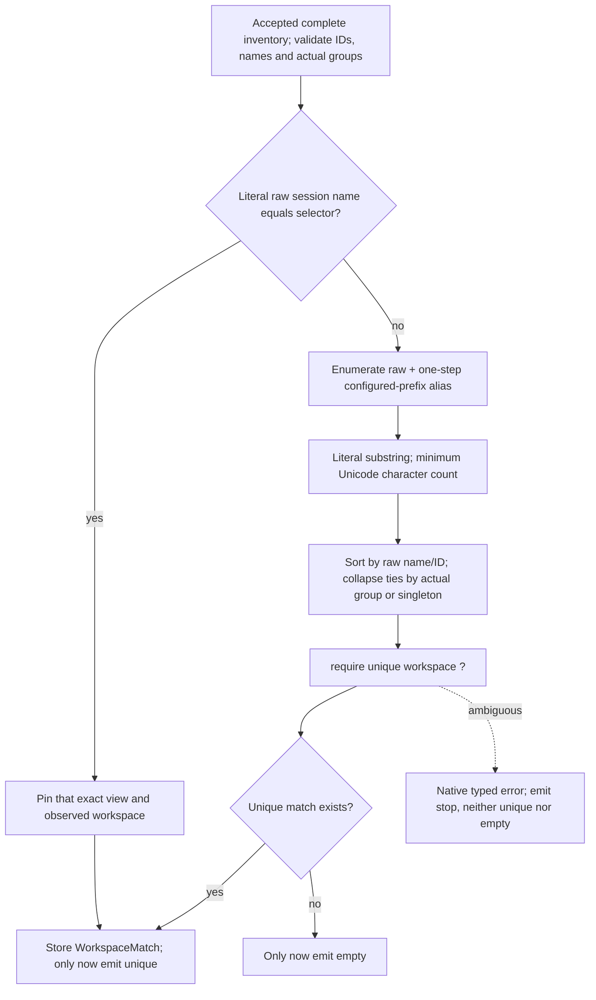

# Outcome and authority

**The first architecture-rewrite stage is implemented internally.** One retained
`EntryAttempt` now carries orphan-only running work through guarded selection,
an immutable `OpenView` or `EnterView` decision, a separate fresh-binding read,
and a coherent exported tmux action. It never calls the old workflow, core
resolver, scaffold resolver or runner loops. This is a new orchestration owner,
not a new wrapper around those APIs.

The parent explicitly conveyed the human's approval of
[Astra's destination](redesign0.gpt6a.md#review-decisions-and-recommendation):
retained mutable attempts, distinct semantic domain values, machine-owned
execution, stronger shared-entry and physical-route binding, a separate read-only
catalog, and breaking pre-1.0 replacement. That approval is recorded here without
editing the independent proposal's historical argument or verification claims.
It supersedes the earlier preservation recommendation for this commission.

Tracking: epic `tta-entry-attempt`; this stage `tta-entry-attempt-kernel`;
next `tta-entry-attempt-discovery`. The parent retains architecture review and
agent rotation. No agent was spawned by this session.

## Implemented versus future

| Implemented in this checkpoint | Not implemented or claimed here |
| --- | --- |
| Supplied frozen target context, parsed registry and once-selected generator | Target/environment acquisition or registry path walk |
| Retained xmachines actor and entry-emitted native directives | Runtime substitution, production replay or another state table |
| Process-local attempt/request/target correlation; exact request echo | Durable IDs, crash resume, server incarnation proof or locks |
| Validated complete session catalog and guarded session-first ranking | Project roots, physical routes, destination checks or creation |
| Semantic OpenView and EnterView, matched-by provenance and scoped identities | Startup argv/window policies on existing-work types |
| Fresh chosen ID/name/group binding for both decisions | Reranking, alternate anchors, retries or cleanup |
| One CLI create → enter → keep-last queue for OpenView | Split independent-view effects or native grouped creation |
| Read-only export to native expression and portable shell snapshot | Execute/delegate lifecycle, host driver, CLI/SSH/consumer adoption |
| Inert borrowed inspection, cloneable immutable snapshots/artifacts | Clone/Sync obligations for the active actor |

The internal `project_scope` chart entry deliberately stops with
`EntryError::DiscoveryNotImplemented` after a genuine session miss. It does not
call the old fallback. The next stage must replace this explicit staged boundary;
it must not publish that limitation as a new production behavior.

`lib.rs` keeps `entry` private with a narrowly placed staged `allow(dead_code)`.
The code is compiled as normal library source, not hidden in tests or supplied
through a compatibility facade. Remove that annotation at cutover. Public 0.7
APIs and existing consumers are unchanged, so there is no version bump yet. The
approved coordinated minor bump/exact pins/consumer lock belong to API cutover.

## Native ownership and progression

- `EntryAttempt::start(Invocation)` validates supplied target/intent, creates one
  actor and drains its initial directive. Its static compiled `Machine` is shared;
  its actor and native attempt data are not reconstructed or cloned.
- `ControlContext` is unit. Only `machine::Event` discriminants and the settled
  independent/shared bit cross serde. Fixed actor time is zero; there are no
  timers, child actors, observers or native callbacks in the runtime registry.
- `@xstate.emit` state entries yield a closed `Directive` enum. The exhaustive
  handler returns control result events or materializes one external request.
  The JSON alone chooses successor states, including ordered view-policy guards
  and inherited stop/cancel transitions. Native handlers cannot assign state IDs.
- `advance(Observed(...))` compares the full pending request before touching actor,
  data or journal: attempt/sequence, target binding, endpoint, purpose and program.
  Sessions are the only observation shape in this stage; wrong fact variants are
  currently impossible by type. Discovery must extend ingress shape checks before
  consuming pending state when it adds observation variants.
- A valid failure reply is an accepted observation, not a `ProtocolError`. Native
  errors stop at their actual boundary with an `Arc<EntryError>`; source types,
  bytes and nested causes survive snapshot cloning. Malformed complete inventory
  is a domain stop, never absence. A partial capture must be a failed observation.
- `waiting()` borrows the existing request/plan/outcome. `snapshot()` clones native
  artifacts and the journal without advancing, draining emissions or rematerializing.
  There is no native `current_phase`; the snapshot leaf is read from the actor.

The [generated structural graph](/doc/entry/attempt-graph.md) projects the actual
JSON's hierarchy, entry directives, initial routes and ordered guards. Its renderer
has no runtime role. Tests deserialize every emitted directive into the exhaustive
native handler vocabulary. The tests also cover the real engine's parent/child
emission order, explicit self-reentry and common parent exits.

### Guarded session resolution

This algorithm diagram is deliberately hand-authored; the executable chart calls
the guarded algorithm rather than moving each comparison into another actor.

The reused `workspace::select`, `satellite_alias`, `satellite_name` and
`resolve::validate_name` are small pure mechanics, not competing orchestrators.
`select::WorkspaceCatalog` validates observation contents. `WorkspaceMatch`
retains canonical view fingerprint, actual group/singleton identity, match reason,
endpoint and observation lineage. The shared-entry plan preserves workspace/match
provenance in `DecisionBasis` rather than losing it when selecting a view.

### Plan, binding and export

The orphan-only fixture contains `$42`, `view-project-42`, actual group `project`,
with configured prefix `view-` and no project-root inputs. Selection records an
alias match and a workspace-scoped anchor. Outside Auto becomes OpenView; Shared
becomes EnterView. Only Export starts the second read. The chosen anchor must
still have exactly the original ID/name/group; another member cannot rescue it.

For OpenView, allocation uses the fresh inventory's actual group members and
global complete names. The smallest free ordinary decimal suffix wins;
`view-project-01` does not occupy `view-project-1`, and an unrelated group's
`view-project-1` does. The logical base is never recursively decorated.
The bound action records the fresh request witness. EnterView targets the chosen
canonical ID, after the newly approved stronger shared binding check.

All plan data remains semantic/native. Even the validated view-directory path
remains a `PathBuf`; only the lowerer encodes tmux formats. The lowerer does not
choose work, default grouping or allocate names. It produces one tmux command
whose argv contains create, exact enter and keep-last separated by tmux queue
delimiters. It preserves hash-format encoding, semicolon operand escaping,
socket-label environment/startup policy and optional tmux config.

Shell output is a derived frozen artifact, not evidence of execution or later
freshness. Non-UTF-8 program/socket/config values survive through a native bound
action; shell rendering stops with the original `tta_command::Error::NonUtf8`.
The action remains inspectable and lowerable to native argv. Non-UTF-8 cwd is
retained even when unused by this existing-work action. Tmux view-directory's
UTF-8 boundary is constructor-checked and does not affect unused Shared options.

## Checkpoints and verification

Explicit owned-path commits:

1. **`d8f2055a`** — retained executable chart and compiled engine-fit witnesses.
2. **`5d268577`** — native attempt protocol, guarded semantic preparation, binding,
   coherent export and existing-work regression tests.
3. **`b92e00c1`** — protect literal project-looking `@2/foo` and wildcard-looking
   selectors in session-first matching before any project qualification.
4. Subsequent documentation/tooling checkpoint — this report, generated graph,
   renderer checks, approval/navigation updates and discovery handoff.

The `.beads/issues.jsonl` starting work and subsequent shared ticket edits remain
excluded from commits. No install, push, runtime dependency change, consumer edit
or unrelated switching/carrier/daemon feature was performed.

Focused commands and results are maintained in [the verification guide](/verification/entry/README.md).

| Check executed in this session | Result |
| --- | --- |
| Kernel nextest, launcher all features | **23/23 passed**, including parameterized policy, binding and protocol cases |
| Kernel nextest, launcher no default features | **22/22 passed**; optional-adapter case is feature-gated |
| Launcher all-target/all-feature clippy, no deps, `-D warnings` | Passed; dependency-owned tmax warnings remain unchanged |
| Launcher formatting check | Passed |
| Structural chart `--check` | Passed against the executable JSON |
| Python renderer regression tests | **4/4 passed**, including guard-array order, self-reentry and unsupported-structure rejection |
| `rkt check --okf` on the five owned Markdown documents | Passed, links/anchors/provenance checked |

These checks exercise the **new kernel**, not a rerun of the old giant acceptance
matrix. Prior real-terminal/SSH evidence remains attributed to the earlier
[port](xmachines-port0.gpt61sol.md) and [project-root](project-roots1.glm53max.md)
reports; it is not proof of a new production cutover. CLI/SSH/consumer/real-terminal
execution must be exercised when those hosts actually use this actor.

## Exact handoff to G: `tta-entry-attempt-discovery`

Read the full approved [redesign](redesign0.gpt6a.md), this report, ticket, actual
`entry/` code, [physical-root contract](/doc/entry/project-roots.md), `projects.rs`
and current scaffold adapters. Claim the existing ticket; preserve append history.
Keep this kernel internal and retain sequential explicit-path jj checkpoints.

1. **Replace `BeginProjects`**, not the attempt owner. Extend the same
   `entry.machine.json` after `sessions_rank.empty`: scope → required root read
   loop → guarded physical rank → new-work or creation preparation. Use explicit
   self-reentry for the next root (engine fit is tested). The discovery task owns
   a remaining-root cursor; the matcher must not return a request or next state.
   Preserve session-first interpretation of literal `@N/name` selectors.
2. **Extend `protocol.rs` and native artifacts**, not `workflow::Input`/fact slots.
   Add roots/startup/create inputs, root slots/routes and correlated request kinds
   for projects, destination, required defaults and physical binding evidence.
   `RequestId` is attempt + monotonically increasing sequence; target binding is
   frozen once. Keep endpoint/target/path/slot/purpose in exact request matching.
3. **Validate reply shape before `pending.take()`**. Add an exhaustive
   request-kind/observation-kind compatibility check, returning `ProtocolError`
   without any actor/data/journal change for wrong shapes. Native acquisition
   failure remains accepted and stopped, never empty/absent. Preserve explicit
   classified absence and complete-success requirements. New shape guards need
   wrong-kind, wrong-slot/path, stale and duplicate witnesses, not just enum tests.
4. **Reuse pure project primitives deliberately** (`projects::scope`, `sources`,
   `select`, matching) or move them to their new discovery owner. Finish all required
   roots before ranking. Distinct physical paths tie ambiguously; equivalent routes
   share one identity and retain every route, with deterministic chosen route.
   Qualified fallback observes only its selected root. Missing root evidence never
   proves absence. Do not call core/runner/scaffold resolve wrappers.
5. **Extend `EntryDecision`/`EntryPlan`/`BoundOperation`** with StartProject and
   ScaffoldAndStart. Keep chosen physical identity, selected route and all route
   provenance semantic and native; preserve startup/window policy only on new-work
   operations. Constructor-check names, paths and adapter specs once. Preserve
   `DecisionBasis` (or expand it into the appropriate typed basis), rather than
   losing alias/root/match provenance on a branch. Do not add `NativeCreation`
   sidecars or lower by converting back to legacy `Selection`.
6. **Split generator API** into validated spec → requirements → materialize.
   `prepare::generator` already selects one registry entry before session lookup;
   it must not materialize or validate unused adapter options on existing hits.
   Destination absence precedes adapter work; adapter options validate before
   required defaults; explicitly absent defaults are completed facts. Materialize
   once with actual facts, never fake empty defaults followed by rerunning resolution.
   Preserve the external name-only rekon multi-root refusal through a declared
   destination contract, not a generic resolver's adapter-name string comparison.
7. **Bind chosen physical routes and destinations freshly**, as explicitly approved.
   Extend `bind_action` to collect operation-specific witnesses without reranking:
   chosen route must still resolve to the observed physical directory; creation
   root/destination and exact lstat absence must still agree; fresh sessions check
   name availability. Plan-time destination absence is not binding-time authority.
   Keep existing-work's single fresh inventory and unchanged-anchor guards intact.
8. **Extend semantic lowering only** for complete short-circuit project/scaffold
   exports. Generation failure must prevent directory entry/session creation;
   creation failure must prevent handoff. Full execution/effect lifecycle belongs
   to cutover, host/catalog acquisition to the hosts stage. Do not sneak policy
   back into a runner to make a branch work sooner.
9. **Update/check the generated graph and tests**. The renderer understands
   ordinary nested states, initial edges, absolute/sibling targets, ordered guard
   arrays and reentry. Teach it new structural features explicitly; it intentionally
   rejects unknown entry actions. Keep pure errors native and directives exhaustive.
   Run focused new branch tests plus affected feature combinations, not old huge
   suites merely to confirm someone else's evidence. Return a bounded discovery
   checkpoint and next host-stage handoff; do not attempt all remaining tickets.

## Actual deletion obligations at coordinated cutover

These are source-inspected obligations, not claims of deletion in this stage:

| Current competing owner | Delete/replace; retain only named mechanics |
| --- | --- |
| `launcher/workflow.rs` and `workflow/machine.rs`/JSON | `Workflow::next/supply`, native replay slots, reconstruction, eight-state/action-free and clone/Sync conformance tests; semantic witnesses should move to new attempts |
| `launcher/resolve.rs` | `Resolution::{NeedProjects,NeedDestination}`, `resolve` scheduler and `Selection` entry surface; move name validation out before deleting the file |
| `launcher/scaffold.rs` | `resolve`, `resolve_with_config`, `Progress`, `Resolved`, repeated expression/default materialization; keep registry parsing/selection and refactored validated adapters |
| `runner/resolve.rs::resolve` | Its `resolve → Need* → resolve` loop; keep `project_inventory`, exact destination lstat and symlink/error classification as observation implementations |
| `runner/scaffold.rs::resolve` | Its second resolver/default loop and compatibility builder; keep registry/default acquisition as bounded observation |
| `runner/driver.rs` | Existing `drive(Workflow)` loop, old observer reply vocabulary and large prepare builder; replace with one request/effect interpreter, not another selection/policy layer |
| `target::Bootstrap` plus `runner/ssh.rs::prepare` | Independent bootstrap-before-workflow program and Setup/Workflow probe envelope split; keep frozen target shell/SSH options, framing, capture limits and diagnostic receipts |
| `launcher/plan.rs` and `prepared.rs` | `Selection + grouped + satellite_name` planner, duplicate defaults/classification and `LaunchPlan::native_creation` sidecar; retain literal command/tmux encoding mechanics under semantic action lowering |
| `runner/execution.rs::ExecuteLaunch for LaunchPlan` | Hidden post-plan backend-preflight decision and mutation/handoff program; put decisions/dispatch boundaries in the same actor, keep low-level execution mechanics |
| `app/cli/src/main.rs` | Duplicate `operation` match and separate discovery/completion branches; derive labels from semantic decisions, drive the same protocol and query the read-only catalog |

Before deleting public surfaces, adapt the actual term-preserver local/SSH call
sites and receiving lock as required by the approved cutover. No consumer was
forced to port prematurely. Stage 5 promotes the complete destination account and
retires preservation-specific machinery; this stage's graph/report are evidence
for that work, not a declaration that the rewrite is already delivered.
