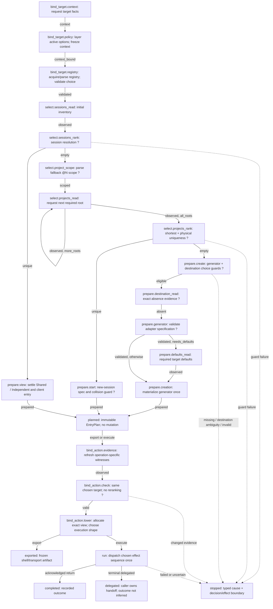
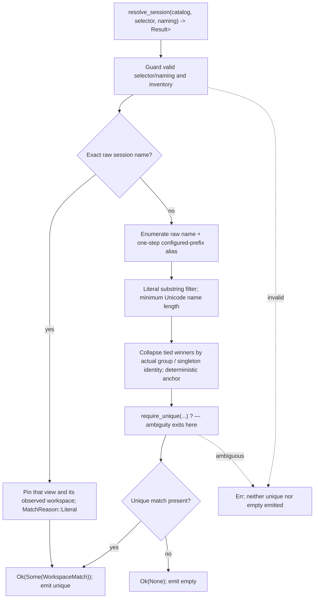
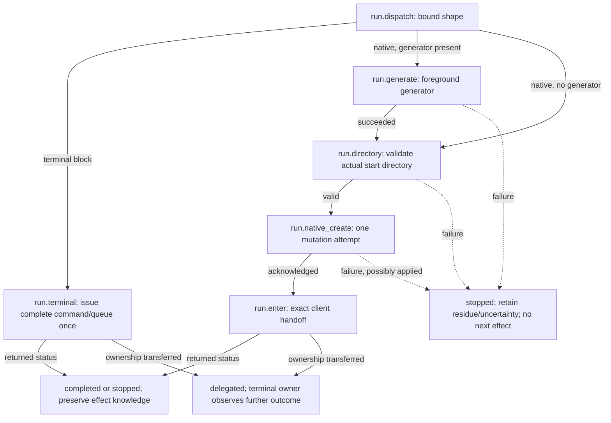

# Recommendation: tta owns an entry attempt

**Rebuild tta around an event-driven `EntryAttempt`, from target binding through
selection, preparation, effect dispatch and terminal handoff.** The machine owns
the course of an attempt. Native Rust domain functions compute its decisions;
replaceable hosts perform its effects. An immutable plan is an inspectable product
of the attempt, not the object that secretly owns the rest of its lifecycle.

This is a destination proposal for review. No production implementation is part
of this document. The human's correction explicitly reopens architecture: the
previous faithful port and preservation review are useful evidence, not a veto
on changing APIs, layers or replay. Delivered 0.7 outcomes remain the acceptance
baseline; closing their tickets did not accept this destination or its predecessor.

The central change is **from “rerun the resolver until it can build commands” to
“advance one explicit entry decision, request its evidence, and carry out its
chosen operation.”** That is an architectural change even if the first released
CLI spells every command exactly as it does today.

## What changes structurally beyond routing the old workflow?

1. **There is one orchestration owner.** Target setup, project fallback,
   creation preparation, view binding and backend preflight become chart states.
   Delete the resolver APIs that return `NeedProjects`/`NeedDestination` and the
   three wrapper loops that repeatedly call them. Matching no longer schedules I/O.
2. **The machine persists for the attempt.** `advance(event)` changes its state
   once. Inspection reads a stable snapshot. No fresh actor or reconstructed
   selection on every `next()`, and no `supply()` calling `next()` to rediscover
   what it was waiting for. This is about ownership and interaction, not a claim
   that microsecond replay costs are the user's main problem.
3. **Work, views and projects become different domain values.** A selected tmux
   session is an anchor/view of shared work; a project directory is a possible
   source for starting work. A new-view decision is neither a project creation
   nor a boolean decoration of an arbitrary `Selection`.
4. **Plans describe operations before encoding them.** `OpenView`, `EnterView`,
   `StartProject`, and `ScaffoldAndStart` are distinct decisions. Grouping defaults
   are settled once. Shell and native execution lower the same semantic decision;
   a portable expression and a native candidate are no longer parallel truths.
5. **“Prepared” stops pretending to be the end of entry.** Freshness checks,
   backend eligibility, generation, creation and handoff have explicit ownership
   and failure outcomes. A completed read, a dispatch, an acknowledged creation
   and a replaced process are different events. CLI, SSH and embedding use this
   same protocol at the boundaries they actually own.
6. **Discovery is independently useful.** A read-only catalog query shares target
   policy, acquisition and candidate identities with entry. Completion projects
   candidates rather than invoking an entry operation or recreating discovery in
   command-specific branches. Partial catalog failure remains visible as partial
   evidence; it can never become an entry miss.

The payoff is a system that can naturally explain a selection, suspend while an
embedding supplies evidence, distinguish an unresolved choice from missing work,
and report where an attempted entry stopped. These are first-class semantics,
not log strings inferred from the shell command afterwards.

## Why the present organization obstructs that destination

The current graph is real: it chooses successors, and its diagrams are checked.
Its limitation is what remains outside that graph, not that the runtime is fake.

| Current evidence | Architectural consequence | Destination |
| --- | --- | --- |
| `workflow.rs:147–287` reconstructs local `resolved`, `pending`, defaults and satellite variables on every pull | The public “workflow” is a bag of historical facts; current decisions have no owned lifetime | Retained actor and native decision artifacts, advanced once per accepted event |
| `resolve.rs:93–148` selects sessions, chooses root observations, detects creation scope and asks for destination facts | A function named resolution is also an implicit scheduler | Separate guarded selection kernels; chart owns observation and fallback transitions |
| `scaffold.rs:117–169` chooses a generator, reruns resolution and materializes its expression; defaults arrive afterwards | Selection and adapter generation are repeatedly interleaved | Select generator policy once; validate adapter spec on creation; observe its requirements; materialize once |
| Runner `resolve.rs`, runner `scaffold.rs` and `driver.rs` each drive forms of the same process | Multiple public routes perpetuate lifecycle/validation duplication | One driver for entry; simple observers remain reusable |
| `target::Bootstrap` plus `ssh::prepare` have their own progression and wrapping request enums | Remote bootstrap is a separate mini-application before entry starts | Target binding is the first compound state; one request/reply protocol |
| `plan.rs` defaults grouping again and stores both an expression and `NativeCreation` | A lowerer still makes user policy; semantic and executable data overlap | Validated `EntryDecision` and one bound operation lowered by chosen executor |
| `execution.rs:48–103` observes live-server eligibility and branches after ready | The most consequential late decision is invisible to the entry graph | Binding/preflight state chooses native versus CLI before any mutation |
| CLI `main.rs:317–326` reconstructs operation labels from selection/mode/group | Reporting contains a third classification of intended behavior | Decision and execution-phase labels come directly from attempt state |
| Local `environment.rs`, `target::Facts::input`, runner config loading and consumer code layer related options | Host provenance and policy are entangled with acquisition and caller surfaces | Pure shared policy over supplied host context; adapters only collect values |

A concrete small divergence illustrates the last row: `environment.rs:51–55`
decodes `TTA_ROOTS` before checking explicit roots, although its comment says a
replaced layer is never parsed. A non-UTF-8 replaced variable can therefore fail
locally before the shared precedence helper runs. This is a source-level finding,
not an executed reproduction in this design session. The redesign should make
whole-layer selection precede decoding, rather than repair that class of drift
independently in each frontend.

## Credible destination shapes

| Shape | Where it helps | What it costs or fails to solve |
| --- | --- | --- |
| **A. Better pure planner:** retain preparation-only graph, persist its cursor, split scaffold validation | Smallest change; removes replay and some duplicate validation | Backend preflight, target setup, consumer interaction and effect lifecycle still live in separate applications; too narrow for this commission |
| **B. Owned entry protocol — recommended** | One attempt, explicit domain decisions and correlated effects; same policy under CLI, SSH, embedding and inspection | Breaks public API; requires a disciplined native-data/runtime adapter and honest handoff outcomes |
| **C. Long-lived workspace manager:** persistent workspace IDs, project associations, resident target agent, reconcile clients/views | Could make root-to-workspace rendezvous, reusable named views and cross-transport management automatic | Adds durable identity/storage, installation and lifecycle authority that tta does not currently need; weakens worker-free SSH simplicity; not justified as the default rewrite |

B is substantial without becoming a daemon. It also leaves a clean seam for C:
a later workspace registry would supply explicit bindings, not silently grow out
of satellite-name parsing. Prefer B over A because the human asked to revise the
application's backbone; prefer B over C because the actual consumer owns a
per-attempt worker and tmux already owns durable running work.

## Domain model: name the things the machine is deciding about

### Work, view, project, target

- **Target** is a host/setup context plus a resolved tmux endpoint. The same
  `/tmp/tmux-1000/default` spelling on two hosts is not the same endpoint.
  Freeze target cwd and setup once; carry their identity on every request.
- **Workspace** means shared tmux windows/processes in one observed server:
  actual group membership, or a singleton ungrouped session. Its key is scoped
  to a target and observation lineage. Group names are not globally durable IDs.
- **View** means one tmux session's window selection over that workspace. Both
  the original session and a satellite are views. “Base” and “satellite” are
  allocation/lifecycle roles, not two kinds of running work.
- **Project** means an observed physical directory plus its configured entry
  routes. Root slots and basenames are selectors; canonical path equality is the
  existing physical-identity rule, not proof of inode/bind-mount equivalence.
- **Entry** is the relationship being established for this invocation: enter a
  selected view, open an independent view, or start work from an existing/new
  project. Terminal transport and caller grouping policy influence entry, not
  project identity.

There is deliberately no inferred project↔workspace equivalence. Session-first
matching remains. A directory named `foo` and group alias `foo` are related names,
not an authoritative binding. An explicit future binding needs real metadata and
its own user decision.

### Intent, evidence, decision and effect

```rust,ignore
// Proposed domain/API sketches; supporting newtypes are abbreviated.
struct EntryIntent {
    selector: SelectorText,       // original literal; @N parsed only after session miss
    view: ViewPreference,         // Auto | Independent | Shared
    create: CreatePreference,     // Off | DefaultGenerator | NamedGenerator
    startup: StartupSpec,         // native argv, pane cwd, initial window policy
}

struct Invocation {
    target: TargetSpec,           // local context acquisition or explicit remote setup
    overrides: Overrides,         // values with presence; not prefilled CLI defaults
    caller: CallerPolicy,         // defaults, client context, permitted delivery
    intent: EntryIntent,
}

struct WorkspaceRef {
    endpoint: EndpointKey,
    key: ObservedWorkspaceKey,    // actual group or singleton ID, observation-scoped
    anchor: ViewFingerprint,     // ID + name + actual group used in this decision
    matched_by: MatchReason,
}

enum EntryDecision {
    EnterView { view: ViewRef, via: ClientEntry },
    OpenView { work: WorkspaceRef, naming: ViewNaming, via: ClientEntry },
    StartProject { project: ProjectRef, session: NewSessionSpec, via: ClientEntry },
    ScaffoldAndStart {
        destination: CreationSite,
        generator: ValidatedGenerator,
        session: NewSessionSpec,
        via: ClientEntry,
    },
}

enum ClientEntry {
    AttachTerminal,
    SwitchWithinServer { context: SwitchContext },
}

struct EntryPlan {                // immutable, Clone; private validated construction
    decision: EntryDecision,
    evidence: DecisionBasis,      // request IDs, roots/routes, match reasons, assumptions
    target: BoundTarget,
}
```

`SwitchContext` records what is actually known. Existing same-server/heuristic
switching can be represented honestly; it must not be named `InvokingClientId`.
The separately paused guarded-switching work remains a separate behavior choice.
The redesign provides a place for that future observation/guard without claiming
to infer origin from a shared pane.

Names safe for tmux, absolute target paths, chosen view policy and validated
adapter specs become constructor-checked values. Public input constructors
validate; private lowerers accept those values rather than repeat the same checks.
Do not retain several unsafe-but-public low-level entry paths merely to justify
revalidation everywhere. Keep a supplied-context constructor for embedders; its
input is the same validated context type produced by acquisition.

## The entry chart

The following is the proposed **state vocabulary and transition structure**, not
a claim that the current JSON implements it. Hierarchical paths correspond to
Rust handler modules: `bind_target`, `select`, `prepare`, `bind_action`, `run`.
Ellipses inside labels summarize a compound state's internals, not alternate
hidden schedulers.



All read and pure preparation states also stop on their own errors. These common
exits are elided from the overview for readability; the executable compound chart
should encode them on the enclosing state. `stopped` records an attempt outcome;
**ambiguity is still an error guard before either `unique` or `empty` is emitted**.
There is no ambiguous→missing edge. No interactive confirmation is added to normal
CLI use: its requested output mode automatically supplies `export` or `execute`.
An embedder may deliberately pause at `planned`.

`projects_read` self-transition re-enters to issue the next request. Its remaining
root cursor belongs to the discovery task, and the `more_roots` predicate describes
that task; no matcher returns a next-root request. A rootless session hit never
reaches `project_scope`. All required roots must succeed before project ranking.

`bind_target.registry` contains the current registry path walk for remote probes;
local acquisition may answer the same semantic registry request with one read.
Keep the walk and its failure classification in the observer implementation, not
as another public entry orchestrator. A runner-free shell observer can expose its
own bounded acquisition task when multiple probes are necessary. That task only
acquires one requested fact; it cannot select work, generators or next entry states.

### Separate session-resolution chart

This is a guarded domain algorithm invoked by `select.sessions_rank`. Candidate
loops remain ordinary Rust; making each string comparison an actor adds nothing.



Exact alias matches win through their minimum length, as today. Collapse is after
ranking, not an invitation for longer group members to compete. `WorkspaceMatch`
retains the matched view, representative/anchor, actual group and reason; it does
not discard workspace information into `Selection::Existing(Session)`.

```rust,ignore
fn rank_sessions(data: &mut AttemptData) -> Result<ControlEvent, EntryError> {
    // The error guard happens BEFORE any selected/missing continuation.
    let found = resolve_session(&data.catalog, &data.intent.selector, &data.naming)?;
    Ok(match found {
        Some(found) => {
            data.matches.store_workspace(found);
            ControlEvent::Unique
        }
        None => ControlEvent::Empty,
    })
}
```

The ingress pump catches that typed `Err`, records it natively and sends `stop` to
the enclosing chart. It does not serialize the cause or turn it into `empty`.
Project ranking has the same contract over physical identities and root routes.

## Machine, native data and caller protocol

### Owned progression, stable inspection

```rust,ignore
struct EntryAttempt {
    control: Actor<ControlContext, ControlEvent>,
    data: AttemptData,             // native paths, argv, specs, facts and typed causes
    pending: Option<Pending>,      // one correlated external request/effect initially
    journal: Vec<AttemptRecord>,   // decisions and boundaries, not a durable event store
}

struct RequestId { attempt: AttemptId, sequence: u64 }
struct ReadRequest { id: RequestId, target: TargetBindingId, kind: ReadKind }
struct ReadCompletion {
    id: RequestId,
    target: TargetBindingId,
    result: Result<Observation, ObservationFailure>,
}

enum ReadKind {
    TargetContext,
    Registry { path: Option<TargetPath> },
    Sessions { endpoint: EndpointKey, purpose: SessionReadPurpose },
    Projects { slot: RootSlot, root: TargetPath, filter: String },
    RootIdentity { slot: RootSlot, root: TargetPath },
    Destination { path: TargetPath },
    ProjectIdentity { route: ProjectRoute },
    GeneratorDefaults { cwd: TargetPath, needs: DefaultRequirements },
}
enum SessionReadPurpose { Selection, BindAction }

enum Waiting<'a> {
    Read(&'a ReadRequest),
    Planned(&'a EntryPlan),
    Effect(&'a EffectRequest),
    InFlight(EffectId),
    Finished(&'a AttemptOutcome),
}
enum Event {
    Observed(ReadCompletion),
    Deliver(Delivery),             // Export | Execute; caller chooses at Planned
    EffectStarted(EffectId),       // driver records dispatch before touching the target
    EffectFinished(EffectCompletion),
    DelegateTerminal(EffectId),    // transfers this outstanding terminal effect
    Cancel,
}
impl EntryAttempt {
    fn start(invocation: Invocation) -> Result<Self, InputError>;
    fn waiting(&self) -> Waiting<'_>; // no progression, replay or trace emission
    fn advance(&mut self, event: Event) -> Result<(), ProtocolError>;
    fn snapshot(&self) -> AttemptSnapshot;
}
```

Domain and observer failure are accepted events ending in `AttemptOutcome::Stopped`;
`ProtocolError` means an invalid ID, wrong fact type/target, duplicate reply or
illegal event. Protocol rejection leaves the waiting state intact. The ordinary
blocking `prepare`/`run` conveniences can translate a stopped outcome to a typed
`Result` with its original source chain. No caller is forced to parse a journal.

One outstanding read/effect is sufficient for the first implementation. A pending
request is issued once; `waiting()` can be called repeatedly without issuing it
again. Distinguish selection and commit/binding inventories by purpose and ID,
not by whether `sessions: Option<_>` happens to be populated. Replies are bound
to exact paths, root slots, endpoint and target setup as well as their enum kind.

An observation says what was observed, not “the world is still like this.” Empty,
absent, failed, incomplete and not-yet-requested are different values. No core
clock or implicit expiry policy is necessary. Refresh is an explicit chart state
at a known boundary, not a cache timer or automatic rerun after failure.

`AttemptSnapshot` and `EntryPlan` may be cloneable, immutable and shareable. The
active attempt has one mutable owner; remove the public obligation to clone or
concurrently pull it. Transfer between threads can be supported where the actual
runtime types permit it, but no consumer currently needs shared mutable access.
A reproducible supplied-facts transcript is still valuable for tests. Replaying
one creates a **new** read-only test attempt; it is not the runtime's progression
implementation or a way to resume uncertain mutation.

### xmachines fit and the concrete integration

Keep the human-selected `xmachines-runtime =1.1.0`. Inspection of the installed
crate confirms retained `Actor`, host-driven time, `send`, `active_leaf_ids`,
`take_emitted`, hierarchical definitions and pure host-driven effects. It also
confirms that actor context must be serde-compatible and that `send` converts
events to JSON. Runtime execution errors persist a message representation; that
is unsuitable as the storage for tta's native typed source chains.

Recommended adapter:

1. The chart emits small **internal directives** on state entry, using built-in
   `@xstate.emit`. Examples: `read_sessions`, `rank_sessions`, `validate_generator`,
   `bind_operation`, `dispatch_terminal`. The attempt pump drains `take_emitted()`.
2. A closed native `Directive` enum implements each directive against owned
   `AttemptData`. Pure directives produce result events/artifacts; external ones
   materialize a correlated pending request and return to the caller. They never
   choose a successor state or call an observer.
3. `ControlContext`/`ControlEvent` carry only serializable discriminants, counters
   and validated outcome summaries such as `more_roots` or `needs_defaults`.
   Paths, raw argv, generator implementations and errors remain native. Artifacts
   are stored in typed slots/collections tied to their issuing state; there is no
   second Rust `current_phase` that independently decides transitions.
4. One ingress function checks pending IDs and shapes, installs the native result,
   then sends the corresponding control event. Unexpected chart directives or
   missing required artifacts are development invariants; ordinary remote read
   failure is an explicit stopped outcome.
5. Use fixed time zero initially. No timers, background observation, child-per-root
   actors, JSON snapshots of native state or hidden I/O in registry callbacks.

This skeleton illustrates the intended code/chart resemblance:

```json
{
  "id": "sessions_rank",
  "entry": [{ "type": "@xstate.emit", "event": { "type": "rank_sessions" } }],
  "on": {
    "unique": { "target": "#prepare_view" },
    "empty": { "target": "#project_scope" }
  }
}
```

The final JSON also gives parent-level stop/cancel routes and explicit IDs.
Unlike today's state polling, directives execute once on real state entry. Unlike
today's `scaffold::resolve`, no directive returns `NeedProjects` to determine the
next stage. The graph names the policy transitions and the operations they cause.

This integration still has a native-data adapter; serde does not disappear by
calling the design “machine-powered.” Keep it small and visible. Native typed
payloads and errors are a reason **not** to move all domain code into JSON or
runtime callbacks. The runtime earns its place by owning substantial lifecycle,
hierarchy and effect boundaries, not by serializing every fact.

The first implementation slice must verify entry emission/self-transition order,
typed-error retention, stale/duplicate response rejection and native-byte survival
with a retained actor. Source inspection supports the approach; this document
does not claim a compiled prototype. If that adapter requires a second transition
table or loses native data, stop and present a focused engine-fit decision.
Statig is the allowed Rust-first fallback to evaluate **then**, with explicit
human approval; there is no silent dependency switch or evidence here of a tested
Statig advantage.

### Diagrams that remain trustworthy

Use one executable entry definition. Generate its structural Mermaid subgraph
(IDs, entry directives, transitions and ordered guards) and place explanations
around it. Check that every emitted directive has a Rust handler and that no
handler can assign a successor state. Keep the separate resolution chart
hand-authored beside the small guarded ranking function, with algorithm tests
covering its ordering. Do not declare algorithmic truth from graph-edge equality.

The current exact-route checker is a useful precedent, but its test requiring
exactly eight states and no actions must be retired. Tests should protect user
outcomes and single ownership, not the shape the redesign was commissioned to
replace. The proposal diagrams above are manually authored design sketches;
generation belongs to the implementation, not this documentation checkpoint.

## Preparation, binding and effects

### A plan is a decision; a bound action is executable

`EntryPlan` fixes **which work and kind of entry** were chosen. It contains neither
a backend sidecar nor a claim that a name remains free. `bind_action` consumes
fresh evidence relevant to that decision, creates an immutable `BoundAction`, and
records the witnesses used. Export lowers that bound action to a shell snapshot;
direct execution uses it immediately. Both modes remain observation-only until
an effect is actually dispatched. A CLI need not expose these as extra commands.

| Decision | Binding evidence and operation |
| --- | --- |
| `EnterView` | Recheck chosen ID/name/group on the same endpoint; target canonical ID |
| `OpenView` | Recheck anchor ID/name/group; derive logical base from that actual group; allocate smallest globally unused complete name; one create→enter→keep-last tmux queue |
| `StartProject` | Recheck selected route still resolves to the observed physical directory; fresh sessions prove current name availability and native-live eligibility |
| `ScaffoldAndStart` | Recheck chosen physical root/destination and exact lstat absence; fresh sessions check name availability/eligibility; retain the selected validated generator and defaults |

The first implementation retains anchor-change fail-closed behavior. It does not
rerank, attach another group member or turn changed facts into a scaffold miss.
`EnterView` revalidation and physical-route binding are **proposed strengthening**
over current behavior, not claims about 0.7. Rechecking destination at binding
after its preparation-time absence check is deliberate: one authorizes preparing
a creation, the other checks the already-chosen action after possible caller
delay. This is not accidental resolver replay.

None of these observations locks tmux or the filesystem. Server-local IDs and
group names can be reused after server restart; today's observations provide no
strong incarnation proof. Keep endpoint/observation scope honest. A reliable server
generation token would require verified acquisition support before it could close
that race. Concurrent mutation can still cause exact-target failure, and a script
evaluated later remains stale. Preserve no blind retries and no `new-session -A`.

### Backend selection becomes a pure decision before mutation

Bound execution shape is selected from decision, client context, raw-argv support,
host capabilities and fresh server facts:

- Native detached creation is eligible only for the currently supported local,
  live-server, inside-switch, representable-argv case. Record that reason.
- Cold/sessionless creation, outside terminal startup and raw Unix argv use the
  real CLI path. This is a planned choice before mutation, not error fallback.
- Independent views always preserve their coherent tmux queue on current
  backends. Do not split a queue merely to draw more execution states.
- SSH uses target CLI operations carried by one prepared terminal invocation.
  Probe and handoff share frozen target setup and connection policy.

Pure lowerers preserve the existing tmux-format escaping, trailing-semicolon
handling, literal argv, singleton executable handling and POSIX rendering limits.
Retain `tta-command` as the generic expression model. Shell rendering can reject
non-UTF-8 while direct local execution keeps raw supported bytes.

```rust,ignore
enum BoundOperation {
    EnterView(ExactViewEntry),
    OpenView(CoherentViewQueue),
    Start(StartOperation),
    ScaffoldAndStart { generator: GeneratorProgram, start: StartOperation },
}
enum ExecutionShape {
    TerminalBlock,       // complete CLI expression; may include generation/creation
    NativeCreateThenEnter,
}
struct BoundAction {
    operation: BoundOperation,
    shape: ExecutionShape,
    basis: BindingEvidence,
}

enum EffectKind {
    Generate(GeneratorProgram),
    CheckCreatedDirectory(TargetPath),
    CreateNative(NativeCreate),
    Terminal(TerminalAction),
}
enum EffectOutcome {
    Succeeded(EffectReceipt),
    Failed { cause: EffectFailure, mutation: MutationKnowledge },
}
enum MutationKnowledge { NotStarted, MayHaveOccurred, Acknowledged }
```

`CheckCreatedDirectory` is a post-generation observation in the execution phase,
not another selection opportunity. It retains the existing requirement that a
generator actually produced the expected directory before session creation.
An effect request includes an attempt-scoped ID. The driver consumes it once and
reports its outcome; identifiers do not promise exactly-once effects across a
process crash or hostile/misbehaving caller.

Each effect state has `requested → in_flight` substates. The driver sends
`EffectStarted(id)` before invoking the operation, then `EffectFinished`; another
start with that ID is rejected. `Waiting::InFlight` cannot issue the effect again.
This is a record of dispatch intent, not proof the target received it. Cancellation
before dispatch prevents dispatch; cancellation after dispatch stops further work
and preserves possible mutation until stronger evidence arrives. Earlier successful
effects remain acknowledged even if the current effect never started. Read
cancellation has its own host cleanup and cannot erase prior mutation receipts.
The overview collapses these identical effect substates; the executable graph and
generated detail should expose them.

### Focused execution lifecycle



A terminal block is coherent, **not transactional**. Its internal short-circuiting
ensures generation failure prevents creation and creation failure prevents entry;
the parent machine cannot claim each remote substep succeeded from one aggregate
exit status. Report `MayHaveOccurred` when granularity is unavailable. After an
acknowledged native create, an output-forwarding or handoff failure records that
creation happened rather than merely saying “launch failed.” No automatic cleanup,
rollback, alternate backend or mutation retry is introduced.

Successful `exec` never returns. The runner records a handoff attempt before it;
it must not record observed successful attachment afterwards. When an embedder
requests the command, `DelegateTerminal(effect_id)` transfers ownership and ends
tta's attempt with that fact. The consumer may report a later outcome itself.
No persistent supervisor or terminal implementation is required.

Export always selects portable terminal-block lowering, even when a direct local
delivery could use native creation. This preserves a complete CLI expression and
keeps `--print-shell` from producing only the tail of a native action. Delegation
transfers a still-undispatched terminal request; it is distinct from reporting a
locally dispatched effect's completion.

## Discovery, completion and interaction

Use a separate **`CatalogQuery`**, not `EntryAttempt { dry_run: true }`. It uses
the same target-context/policy constructor, `ReadRequest` types, observation
adapters and candidate constructors, but its graph has only bind→collect→report.
It cannot issue mutation effects or yield an `EntryPlan`.

The query returns typed workspace aliases, literal view selectors, project routes,
identity groups and per-source failure. Entry needs complete success over its
required sources. Completion may show successful session candidates even when a
project root fails, while retaining that failure for diagnostics. Bare project
names are offered only when complete required root evidence establishes their
unique physical identity. Missing root evidence must not certify a bare name.
Qualified results from successfully observed roots can still be offered.

This unifies candidate meaning without confusing completion with winner selection:
Tab keeps all useful aliases and wildcard filtering; Enter keeps literal
session-first shortest matching. Names such as `@2/foo` are typed project-route
candidates, not strings whose significance each frontend has to rediscover.
The line-oriented Zsh adapter still filters control characters and escapes text.

The initial `EntryAttempt` treats ambiguity as a typed stopped result with the
tied candidates and their explicit selectors. CLI prints the diagnostic, as now.
An interactive caller can present those candidates and start a **new attempt**
with the user's exact selector. This is preferable initially to preserving a
half-live failed resolver and pretending old evidence authorizes the new choice.
A future `AwaitChoice` interaction can be added deliberately, with revision-bound
candidate tokens and fresh binding, if avoiding full re-discovery matters.

## Journeys that exercise the new backbone

### 1. Orphan view rendezvous without a project directory

Only `view-project-42` remains, in actual group `project`, prefix `view-`.
`bind_target` validates supplied context/registry; `sessions_read` observes it.
`resolve_session("project")` yields a workspace match through a one-step alias.
`prepare.view` settles `OpenView` for outside `Auto`. No root read occurs.
Binding re-observes the chosen anchor and global names, allocates
`view-project-1`, and dispatches the coherent queue. Startup argv is irrelevant
to existing work and cannot leak into that operation's type.

**Leverage:** the plan explicitly says “new view of this workspace,” with its
alias reason and anchor. CLI diagnostics, embedding UI, allocation and execution
consume that same decision. If the anchor changed, the attempt stops at binding;
there is no path from that failure back to project creation.

### 2. Duplicate roots are a choice, not list-order priority

No live session matches `foo`; `/personal/foo` and `/team/foo` are distinct physical
directories. The chart obtains both root inventories before `projects_rank`.
Its uniqueness guard returns a structured ambiguity containing `@1/foo` and
`@2/foo`; neither `unique` nor `empty` is sent. Completion can expose those same
routes. A new `@2/foo` attempt searches sessions using the original literal first,
then observes only root 2 on fallback. A `--session-name team-foo` produces a
`StartProject` decision with physical identity and selected route intact.

If both routes resolve to one directory, ranking yields one physical winner and
retains both routes. Root order picks presentation/entry route, not work priority.
**Leverage:** candidate identity is shared by query, diagnostics and binding;
there is no unqualified flattened string list to repair at every frontend.

### 3. Clean miss and scaffold

`@2/new-project` misses sessions and its selected root. The chart checks generator
availability, explicit creation site, safe names and session collision. Exact
destination absence precedes adapter/default work. Adapter validation yields a
`ValidatedGenerator` with requirements and destination capability; required
author/license facts are then observed once, and the generator program is built
once. No preliminary expression is built with fake empty defaults.

An external name-only `rekon` adapter reports its actual destination contract.
Preserve today's multi-root refusal in the first landing; do not bury it as a
string comparison in general resolution. Tightening its existing single-root
divergence is a separate review decision, not a silent behavior change here.
Native adapter declares selected-root support.

The plan's destination is fixed. At delivery, binding checks it again; a new
file/dangling link stops the attempt. Direct native execution proceeds through
generation→directory validation→create→handoff; portable/SSH execution uses the
complete short-circuit block. **Leverage:** requirements, destination authority,
decision and partial execution each have one owner and a meaningful failure point.

### 4. Target-local SSH

The caller supplies destination, SSH options and explicit overrides, not locally
expanded launch defaults. The first target-context request observes physical cwd,
UID and relevant environment; the binding is frozen for later probes and action.
Shared policy selects target `TTA_ROOTS`, registry, tmux program and prefix.
Local `TMUX`, HOME and roots do not leak across this boundary. Attach is explicit
because this is a new remote terminal, regardless of the local pane.

The same entry chart requests sessions/projects/defaults; the SSH observer emits
and decodes the existing nonce-bound probes, preserving complete-EOF checks and
diagnostic receipts. It later renders one target action into the same setup and
connection policy. Truncated capture stops at a read state; transport loss after
terminal dispatch stops with possible mutation. **Leverage:** SSH changes the
fact/effect interpreter, not the policy application or orchestration loop.

### 5. Embedding and completion

term-preserver constructs the invocation inside its existing local attempt worker.
Its explicit `tmux_group` becomes Shared/Independent, never Auto. It drives local
effects or asks tta to delegate the bound SSH terminal command to its existing
transport. Proxy, PTY, master options and retry prompt remain consumer-owned.
A user retry creates a new attempt and new observations. A mutable attempt needs
no `Clone + Sync` promise because these actual call sites are sequential workers.

Its completion can adopt `CatalogQuery` under `tta-lib`. Its non-library build
already maintains independent completion and roots policy; that is a real feature
obligation, not an excuse to force in the runner. Decide whether to retain that
standalone implementation with shared contract fixtures or depend only on a small
pure discovery module. Recommend fixtures first; split a crate only if the actual
dependency/features make that useful.

**Leverage:** richer callers can show “opening another view,” “need target root
facts,” or “created; handoff failed” without decoding shell source or reconstructing
tta policy. The minimal blocking API can still be one call plus delivery.

## Ownership and concrete source migration

Use domain modules within the existing core/runner package split before deciding
whether any new crate boundary earns its cost. No mass physical reorganization is
needed to establish the new architecture.

| Proposed owner in `session/launcher/src/` | Responsibility | Current material |
| --- | --- | --- |
| `entry/{mod,protocol,machine}.rs` + `entry.machine.json` | Owned attempt, events, pending correlation, graph, inspection | Replace `workflow.rs` and current machine adapter |
| `entry/select.rs`, `entry/prepare.rs`, `entry/bind.rs` | Pure state-entry directives, typed artifacts, decision construction | Split behavior out of `resolve.rs`, scaffold wrapper and planner |
| `context/{mod,policy,endpoint}.rs` | Supplied host context, whole-layer precedence, target binding and client policy | Unify core `target::Facts::input`, socket policy and CLI layering; preserve raw local values |
| `discovery/{catalog,workspace,projects,matching}.rs` | Candidate identities/provenance, guarded ranking, completion projection | Retain/refactor current matching, workspace and projects algorithms |
| `generation/{registry,adapter}.rs` | Generator selection, validated spec, requirements and destination contract | Keep parsing; remove scaffold's resolver wrapper and generic adapter-name policy |
| `action/{mod,tmux,shell}.rs` | EntryPlan, BoundAction, operation-specific lowering and coherent queues | Replace `Selection + prefix + grouped + satellite_name` planner surface and `NativeCreation` sidecar |
| `observation/{mod,probe}.rs` | Read vocabulary and pure probe codecs; acquisition subtasks | Flatten Setup/Workflow wrapper protocol; preserve framing/classification code |
| `target/shell.rs` | Literal setup/carrier construction | Retain existing target shell encoding, separated from entry policy |

Runner ownership becomes `observe/{local,ssh}`, `execute/{local,ssh}`, bounded
`capture`, and a small shared `drive` loop. Native and CLI remain selectable
capabilities, not policy implementations. The driver matches `Waiting`, performs
the requested operation, and sends the reply. It must not inspect a fragment,
choose a generator, default grouping, allocate a view or rerank a selection.

**Delete on migration:** `Resolution::{NeedProjects,NeedDestination}`, public
core/runner/scaffold resolver builders, `scaffold::Progress`/`Resolved` as entry
wrappers, replay fact slots, `next()` reconstruction, SSH's independent bootstrap
entry loop, `LaunchPlan::native_creation`, and CLI's duplicate operation matrix.
Remove the old workflow surface once its actual consumers use the new one.

**Keep as proven mechanics:** rank/alias/group rules, project identity/provenance,
root precedence semantics, name validation, socket label startup policy,
literal expression model, tmux escaping, bounded captures, probe framing/errno
classification, local filesystem acquisition, generator command recipes and
real-terminal/SSH verification tooling. Refactoring those into their new owners
must not be mistaken for reproducing all of them from scratch.

**Change deliberately:** adapter `validate → requirements → materialize` API;
attempt/event/error surface; semantic action representation; context layering;
completion's typed result surface; execution result reporting. The source tree
and the diagram should expose these domain owners, not a new generic workflow
framework with “jobs,” plugins and mutable global registries.

## Invariants and failure decisions

1. Registry structure and selected generator choice fail before entry session
   lookup, as today. Unused adapter options remain unused on an existing hit.
   On creation, options validate before requesting generator defaults.
2. `resolve_session` and project uniqueness guards finish before selected/missing
   continuation. Failed or incomplete acquisition never supplies absence.
3. Session-first is explicit graph control. Required project roots are complete
   before selection; ordered roots are not priority. No root needed for a hit.
4. Actual group and physical-directory evidence define identity; aliases only
   navigate. Physical provenance and selected route both survive into the plan.
5. Explicit caller view policy wins; Auto resolves once from client context.
   Startup argv/window naming are only available to new-work operations.
6. A request/effect ID can be accepted once in its issuing attempt and target.
   Inspection has no effects; observer failures preserve source and diagnostics.
7. Binding checks the chosen operation; it cannot change the chosen work.
   Fresh reads are evidence, not locks, and unknown server incarnation stays unknown.
8. No mutation before delivery has selected and bound an action. Export runs
   reads only, produces a snapshot, and claims no execution authority or freshness
   at later evaluation time. A plan is not a persistent resume token.
9. Native eligibility is chosen before generation/mutation. Once native creation
   is attempted there is no CLI fallback. Grouped lifecycle remains one tmux queue.
10. Execution reports known boundaries and uncertainty. Process replacement,
    delegation and attachment success are distinct; cleanup/retry remain deliberate.

Important cost: stronger binding may add reads, particularly for SSH and delayed
plans. Prefer one binding inventory serving name collision, view allocation and
native eligibility rather than several independent “freshness” layers. Measure
real round trips when implementing; do not erase explicit checks by silently
reusing preparation facts. Batching independent observations is a later optimization
within this protocol, with request identity and fail-closed requirements intact.

## What the redesigned application can naturally grow into

These are **proposed possibilities**, not implementation authorization:

| Possibility | Why the destination supports it | Additional decision/evidence required |
| --- | --- | --- |
| Explain/preview entry with match reasons, root routes and intended view behavior | `EntryPlan` and catalog carry structured decisions and provenance | Choose CLI/UI presentation; no need to parse generated shell |
| Interactive disambiguation in an embedded picker | Typed tied candidates and stable explicit selectors | Decide new-attempt choice versus `AwaitChoice`; bind fresh evidence before effects |
| A cancelable UI that shows preparation and partial entry progress | Pending reads/effects and phase outcomes exist | Host cancellation/cleanup semantics; canceling a dispatched remote mutation cannot promise reversal |
| Named/reusable views or workspace-oriented rendezvous after representative loss | Workspace and view no longer share one selection type | Real identity/lifecycle policy and refresh semantics; no name-only inference |
| Explicit “resume only,” “start this project,” or “open independent view” intentions | Distinct decisions no longer rely on one catch-all create flag | Selector grammar and compatibility with session-first defaults must be selected |
| SSH observation with another terminal carrier, including mosh | Observation host and terminal action are separate interpreters over one bound target | Actual consumer observation-host/options agreement and target equivalence, presently unresolved |
| Live catalog panels or batched root observation | Catalog tasks retain per-source identities and failures | Scheduling, refresh and cancellation policy; no daemon required for one query |
| Persistent project↔workspace bindings | An explicit binding could enter the domain rather than a name heuristic | Durable metadata/storage, identity and ownership; not part of this rewrite recommendation |

Full deferred workflow compilation remains a distinct larger project. Exporting
the statechart or serializing an `EntryPlan` does not by itself make a standalone
shell discover, decide and execute safely on a later host.

## Landing sequence after destination review

Each stage has an independently reviewable checkpoint. No estimates, compatibility
facades, ticket reopening or production implementation are implied by this proposal.

### 1. Establish the new attempt kernel with one complete existing-work journey

Implement retained xmachines control, native directive pump, correlated request
protocol, guarded workspace selection, explicit EnterView/OpenView decisions and
binding. Use supplied target context first. Carry an orphan-only workspace through
independent-view binding to an exported coherent queue, without the old workflow
resolver. Include Shared and changed-anchor/error cases. This is the first
implementation-ready slice, not a preliminary cosmetic refactor.

Acceptance: diagram/directive conformance; no root requests on hits; no plan on
ambiguity/incomplete read; exact ID/target correlation; repeated inspection does
nothing; raw native data survives; one artifact materialization per stage; orphan
alias/custom prefix and whole-name collision rules. Compile/test the actual
retained-actor bridge before expanding it. Keep it internal until a full frontend
can switch; the old production path is removed at cutover, not publicly shimmed.

### 2. Complete discovery and creation as machine-owned branches

Add project-scope/root task, physical-identity ranking, destination guards and
adapter spec/requirements/materialization. Replace resolver scheduling with chart
transitions. Implement the semantic plan and target-bound action types. Cover
duplicate roots, qualified creation, symlink routes, absent/default distinctions,
external adapter boundary and scaffold short-circuit recipes.

Review the **deletion delta** here: if `resolve → Need* → resolve` survives behind
new names, the architectural slice has not landed. Preserve matching invariants,
not exact historical call order where it only reflected replay.

### 3. Unify target binding, local/SSH observation and catalog querying

Move pure context policy into its shared owner, with caller-native environment
values selected before decoding. Move registry walk into acquisition. Adapt
worker-free probe codecs to the new request vocabulary; preserve framing,
diagnostic receipts and bounded capture. Add CatalogQuery and thin completion
projections. Share one driver instead of local and remote preparation programs.

Acceptance: runner-free supplied-facts and poison witness, local/probe agreement,
target-only SSH defaults/setup, context/request mismatch rejection, completion's
physical uniqueness under complete/partial inventories. Query must be incapable
of emitting a mutation request. Runtime token/nonce generation stays in hosts.

### 4. Bring execution into the protocol and cut over CLI plus real consumer

Implement binding evidence and pure execution-shape choice, native effect sequence,
terminal-block lowering, stop/partial/delegated outcomes. Switch CLI entry/printing
and completion; adapt term-preserver's two embedded call sites and receiving lock
in the same coordinated API landing. Preserve its explicit grouping, retry worker,
SSH options and transport ownership. Remove old public wrappers and sidecar plans.

Use the project's pre-1.0 coordinated version policy: next minor and exact internal
pins/receiving lock when the public surface changes. No migration machinery is
needed for in-memory attempt types; existing tmux sessions and project directories
continue through the same observed identities. No durable format is introduced.

Acceptance: existing native/CLI direct/shell real-terminal view matrix; same-client
limitations honestly retained; actual worker-free loopback SSH; scaffold failure
prevents later work; native uncertainty never retries; consumer launcher and
non-library completion cases; literal/raw argument and shell rendering boundaries.

### 5. Promote the destination account and remove preservation-specific machinery

Replace maintained current architecture diagrams with generated structural charts
plus focused resolution prose; keep these design reports as evidence. Retire tests
requiring immutable pulls, clone/thread-sharing or exactly eight action-free states.
Retain semantic witnesses and strengthen them for correlated event/lifecycle
outcomes. Update consumer accounts and optional examples. Only then consider any
of the additional capabilities above as a separate commission.

## Review decisions and recommendation

Approve **B: an owned per-entry protocol** with these concrete choices:

1. Retained mutable attempt; immutable plans/snapshots, no production replay.
2. Distinct workspace/view/project values and semantic entry operations.
3. One chart for entry policy through effect dispatch; no I/O inside it, no daemon.
4. Fresh binding of the chosen action and honest partial/delegated outcomes.
5. One typed discovery model with a separate read-only catalog query.
6. Breaking pre-1.0 API replacement, coordinated with actual term-preserver calls.

The consequential behavior decision is the proposed stronger binding checks for
shared entry and project physical routes. I recommend them, accepting additional
reads for a clear selected-target contract. The engine-fit spike is a technical
gate inside that destination, not permission to shrink the commission back to an
eight-state port. Interactive choice, persistent workspace metadata, mosh coupling
and guarded inside switching need their own explicit decisions.

## Cross-references and verification standing

- [Current entry contract](/doc/entry/README.md) supplies delivered semantics and
  the human's guard-before-continuation requirement. This proposal replaces its
  orchestration if accepted, not its claim that 0.7 is implemented.
- [Previous architecture review](architecture0.gpt61sol.md) is the main tension:
  it optimized for preserving a pure planner's API. Its replay measurements and
  validation observations are useful; its “no broad rewrite” conclusion answers
  an earlier narrowed scope and does not answer this corrected commission.
- [Faithful port](xmachines-port0.gpt61sol.md) establishes the selected engine and
  native-data boundaries. The destination uses more of its retained lifecycle
  rather than interpreting the faithful port as the final application design.
- [Earlier pure-core design](/design/launcher/runner-core0.gpt6a.md#observations-and-decisions)
  is both precedent and tension: preserve no-I/O decisions, worker-free probes and
  coherent mutation blocks; revise the ready-plan endpoint under the later explicit
  machine-powered redesign commission. This is a bounded entry protocol, not a
  general command scheduler.
- [Remote lifecycle inquiry](/design/launcher/remote0.glm53max.md#candidate-structuring-threads-suggested-not-prescribed)
  anticipated state-specific placement and uncertain transitions. Bound target,
  effect shape and delegated handoff make those earlier questions concrete here.
  [Independent-view inquiry](/design/launcher/launch-backends1.gpt61sol.md#native-attachment-preparation-and-lifecycle)
  explains why reusable views and native grouped queues require actual client
  identity and lifecycle evidence, beyond a cleaner domain model.
- [Ordered-root contract](/doc/entry/project-roots.md) constrains catalog and
  selection semantics; [multi-root checkpoint](project-roots0.gpt61sol.md)
  demonstrates that real consumer API adaptation is feasible and necessary.
- [Capability pitch](ticket-surface0.gpt6a.md) is navigation/history, not approval
  of either architecture. Closed delivery tickets stay closed.
- [term-preserver account](/doc/consumer/term-preserver.md) and its actual
  `embedded_tta`/`embedded_ssh` functions ground the single-owner, explicit-policy
  and delegated-terminal design. Its non-library completion is a real obligation.

Verification for this work is source inspection and the owned-document Markdown/
provenance check. Proposed Rust/JSON and diagrams are design sketches, not compiled
implementation. Prior runtime results remain attributed to their existing records;
no builds, runtime tests, production edits, ticket changes, install or push were
performed for this proposal.
