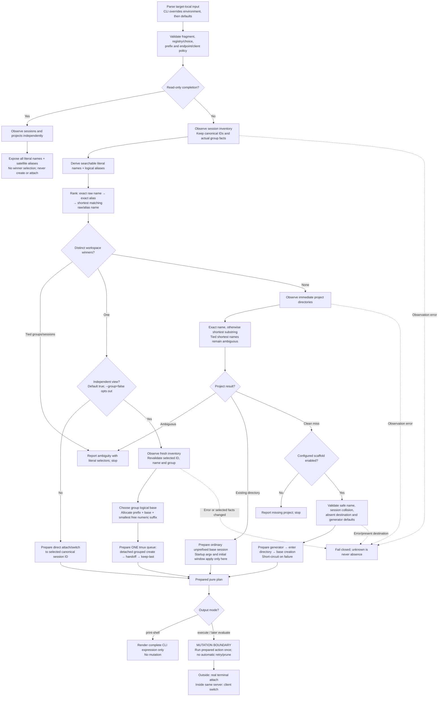

# Project entry contract

This declares the implementation destination, not a retrospective claim that
every transition is already implemented. The existing pure `Workflow` remains
the backbone: observers provide facts; resolution and planning perform no I/O;
execution alone crosses the mutation boundary. The literal input fragment is
never rewritten into a guessed project name.

## Input state machine

Classified absent servers and successful empty inventories are empty session
facts. Permission, protocol, decoding, incomplete capture and other acquisition
failures are errors. Completion may suppress diagnostics for Tab, but may not
interpret a failed lookup as permission to mutate.

## Names, aliases and workspace winners

- Default prefix: `_`. Override with `--satellite-prefix` or target-local
  `TTA_SATELLITE_PREFIX`; explicit CLI wins. Rust APIs accept the same explicit
  prefix. SSH uses target environment, never the caller's local prefix variable.
- A prefix must be nonempty and tmux-session-name-safe: no `.`, `:` or control
  characters. Explicit empty prefix is an error. Empty environment values are
  unset, consistently with existing environment policy.
- A satellite alias removes **exactly one** configured leading prefix and
  **exactly one** terminal `-DIGITS`, with a nonempty base and one or more ASCII
  decimal digits. Examples: `_project-42` → `project`, `_project-7-42` →
  `project-7`; `_project-x` and `project-42` remain literal with prefix `_`.
  Zero and leading zeros are recognized as numeric aliases, although allocation
  emits ordinary positive counters starting at `1`. No recursive stripping.
- Exact literal selectors take priority. Otherwise exact aliases win, followed
  by shortest Unicode-character matching raw/alias names. As exact aliases have
  the fragment's length, this is also minimum-length ranking. Substrings remain
  literal and case-sensitive; no wildcard interpretation in launch resolution.
- Equally ranked sessions in the **same actual tmux group** are one workspace
  candidate. Choose its representative deterministically by literal name then
  canonical ID. Ungrouped sessions are separate candidates. Names alone never
  establish group membership. Distinct groups with identical aliases remain
  ambiguous; the error offers literal session selectors to disambiguate.
- An exact raw `project` selects that session even if an unrelated `_project-42`
  offers alias `project`. If only `_project-42` survives, `tta project` selects
  that existing session, even when no project directory exists. Its canonical ID
  remains the creation target; no new processes are started for existing work.
- Completion offers raw names **and** aliases without shortest-winner filtering.
  An ambiguous alias is still a valid navigation term, not proof of uniqueness;
  raw names remain available. Completion and launch use one alias function.

## Independent view allocation and lifecycle

The first project entry creates an ordinary session named after the project
(or explicit new-session override). Every subsequent independent entry creates
a distinct session sharing the selected session's actual group windows/panes.
Changing one session's current window does not change another's. Shared panes
still share running processes and pane-local state.

Before allocation, request a fresh inventory and require the selected session's
ID, name and group to agree with the selection snapshot. Stop on disappearance
or change; do not rerank, scaffold, retry or silently choose another workspace.
For the selected actual group, prefer a non-satellite member's name as base
(shortest name, then lexical order); with only satellites, use the selected
session's one-step alias. An ungrouped selection uses its own name/alias.
Allocation never produces `_` + an already decorated satellite + another suffix.

Choose the smallest positive decimal counter whose **complete generated name**
is unused among all sessions, including unrelated groups. Exact names, rather
than parsed integer values, determine collisions: `_project-01` does not occupy
`_project-1`. No lock is implied by the snapshot. Concurrent entrants can collide;
tmux failure stops the queue, with no blind retry or alternate-match fallback.

Create → attach/switch → set `destroy-unattached=keep-last` stays one CLI tmux
queue on both backend selections and in shell/SSH output. This avoids detached
satellite destruction between separate actions. Detaching removes a satellite
when another group session remains; the final session preserves the work.
Failures after creation can leave residue; no automatic cleanup is introduced.

`--group=false` and `.grouped(false)` deliberately join the selected session's
window selection instead. Low-level lowering APIs also default to grouped entry
and require a supplied satellite name for existing selections; the higher-level
workflow performs allocation. No startup command runs merely for joining a group.

## Explicit boundary: inside-client origin

Outside terminals, including new SSH terminals, each own their real attached
tmux client. Inside entry retains the existing same-server switching boundary.
Two clients displaying the same shared pane have identical shell, environment
and pane tty; tmux's activity heuristic can choose the other client. This work
does **not** establish input-origin identity, guarded native switching, repeated
inside-entry view reuse, or an authoritative client-token contract. Those remain
separate work; independent outside-window selection must not be described as
fixing that ambiguity.

## Verification obligations

Prove plain entry with two **real terminal clients**, not control-mode substitutes:
same window IDs, pane IDs and process IDs; distinct sessions; selecting in either
client leaves the other selection unchanged. Cover native/CLI, direct/evaluated
shell entry, explicit shared attachment, custom prefix, orphan-only alias lookup
and completion, and last-view survival. Retain existing lifecycle, runner-free and
SSH boundary tests; verify SSH defaults/prefix precedence and generated action.
Unit tests must distinguish aliases from actual group identity, preserve shortest
matching and ambiguity, and reject changed fresh facts without authorizing mutation.

The [maintained user guide](/README.md#how-we-use-tmux) describes released behavior;
the [historical two-terminal trial](/verification/trials/independent-views/README.md)
preserves the defect evidence this contract must not erase.
