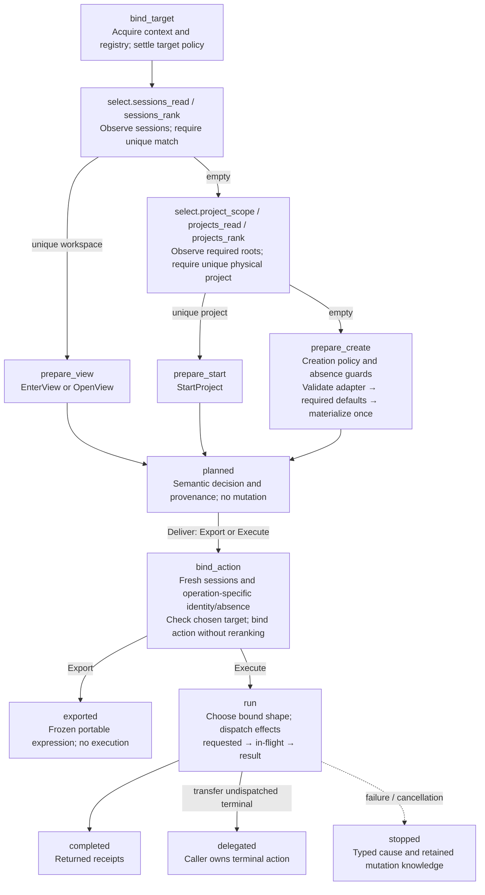
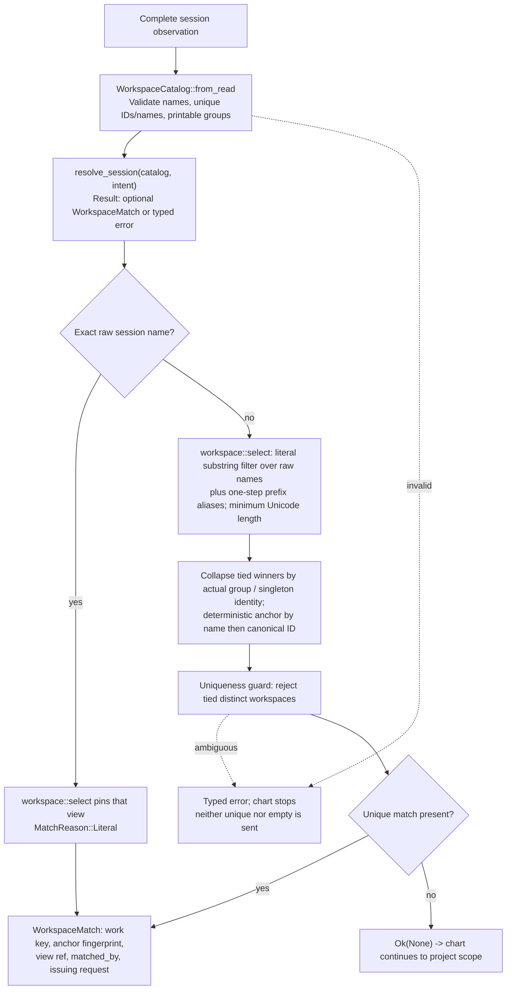

# Project entry contract

This is the implemented **0.8.0 entry architecture**: one owned `EntryAttempt`
per invocation drives context binding, selection, preparation, fresh action
binding and effect dispatch through an executable chart. The machine persists
for the attempt; native Rust domain functions compute its decisions; replaceable
observers perform its reads; executors interpret exactly the effect it dispatches.
Observers provide facts; selection and planning perform no I/O; execution alone
crosses the mutation boundary. The literal input fragment is never rewritten
into a guessed project name.

**Diagram reading map:** [Backbone lifecycle](#backbone-lifecycle) →
[Unique-session resolution](#guarded-session-resolution) →
[Full generated attempt chart](attempt-graph.md).
The [read-only catalog chart](catalog-graph.md) covers completion separately;
the [main guide's ownership diagram](/README.md#architecture-at-a-glance) shows
how callers, the machine, native domain functions and hosts fit together.

## Backbone lifecycle

This is a hand-maintained overview of the production chart, using its state
names and collapsing internal reads/directives. The
[generated chart](attempt-graph.md) expands every state and ordered transition.



**Guards precede continuation.** Ambiguity or failed observation stops; neither
is an empty result authorizing project creation. Errors/cancellation can end any
active stage; the diagram shows the execution exit explicitly because prior
effects may already have occurred. The generated graph exposes the shared exits
and per-effect substates. Successful process replacement does not return a
`completed` acknowledgement; no retry, rollback or automatic cleanup is implied.

The resolution box is expanded in the [focused flowchart](#guarded-session-resolution).
The [fresh-binding](#fresh-binding-and-delivery) and
[effect-outcome](#effects-and-outcomes) sections explain the later boundaries.

### Implementation and history

The [approved redesign](/design/entry/redesign0.gpt6a.md) is this architecture;
the [cutover receipt](/design/entry/cutover1.gpt61sol.md) records the coordinated
deletion of the previous orchestration and the actual CLI/SSH/consumer acceptance.
The **0.7 replay contract** this file previously maintained — the eight-state
`Workflow` with immutable `next()`/`supply()` replay, `resolve_unique`, and the
parallel portable/native `LaunchPlan` — is historical evidence, not a supported
API: it remains readable at its last maintained revision
(`jj file show -r 0349b34e doc/entry/README.md`). No compatibility facade
bridges the two.

## The owned attempt

`session/launcher/src/entry` owns entry. The public protocol
([`protocol.rs`](/session/launcher/src/entry/protocol.rs)) is the caller surface;
the CLI, the SSH path and embedded consumers all use it:

```rust,ignore
use tta_launcher::entry::{EntryAttempt, context, protocol::*};

// Acquire: the chart requests raw target context first; policy layers it.
let mut attempt = EntryAttempt::acquire(context::Acquisition {
    scope: context::Scope { origin: context::Origin::Local { host: "local".into() }, cwd: None },
    overrides: context::Overrides::default(),     // explicit values only, presence-based
    intent: EntryIntent::selector("myproject"),   // view/roots/startup/prefix settle here
    default_scaffold: "default".into(),           // caller default, never local environment
})?;

// One correlated request is issued once; repeated waiting() is inert.
while let Waiting::Read(request) = attempt.waiting() {
    let observation = my_observer.answer(request)?;      // local, SSH or supplied facts
    attempt.advance(Event::Observed(ReadCompletion { .. }))?;
}

let Waiting::Planned(plan) = attempt.waiting() else { /* Finished(outcome) */ };
attempt.advance(Event::Deliver(Delivery::Execute { native: true }))?; // or Delivery::Export
```

Properties the protocol enforces:

- **One orchestration owner.** Target setup, session selection, project
  fallback, creation preparation, view binding and effect dispatch are chart
  states. No resolver API returns `NeedProjects`/`NeedDestination`; no wrapper
  loop re-derives a selection on each pull. Matching never schedules I/O.
- **The machine persists for the attempt.** `advance(event)` changes state once.
  `waiting()` and `snapshot()` read stable state without replaying or issuing
  anything. A pending request is issued once; replies carry exact request IDs,
  paths, root slots, endpoint and target binding, and wrong-shape/stale/
  duplicate replies are `ProtocolError`s that leave the waiting state intact.
- **Native data stays native.** Paths, argv, generator programs, inventories
  and typed error chains never enter the runtime's serde context. Only event
  discriminants, counters and small validated summaries cross the chart.
- **Domain failures are events, not exceptions to the model.** Observer
  failures and guard failures end in `AttemptOutcome::Stopped` with a typed
  `EntryError` cause; ambiguity is a guard **before** the unique/empty
  continuation, never a missing-work path.

The supplied-facts constructor `EntryAttempt::start(invocation)` freezes a
`SuppliedContext` for embedders and tests; `start_at` additionally pins an
explicit scope. An attempt is single-owner mutable; plans and snapshots are
shareable, but no production replay, resume token or second progression truth
exists. A reproducible supplied-facts transcript creates a *new* read-only
attempt in tests — it is never a way to resume uncertain mutation.

## The executable chart

The structural truth is [`entry.machine.json`](/session/launcher/src/entry/entry.machine.json);
the maintained diagram in [attempt-graph.md](attempt-graph.md) is **generated
from it** (IDs, entry directives, ordered guards) by
`python3 verification/entry/graph.py --write` and checked by `--check`.
Compound states: `bind_target` (context → policy → optional endpoint identity →
registry → choice validation), `select` (sessions read/rank, optional project
scope, per-root read loop, physical ranking), `prepare_view`/`prepare_start`/
`prepare_create` (view policy, new-session specification, or the creation
ladder: policy → destination absence → adapter validation → required defaults →
one materialization), `bind_action` (fresh binding evidence → check → lower),
`run` (dispatch with requested/in-flight substates per effect), and the finals
`exported`/`completed`/`delegated`/`stopped`. `active` owns common `stop`/
`cancel` routes. State-entry directives (`read_sessions`, `rank_sessions`,
`validate_generator`, `bind_operation`, `request_terminal`, …) execute once on
entry; a closed native `Directive` enum implements them against owned data and
never chooses a successor state. Tests exhaustively dispatch every directive
and check guard order and self-reentry against the parsed graph.

Read and preparation states stop on their own errors; the overview elides those
common exits, the executable chart encodes them on the enclosing state. A
rootless session hit never reaches project scope; all required roots complete
before project ranking; `projects_read` reentry issues the next root request
from the discovery task's cursor.

### Fresh binding and delivery

A plan fixes **which work and kind of entry** were chosen
(`EntryDecision`: `EnterView`, `OpenView`, `StartProject`, `ScaffoldAndStart`)
with its typed `DecisionBasis` provenance. At delivery — export or execute —
`bind_action` collects fresh evidence for that decision: a fresh session
inventory for name collision, view allocation and native eligibility, plus
route identity or destination absence for new work. Changed anchor facts stop
the attempt fail-closed; binding never reranks or substitutes other work.
`bind_operation` lowers the validated decision into an immutable `BoundAction`
whose `ExecutionShape` (`TerminalBlock` or `NativeCreateThenEnter`) is a pure
choice made **before** any mutation — a planned decision, never an error
fallback. Export always lowers the portable terminal block; `ExportedAction`
carries the frozen expression and its shell rendering.

### Effects and outcomes

`run` dispatches one effect at a time as a correlated `EffectRequest`:
foreground `Generate`, post-generation `CheckCreatedDirectory`, one
`CreateNative`, or the `Terminal` block (which stays one coherent CLI tmux
queue for grouped create → attach/switch → `keep-last`). The driver records
`EffectStarted` before invoking the operation; requested effects cannot be
reissued and in-flight effects cannot redispatch. Terminal-block short-circuit
ordering means generation failure prevents creation and creation failure
prevents entry; an aggregate exit status is never misread as proof of each
substep. Outcomes are honest: `Completed` carries effect receipts including the
aggregate terminal status; `Delegated` records that an undispatched terminal
request was transferred to a caller who observes the later outcome itself;
`Stopped` records the boundary and retained effect knowledge (what finished,
what may have mutated) with its native cause. There is no automatic retry,
rollback, cleanup or backend fallback; a user retry builds a **new** attempt
with fresh observations.

## Guarded session resolution

This expands the chart's `select.sessions_rank` directive. It is a guarded
pure function — [`entry::select::resolve_session`](/session/launcher/src/entry/select.rs)
over a validated `WorkspaceCatalog` — not a second machine. Candidate loops
are ordinary Rust; the error guard finishes **before** the function emits
`Some` (unique) or `None` (empty):



Exact aliases are not a separate search pass: an alias's score equals the
fragment's length and wins the same minimum-length comparison. Actual-group
collapse happens **after** shortest ranking; group membership never admits
longer candidates. The matched view, its workspace key (actual group or
singleton ID), the anchor fingerprint, the match reason and the issuing request
ID all survive into the plan's basis — selection no longer discards workspace
information into a bare session. Ungrouped sessions stay distinct candidates;
names alone never establish group membership. Project ranking applies the same
guard contract over physical identities and root routes
([project roots](project-roots.md)).

Completion does not execute this selection procedure; the read-only
[catalog](#the-read-only-catalog) exposes the same candidate identities without
choosing a winner.

## Names, aliases and workspace winners

- Default prefix: `_`. Override with `--satellite-prefix` or target-local
  `TTA_SATELLITE_PREFIX`; explicit CLI wins. Rust callers set
  `EntryIntent::satellite_prefix`. SSH uses target environment, never the
  caller's local prefix variable.
- A prefix must be nonempty and tmux-session-name-safe: no `.`, `:` or control
  characters. Explicit empty prefix is an error. Empty environment values are
  unset, consistently with existing environment policy.
- A satellite alias removes **exactly one** configured leading prefix and
  **exactly one** terminal `-DIGITS`, with a nonempty base and one or more ASCII
  decimal digits. Examples: `_project-42` → `project`, `_project-7-42` →
  `project-7`; `_project-x` and `project-42` remain literal with prefix `_`.
  Zero and leading zeros are recognized as numeric aliases, although allocation
  emits ordinary positive counters starting at `1`. No recursive stripping.
- Exact literal selectors take priority. Otherwise exact aliases win, followed
  by shortest Unicode-character matching raw/alias names. Substrings remain
  literal and case-sensitive; no wildcard interpretation in launch resolution.
- Equally ranked sessions in the **same actual tmux group** are one workspace
  candidate with a deterministic representative (literal name, then canonical
  ID). Distinct groups with identical aliases remain ambiguous; the error
  offers literal session selectors to disambiguate.
- An exact raw `project` selects that session even if an unrelated
  `_project-42` offers alias `project`. If only `_project-42` survives, `tta
  project` selects that existing session even when no project directory exists.
  Its canonical ID remains the target; no new processes start for existing work.
- Completion offers raw names **and** aliases without shortest-winner filtering.
  An ambiguous alias is still a valid navigation term. Zsh first offers all
  logical workspace aliases, falling back to raw selectors when the typed
  fragment does not match an alias. Completion and launch use one alias
  function; neither inventory selects a winner.

## Independent view allocation and lifecycle

The first outside project entry creates an ordinary session named after the
project (or an explicit `--session-name`). Every subsequent independent entry
creates a distinct session sharing the selected session's actual group
windows/panes. Changing one session's current window does not change another's.
Shared panes still share running processes and pane-local state.

Allocation happens at **binding**, from the fresh binding inventory: the
selected anchor's ID, name and group must still agree with the selection
snapshot; stop on disappearance or change; do not rerank, scaffold, retry or
silently choose another workspace. For the selected actual group, prefer a
non-satellite member's name as base (shortest name, then lexical order); with
only satellites, use the selected session's one-step alias. An ungrouped
selection uses its own name/alias. Allocation chooses the smallest positive
decimal counter whose **complete generated name** is unused among all sessions,
including unrelated groups: exact names, not parsed integers, determine
collisions (`_project-01` does not occupy `_project-1`), and allocation never
produces `_` + an already decorated satellite + another suffix. No lock is
implied; concurrent entrants can collide and tmux failure stops the queue with
no blind retry or alternate-match fallback.

Create → attach/switch → `destroy-unattached=keep-last` stays **one CLI tmux
queue** in every delivery shape and in shell/SSH output. This avoids detached
satellite destruction between separate actions. Detaching removes a satellite
when another group session remains; the final session preserves the work.
Failures after creation can leave residue; no automatic cleanup is introduced.

`--group=false` (and consumer `ViewPreference::Shared`) deliberately joins the
selected session's window selection instead. Omitted grouping resolves to
independent for outside attach and shared for inside switch, consistently
across the CLI, the attempt and lowering. Explicit caller policy is never
replaced. Startup argv, window naming and initial directories are new-work-only
inputs: existing-work decisions have no startup fields to leak into.

## The read-only catalog

[`CatalogQuery`](/session/launcher/src/entry/catalog.rs) is a separate retained
actor — not `EntryAttempt { dry_run }`. Its waiting/event types cannot yield a
plan or effect; it shares the entry `bind_target` subchart and the same
observer adapters, then follows a collect/report course. Each root is collected
once, including after a preceding root failure; the `Report` retains typed
workspace aliases, literal view selectors, project routes with physical
identity and per-source failures. Only complete required root evidence
certifies bare project names; partial results still offer qualified `@N/name`
selectors and successful session aliases. Completion projects candidates; it
never selects a launch winner, generator, view policy or delivery mode. The
query cannot emit a mutation request — the chart has no delivery route.

## Ordered project roots

The [multi-root contract](project-roots.md) specifies configuration
precedence, qualified `@N/name` selectors, physical-directory provenance and
safe scaffold destinations. Its selection semantics are unchanged by this
architecture; the orchestration moved into the chart's `select` compound
(scope → per-root read reentry → guarded physical ranking) described above.

## Explicit boundary: inside-client origin

Outside terminals, including new SSH terminals, each own their real attached
tmux client. Inside entry retains the existing same-server switching boundary.
Two clients displaying the same shared pane have identical shell, environment
and pane tty; tmux's activity heuristic can choose the other client. This work
does **not** establish input-origin identity, guarded native switching, repeated
inside-entry view reuse, or an authoritative client-token contract. Those remain
separate work; independent outside-window selection must not be described as
fixing that ambiguity.

## Verification obligations

Prove plain entry with two **real terminal clients**, not control-mode
substitutes: same window/pane/process IDs; distinct sessions; selecting in
either client leaves the other selection unchanged. The maintained suites:

- [Entry attempt checks](/verification/entry/README.md) — supplied-facts
  journeys, machine/guard conformance, purity under poisoned environments,
  local/probe agreement and the focused host suites.
- [Cutover receipt](/design/entry/cutover1.gpt61sol.md) — the final workspace
  matrix, runner-free witnesses and the authenticated SSH/consumer evidence
  (19 checks, 13 terminal runs, 16 authorized creations) with reproduction
  recipes.
- [Runner-free supplied-facts witness](/verification/core/README.md) and
  [emitted-probe round-trip](/verification/probes/README.md) — the pure
  protocol exercised without a runner.
- [Two-real-terminal verification](/verification/views/README.md); the
  [historical two-terminal trial](/verification/trials/independent-views/README.md)
  preserves the inside-switch defect evidence this contract must not erase.

Unit tests distinguish aliases from actual group identity, preserve shortest
matching and ambiguity, reject changed fresh facts without authorizing
mutation, and retain raw bytes and native error chains end to end.

## Related work organization

The [redesign proposal](/design/entry/redesign0.gpt6a.md) (approved), the
staged implementation reports — [kernel](/design/entry/kernel0.gpt61sol.md),
[discovery](/design/entry/discovery0.glm53m.md),
[hosts](/design/entry/hosts0.gpt61sol.md) — and the
[cutover receipt](/design/entry/cutover1.gpt61sol.md) are the delivery history
of this architecture; earlier engine/architecture stages are linked from the
[inquiry index](/design/entry/README.md). The maintained user
[guide](/README.md) describes released behavior;
[ticket-surface0](/design/entry/ticket-surface0.gpt6a.md) is historical
navigation, not a runtime contract.
