# Retained entry attempt: structural graph

This is the **internal replacement**, not the public `Workflow` contract in
[the current entry account](README.md). The [approved redesign](/design/entry/redesign0.gpt6a.md),
[first-stage report](/design/entry/kernel0.gpt61sol.md) and [discovery-stage
report](/design/entry/discovery0.glm53m.md), plus the
[hosts-stage report](/design/entry/hosts0.gpt61sol.md), explain scope, evidence and
remaining work. The complete existing-work journey ends in an exported
snapshot after fresh binding; the discovery branches extend the same retained
actor through machine-owned project scope, a per-root read loop with explicit
self-reentry, guarded physical ranking, and the creation-preparation ladder
(policy → destination absence → adapter validation → required defaults →
one materialization). New-work bindings add a second evidence read — chosen
route identity or destination absence — before the shared check/lower states.
There are still no effect requests: export remains the only delivery.
The initial `bind_target` compound now requests raw host context, applies shared
whole-layer policy, optionally compares physical endpoint identities, and requests
one semantic registry acquisition before validating the choice. Supplied frozen
context skips acquisition through an explicit chart edge, not a separate driver.
The separate [catalog graph](catalog-graph.md) reuses this actual binding
subchart, then follows a collect/report course incapable of producing an entry
plan or mutation. Local/SSH interpreters answer the same native requests.

Generated from the actual JSON, not copied from the design sketch. Node labels
show IDs, hierarchical paths and state-entry directives. Dotted initial edges
enter compounds; solid edges show actual event routes. Numbers retain guard
priority. `active` owns common `stop`/`cancel` routes inherited by its descendants.
Native errors are stored before `stop`, never serialized into the actor.

```sh
python3 verification/entry/graph.py --write
python3 verification/entry/graph.py --check
```

Only the marked region is regenerated. The renderer intentionally fails on entry
action types it does not understand. It is not an execution engine or proof of
the guarded matching algorithm; [the kernel report](/design/entry/kernel0.gpt61sol.md#guarded-session-resolution),
[the discovery report](/design/entry/discovery0.glm53m.md) and the native tests
cover those separate contracts.

```mermaid
flowchart TD
    entry_attempt["entry_attempt<br/>compound"]
    active["active<br/>compound"]
    bind_target["bind_target<br/>active.bind_target<br/>compound"]
    context_read["context_read<br/>active.bind_target.context_read<br/>emit read_context"]
    context_policy["context_policy<br/>active.bind_target.context_policy<br/>emit apply_context_policy"]
    endpoint_read["endpoint_read<br/>active.bind_target.endpoint_read<br/>emit read_endpoint_identity"]
    registry_read["registry_read<br/>active.bind_target.registry_read<br/>emit read_registry"]
    bind_registry["bind_registry<br/>active.bind_target.bind_registry<br/>emit validate_registry"]
    select["select<br/>active.select<br/>compound"]
    sessions_read["sessions_read<br/>active.select.sessions_read<br/>emit read_selection_sessions"]
    sessions_rank["sessions_rank<br/>active.select.sessions_rank<br/>emit rank_sessions"]
    project_scope["project_scope<br/>active.select.project_scope<br/>emit scope_projects"]
    projects_read["projects_read<br/>active.select.projects_read<br/>emit read_projects"]
    projects_rank["projects_rank<br/>active.select.projects_rank<br/>emit rank_projects"]
    prepare_view["prepare_view<br/>active.prepare_view<br/>compound"]
    view_policy["view_policy<br/>active.prepare_view.view_policy<br/>emit settle_view"]
    open_view["open_view<br/>active.prepare_view.open_view<br/>emit plan_open_view"]
    enter_view["enter_view<br/>active.prepare_view.enter_view<br/>emit plan_enter_view"]
    prepare_start["prepare_start<br/>active.prepare_start<br/>emit prepare_start"]
    prepare_create["prepare_create<br/>active.prepare_create<br/>compound"]
    create_policy["create_policy<br/>active.prepare_create.create_policy<br/>emit create_policy"]
    destination_read["destination_read<br/>active.prepare_create.destination_read<br/>emit read_destination"]
    generator_spec["generator_spec<br/>active.prepare_create.generator_spec<br/>emit validate_generator"]
    defaults_read["defaults_read<br/>active.prepare_create.defaults_read<br/>emit read_defaults"]
    creation["creation<br/>active.prepare_create.creation<br/>emit prepare_creation"]
    planned["planned<br/>active.planned"]
    bind_action["bind_action<br/>active.bind_action<br/>compound"]
    binding_read["binding_read<br/>active.bind_action.binding_read<br/>emit read_binding_sessions"]
    binding_evidence["binding_evidence<br/>active.bind_action.binding_evidence<br/>emit read_binding_evidence"]
    binding_check["binding_check<br/>active.bind_action.binding_check<br/>emit check_binding"]
    binding_lower["binding_lower<br/>active.bind_action.binding_lower<br/>emit bind_operation"]
    export_action["export_action<br/>active.export_action<br/>emit export_action"]
    exported["exported<br/>final"]
    stopped["stopped<br/>final"]
    entry_attempt -.->|initial| active
    active -.->|initial| bind_target
    active -->|stop| stopped
    active -->|cancel| stopped
    bind_target -.->|initial| context_read
    context_read -->|observed| context_policy
    context_read -->|supplied| bind_registry
    context_policy -->|context_policy, 1: needs_endpoint_identity| endpoint_read
    context_policy -->|context_policy, 2: otherwise| registry_read
    endpoint_read -->|observed| registry_read
    registry_read -->|observed| bind_registry
    bind_registry -->|validated| select
    select -.->|initial| sessions_read
    sessions_read -->|observed| sessions_rank
    sessions_rank -->|unique| prepare_view
    sessions_rank -->|empty| project_scope
    project_scope -->|scoped| projects_read
    projects_read -->|observed_projects, 1: more_roots, reenter| projects_read
    projects_read -->|observed_projects, 2: otherwise| projects_rank
    projects_rank -->|project_unique| prepare_start
    projects_rank -->|project_empty| prepare_create
    prepare_view -.->|initial| view_policy
    view_policy -->|view_policy, 1: independent| open_view
    view_policy -->|view_policy, 2: otherwise| enter_view
    open_view -->|prepared| planned
    enter_view -->|prepared| planned
    prepare_start -->|prepared| planned
    prepare_create -.->|initial| create_policy
    create_policy -->|eligible| destination_read
    destination_read -->|observed| generator_spec
    generator_spec -->|validated_generator, 1: needs_defaults| defaults_read
    generator_spec -->|validated_generator, 2: otherwise| creation
    defaults_read -->|observed| creation
    creation -->|prepared| planned
    planned -->|export| bind_action
    bind_action -.->|initial| binding_read
    binding_read -->|binding_observed, 1: needs_binding_evidence| binding_evidence
    binding_read -->|binding_observed, 2: otherwise| binding_check
    binding_evidence -->|observed| binding_check
    binding_check -->|checked| binding_lower
    binding_lower -->|bound| export_action
    export_action -->|exported| exported
```

<!-- entry-machine:start -->



<!-- entry-machine:end -->
