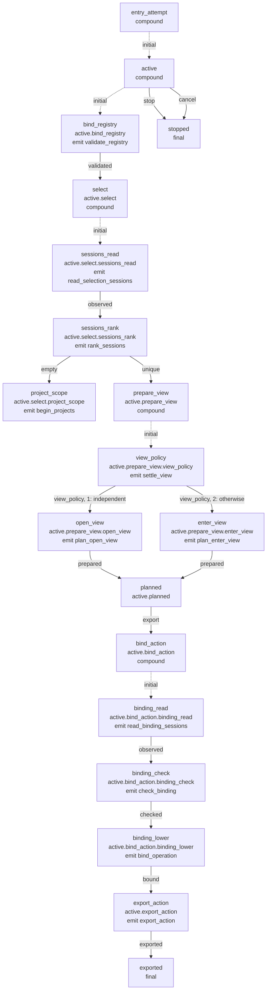

# Retained entry attempt: structural graph

This is the **internal replacement**, not the public `Workflow` contract in
[the current entry account](README.md). The [approved redesign and first-stage
report](/design/entry/kernel0.gpt61sol.md) explain scope, evidence and remaining
work. There are no effect requests yet: the complete existing-work journey ends
in an exported snapshot after fresh binding. `project_scope` deliberately stops
with a typed not-yet-implemented outcome until the discovery stage replaces it.

Generated from the actual JSON, not copied from the design sketch. Node labels
show IDs, hierarchical paths and state-entry directives. Dotted initial edges
enter compounds; solid edges show actual event routes. Numbers retain guard
priority. `active` owns common `stop`/`cancel` routes inherited by its descendants.
Native errors are stored before `stop`, never serialized into the actor.

```sh
python3 verification/entry/graph.py --write
python3 verification/entry/graph.py --check
```

Only the marked region is regenerated. The renderer intentionally fails on entry
action types it does not understand. It is not an execution engine or proof of
the guarded matching algorithm; [the kernel report](/design/entry/kernel0.gpt61sol.md#guarded-session-resolution)
and the native tests cover that separate contract.

<!-- entry-machine:start -->



<!-- entry-machine:end -->
