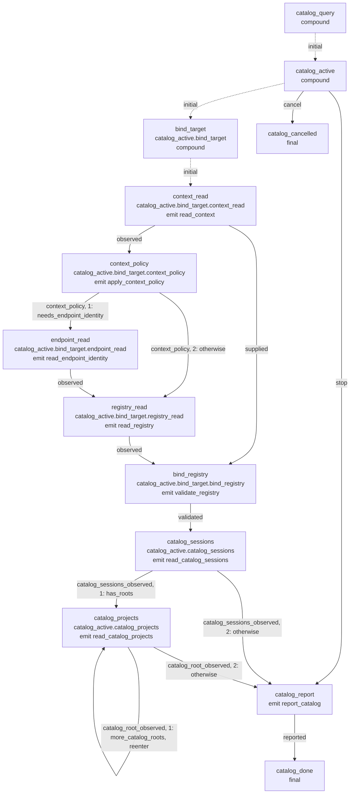

# Read-only catalog: structural graph

This is the production completion/inventory path of the 0.8.0 architecture.
`CatalogQuery` is a separate retained actor with only `Observed` and `Cancel`
ingress. Its waiting type cannot yield a plan or effect. It shares the actual
`bind_target` subchart of the [entry graph](attempt-graph.md), wiring that
subchart's one validated exit to collection. `catalog.rs::definition` and the
renderer perform this static composition; no native directive assigns a state.

Each root is collected once, including after a preceding root failure. Successful
sources retain configured slots, physical roots and physical project routes.
The report contains native per-source failures; only complete root evidence may
certify bare project names. Partial results can still offer qualified selectors
and successful session aliases. The query does not select a launch winner,
generator, view policy or delivery mode.

```sh
python3 verification/entry/graph.py --catalog --write
python3 verification/entry/graph.py --catalog --check
```

<!-- entry-machine:start -->



<!-- entry-machine:end -->
