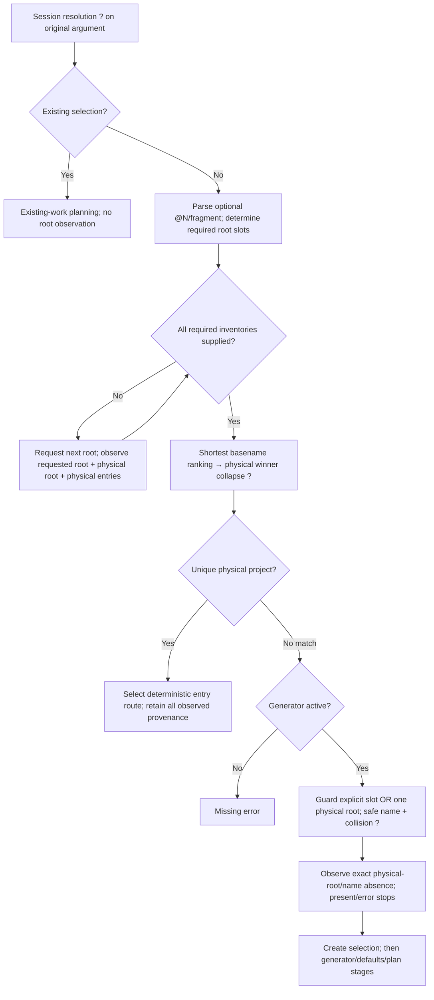

# Ordered roots, not implicit priority

Work anchor: `tta-project-roots`. This declaration precedes implementation.
Declared in commit `3247ce5e` before code; the establishing slice now implements
core policy and the observer/API changes needed
to keep the workspace coherent. CLI/environment/completion adoption and complete
end-to-end acceptance belong to the next integration slice; this document does
not claim those surfaces are already delivered.

## Input contract

The final command surface is repeated `--root PATH`, preserving occurrence order:

```sh
tta --root /work/personal --root /work/team project
tta --root /work/personal --root /work/team @2/project
tta --root /work/personal --root /work/team --scaffold=mine @2/new-project
```

One active layer replaces the entire list, never appends to a lower layer:
**repeated `--root` > `TTA_ROOTS` > `TTA_ROOT` > `PROJECTS_DIR` > `$HOME/src`.**
`TTA_ROOTS` is a JSON array of nonempty path strings, e.g.
`TTA_ROOTS='["/work/personal","/work/team"]'`. An active empty array, non-array,
empty element or malformed JSON is an error. Empty environment strings remain
unset. JSON avoids splitting valid paths at colons or spaces. No new roots table
is added to the scaffold registry. One `--root`, `TTA_ROOT`, and the dtachment
`PROJECTS_DIR` convention retain their existing meaning.

Relative explicit roots, `TTA_ROOTS` and `TTA_ROOT` are frozen against invocation
cwd. Relative `PROJECTS_DIR` is HOME-relative; its absolute form needs no HOME.
No embedded tilde/variable expansion. No available default root yields an empty
list, which is legal until project fallback actually needs roots. Invalid active
configuration fails before lookup, but a live session requires no filesystem
observations or HOME.

SSH uses **target-local** environment, cwd and HOME for the same layering. Explicit
caller roots replace target defaults and are resolved on the target. Caller-host
`TTA_ROOTS`, `TTA_ROOT`, `PROJECTS_DIR` and HOME never become SSH defaults.

## Matching, physical identity and selectors

1. Resolve the original literal argument against sessions first, with the existing
   exact/alias/shortest rules and error guard. A hit needs no project observations.
2. On a session miss, `@N/FRAGMENT` selects the **one-based configured root slot**
   N. It is an explicit project selector, not a new session alias. N must be in
   range and FRAGMENT a nonempty immediate basename. Numeric `@N/` syntax is
   reserved at project fallback; it does not rewrite the initial session input.
   Other slash-bearing inputs are not arbitrary filesystem traversal. An explicit
   selector, rather than a second absolute-path grammar, is the disambiguation API.
3. Unqualified matching observes every configured root in order. A qualified
   selector observes only its selected root. Any required observation failure
   stops; an inaccessible root is never an empty root or permission to scaffold.
4. Rank entry basenames using the existing literal, case-sensitive, shortest
   Unicode-name rule **across all observed roots**, then collapse tied winners by
   their observed canonical physical directory. Different physical directories
   remain ambiguous even with identical basenames. Errors offer `@N/name`
   selectors. Root order is presentation and deterministic representative order,
   **not first-root-wins priority**.
5. Inventories retain configured/requested root, physical root, entry basename
   and physical entry directory. Selected project provenance retains every
   observed route to the physical winner, including aliases. Repeated roots,
   symlinked roots and child symlinks can therefore identify one candidate without
   losing their routes. Overlapping roots are not recursively scanned: a parent
   entry and a nested root's children are separate immediate entries unless their
   observed physical directory is actually equal. Bind-mount/inode equivalence is
   not inferred from canonical path equality.

Launch uses the first winning entry route in configured-root order, then basename
order; its basename remains the default session name. Provenance exposes physical
identity separately. Inventory order within a directory must not affect a winner.
Duplicate-name projects still create ordinary basename sessions: if that name is
already live, unqualified entry returns to it. To create the other project's
session deliberately, use its qualified selector and a distinct `--session-name`;
session collision guards still apply. No inferred directory-to-live-session map.

Completion must use the same pure inventory/identity helpers. It offers ordinary
basenames only when launch can select them unambiguously, and qualified selectors
for ambiguous basenames (qualified alternatives may also be offered for all
entries). Session aliases remain independently available and session-first on
Enter. Line-oriented completion still omits control characters and shell-escapes
insertions. `@N/name` allows wildcard/substring filtering by its basename without
pretending `name` alone is unique.

## Safe scaffold destination

A miss with an active generator is not a destination decision. `@N/new-name`
explicitly selects that root. Unqualified creation is allowed only when all
observed root slots refer to **one physical root**; otherwise fail with an
actionable destination-ambiguity error offering `@N/new-name`. List order never
authorizes creation in the first root. There is no implicit create-root default,
and `--dir` remains pane cwd, not project destination.

Validate the new name and tmux session name/collision before asking for destination
absence. Observe the exact physical-root/name path with lstat semantics; present
files and dangling symlinks fail. Only supplied absence can authorize a Create
selection. Its provenance records the selected configured slot and physical root.
Generator planning and mutation retain their existing short-circuit boundaries.

## Progression and diagrams

The [entry graph](/doc/entry/README.md#input-state-machine) keeps its eight stages.
The projects stage supplies **one root inventory per visit**; resolve requests the
next still-needed root before selecting any project or destination. A qualified
selector needs only one visit. The repeated existing `projects → resolve →
projects` route needs no additional state or event. Native paths, inventory and
provenance never enter machine serialization.

The existing argument-filtered observation policy is preserved: launch inventories
inspect matching basenames, while completion requests an empty filter. Physical
provenance covers every supplied route to a selected project, not undiscovered
aliases elsewhere on the filesystem. Failure inspecting a required matching entry
stops; unrelated broken symlinks do not poison fragment-specific discovery.



## Acceptance and handoff

Core tests must cover cross-root shortest matching, actionable duplicate ambiguity,
physical alias collapse and provenance, ordered deterministic routes, rootless
session hits, qualified selection, wrong-root replies, and destination ambiguity
before any absence/defaults/mutation request. Local and emitted-probe inventories
must agree about canonical identity, symlinks, empty roots and failures. Final
integration adds repeated CLI roots, environment precedence, target-local SSH,
Zsh completion and actual embedded-consumer review/receiving locks. Keep the ticket
open until these surfaces are implemented and meaningfully checked.

The [establishing checkpoint](/design/entry/project-roots0.gpt61sol.md) records
implemented interfaces, verification, the consumer port and the next G turn.
The legacy external `rekon` adapter remains a consequential integration review
point: its script ignores the chosen root. Safe multi-root **generation** must
not be claimed for it merely because core destination selection is unambiguous;
prefer a fail-closed multi-root guard or change that adapter's real destination
contract before acceptance. `rekon-native` already receives and honors the root.
